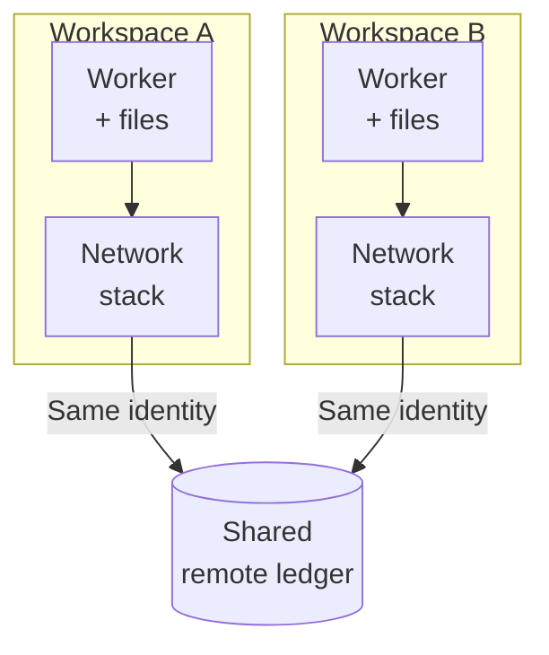

An agent edits a local file in a disposable workspace. Throw away that
workspace and the edit disappears. The same agent sends a message from it.
Throw it away and the recipient still has the message.

The difference is where the effect lives.

Forking a working environment makes it easier to try competing approaches.
Each copy can change its own files without disturbing the other. But a copied
environment is not a copied world. Two pumps on separate bases can still draw
from one reservoir. Removing either pump does not put the water back.

## A snapshot has a defined scope

Copy-on-write makes separate local versions possible without immediately
duplicating all their data. The kernel's
[block-device snapshot documentation](https://docs.kernel.org/admin-guide/device-mapper/snapshot.html)
describes one implementation: changed chunks go into separate storage, while
reads of unchanged data come from the original device. The scope is that block
device.

A system might copy only a filesystem, or also capture running process state.
Those are different capabilities. Neither includes an external database merely
because a process knows how to connect to it. Copying a connection address
copies a reference, not the database at the other end.

Credentials need the same care. A platform might omit secrets from its
snapshot and supply fresh credentials when a copy starts. If credentials are
preserved or supplied to both copies, however, both may authenticate to the
same remote account. Even two different credentials can authorize writes to
the same data.

A private network namespace is another boundary. The
[network-namespace manual](https://man7.org/linux/man-pages/man7/network_namespaces.7.html)
describes separate network devices, protocol stacks, routing tables, firewall
rules, and sockets. It also describes virtual links between namespaces and
bridges to physical networks. A separate network stack is not, by itself, a
rule forbidding outbound requests. Connectivity depends on how it is
configured.

These mechanisms answer different questions: which local state can diverge,
which network resources a process sees, and which remote resources a request
can change. Calling an environment a container or a sandbox does not establish
all three.

## Two workspaces, one reservation ledger

Consider a hypothetical reservation service on another machine. It starts
with ten available places. Each successful reservation atomically reduces
that count by one.

Workspaces A and B begin with identical local files but independent writable
storage. In this example, both are deliberately configured with outbound
access and credentials for the same account in a shared test tenant. A tenant
is the service's account-level space for data. Neither workspace owns a copy
of its ledger.

Suppose A reserves one place and saves a local receipt. B then does the same.
No cancellation or expiration occurs during these steps:

| Step | Local state | Available places remotely |
| --- | --- | --- |
| Start both workspaces | Two independent copies | 10 |
| A reserves a place | A saves its receipt | 9 |
| B reserves a place | B saves its receipt | 8 |
| Restore A's earlier local snapshot | A's receipt disappears | 8 |

The service has received two reservations and no cancellations. Restoring
either client's disk does not change that ledger.

Each network stack belongs to its own namespace. The boxes group local
resources, not full snapshot contents; the arrows show configured outbound
requests. The ledger is outside both boxes.

This coupling can also spoil an experiment without touching production. If
the trials are supposed to be independent, B should not see fewer available
places because A already reserved one. A shared test tenant protects a
different boundary than a separate tenant for each trial.

## A successful request can outlive its caller

Local rollback is especially misleading when a request's outcome is uncertain.
The service may have accepted a write before the connection failed. Resetting
the client does not settle whether the server performed it.

Idempotency helps with a narrower problem. The
[HTTP specification's definition](https://www.rfc-editor.org/rfc/rfc9110.html#section-9.2.2)
says that repeated identical requests using an idempotent method have the same
intended server effect as one request. It explicitly allows other effects,
such as logging each request separately. Repeating safely is not reversing:
an update applied once is still an update.

A cancellation or compensating write is another action on the remote system,
with its own chance of failure. It may restore the available-place count,
but it cannot make a delivered message unread. Nor does restoring a local
snapshot erase charges already incurred for remote work. Those consequences
belong to systems outside the snapshot.

## Decide what the experiment can share

There are several reasonable ways to run an experiment, depending on what it
needs to prove.

A **mock service** is useful when the question is whether an agent forms the
right requests or handles a particular response. It cannot establish how the
real service behaves under its actual timing, authorization, or consistency
rules.

A **temporary test tenant** can exercise the real interface against separate
data. Its isolation must include relevant integrations: a test label alone
does not prevent an outgoing email or a billable operation. Sharing that
tenant between trials can still couple their results.

A **separately approved live action** may be necessary when only the live
system can answer the question. That is a bounded real action, not an effect
made disposable by the workspace around it.

Whichever option fits, four choices remain separate:

- **Local state:** what can each copy write independently, and what does a
  reset actually restore? Shared mounts need particular attention.
- **Remote target:** does each trial reach its own mock or test tenant, or a
  service shared with other work?
- **Identity:** are credentials scoped to that target? A fresh key for the
  same account does not create separate data.
- **Network egress:** which destinations can the copy actually reach? A
  private namespace does not replace an enforced outbound policy.

I have not run this reservation example or tested a particular sandbox's
snapshot coverage, credential handling, or network rules.

Before calling a trial disposable, ask what would remain different on another
machine after deleting the local copy. For each surviving record, delivered
message, or charge, decide who owns cleanup and whether cleanup is possible.
