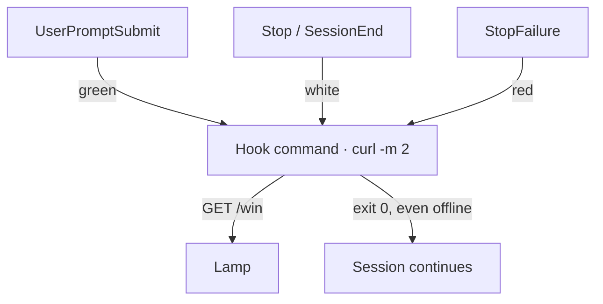

I want to know whether an agent task is still running without keeping its terminal in view. A desk lamp that breathes green while the agent works and turns white when it stops is a small answer to that. It is also a good way to learn hooks, because a hook is the only honest source for the signal. The lamp cannot watch a model think. It can only hear about events the runtime names.

## A hook is a command bound to an event

Claude Code runs hooks: shell commands it executes at named points in a session. Cursor and Gemini CLI have hooks too, and a later section compares their wiring. Claude Code reads hooks from JSON files, usually in one of two places:

```sh
~/.claude/settings.json   # every project for this user
.claude/settings.json     # this repository only
```

A lamp belongs to a desk, not a repository, so the user-level file fits. Each event holds matcher groups, and each group holds its handlers. This is the whole integration:

```json
{
  "hooks": {
    "UserPromptSubmit": [
      { "hooks": [{ "type": "command", "command": "curl -sm 2 -o /dev/null \"http://$LAMP/win&T=1&R=0&G=255&B=0&FX=2\" || true" }] }
    ],
    "Stop": [
      { "hooks": [{ "type": "command", "command": "curl -sm 2 -o /dev/null \"http://$LAMP/win&T=1&R=255&G=255&B=255&FX=0\" || true" }] }
    ],
    "SessionEnd": [
      { "hooks": [{ "type": "command", "command": "curl -sm 2 -o /dev/null \"http://$LAMP/win&T=1&R=255&G=255&B=255&FX=0\" || true" }] }
    ],
    "StopFailure": [
      { "hooks": [{ "type": "command", "command": "curl -sm 2 -o /dev/null \"http://$LAMP/win&T=1&R=255&G=0&B=0&FX=1\" || true" }] }
    ]
  }
}
```

`$LAMP` holds the lamp's address on the local network, exported from my shell profile; hook commands inherit the environment of the Claude Code process. The lamp runs WLED, open-source LED firmware with a URL API: `R`, `G`, and `B` set the color, `FX` picks an effect (0 solid, 1 blink, 2 breathe), and `T=1` turns it on. Each hook is one GET request.

The event names are keys in the `hooks` object. Each matcher group can narrow an event to certain tools or end reasons; these groups have no matcher, so they run for every matching event. The `command` handler runs in a shell, and `curl -m 2` supplies its own two-second bound.

## Four events, three states

| Event | Fires when | Light |
| --- | --- | --- |
| `UserPromptSubmit` | A prompt is submitted | Breathing green |
| `Stop` | Claude finishes responding | Solid white |
| `SessionEnd` | The session terminates | Solid white |
| `StopFailure` | A turn ends because of an error | Blinking red |

Two events share white on purpose. `Stop` marks the end of a response. `SessionEnd` is the backstop for sessions that close another way; its payload includes a `reason`. The lamp signals submitted work rather than an open session, so this setup does not use a `SessionStart` hook.

White means an end event arrived, not that the work succeeded. That is a more modest signal than "done," and a more honest one. Each state also has its own motion, so the lamp does not rely on color alone.



## Every hook gets a payload and may answer

Claude Code pipes each hook a JSON payload on stdin. Its field names are snake_case; for example, the session identifier is `session_id`. The lamp ignores the payload, but it is what makes hooks more than triggers: `SessionEnd` includes a `reason`.

Stdout is the way back. When a hook exits 0, the runtime parses what it printed as the hook's answer, and some events act on that answer: a `PreToolUse` hook can allow or deny the tool call about to run. A status hook has nothing to say, so `-o /dev/null` keeps the lamp's own response out of that channel.

## The event decides what failure means

For Claude Code, exit code 2 has event-specific meaning: `UserPromptSubmit` can block the prompt, while `Stop` can keep Claude working. Other non-zero exits are logged and do not block the session. That is why the `|| true` matters for an optional light: an unplugged lamp should cost visibility, not work.

For comparison, a `PreToolUse` guard could run the same `curl` without `|| true`, then use `|| exit 2` to reject the tool call if the lamp is unreachable. That deliberately differs from the status command above, where `|| true` keeps an optional light from stopping work.

So I would test the boundary rather than trust it: point `$LAMP` at an address nothing answers, then check that sessions still run and no hook outlasts curl's two-second limit.

## The command travels, the wiring doesn't

Nothing in the curl command belongs to one harness. It reads `$LAMP` and sends one request, so any harness that runs a shell command on an event can drive the lamp. What changes is the wiring around it: the file, the event names, how entries nest, and what a failing hook does.

Claude Code [reads hooks](https://code.claude.com/docs/en/hooks) from `~/.claude/settings.json` for every project, or from `.claude/settings.json` inside one. Each event holds matcher groups, and each group holds its handlers. Commands run through a shell, so `$LAMP` expands as shown above. I ran this configuration twice against a fake lamp, a local server that logs each request: once with a local stand-in for the model API, and once with an expired login. The first run went green, then white at `Stop` and again at `SessionEnd`. The second went green, then red at `StopFailure`, then white as the one-shot session closed. In an interactive session nothing would follow the failure, so red would hold until the next prompt.

The three states map onto each harness's own events:

| Harness | Green | White | Red |
| --- | --- | --- | --- |
| Claude Code | `UserPromptSubmit` | `Stop`, `SessionEnd` | `StopFailure` |
| Cursor | `beforeSubmitPrompt` | `stop`, `sessionEnd` | `stop`, when `status` is `error` |
| Gemini CLI | `BeforeAgent` | `AfterAgent`, `SessionEnd` | None documented |

I fired every event in the Claude Code row. The Cursor and Gemini CLI rows come from [Cursor hooks](https://cursor.com/docs/hooks) and the [Gemini CLI hooks reference](https://geminicli.com/docs/hooks/reference/).

Claude Code's file is the nearest thing to a shared format, because other harnesses read it. Cursor [imports Claude Code hooks](https://cursor.com/docs/reference/third-party-hooks) by default and maps their event names onto its own. Gemini CLI reads hooks only from its own settings files, which nest the same way, but `gemini hooks migrate --from-claude` [copies a project's Claude Code hooks](https://github.com/google-gemini/gemini-cli/blob/aeb6c04b093eb00c33585ba587c4889ae4c5e957/packages/cli/src/commands/hooks/migrate.ts#L22-L33) into `.gemini/settings.json`, renaming the events and converting timeouts to milliseconds. It also [replaces any hooks already listed under each event it writes](https://github.com/google-gemini/gemini-cli/blob/aeb6c04b093eb00c33585ba587c4889ae4c5e957/packages/cli/src/commands/hooks/migrate.ts#L251-L259), so a `BeforeAgent` guard you set up for Gemini CLI disappears when the lamp's green hook takes its place. Back up `.gemini/settings.json` before migrating, and restore any guard it drops before the next session.

Red is the part that doesn't carry over. Cursor does not have a `StopFailure` event, and Gemini CLI's migration copies it unchanged, though no Gemini CLI event has that name. Cursor maps `Stop` to its own `stop`, which fires however the loop ended, so loaded there, this file paints a failure white.

## Harnesses disagree most about failure

A lamp shows the last event it heard. When a harness has no event for how a turn ended, the lamp shows the wrong state: green over an idle session, or white over a failure. In Claude Code, neither `Stop` nor `StopFailure` fires when you interrupt a turn, so after Esc the lamp keeps breathing green. Cursor reports every ending through `stop` and puts the outcome in a `status` field, so red there takes a short script that reads stdin and picks a color. Gemini CLI documents no failure event. In the source I read, an API error [still ends the turn through `AfterAgent`](https://github.com/google-gemini/gemini-cli/blob/aeb6c04b093eb00c33585ba587c4889ae4c5e957/packages/core/src/core/client.ts#L1007-L1023), which turns the lamp white as though the work had finished, while an authentication error [skips it](https://github.com/google-gemini/gemini-cli/blob/aeb6c04b093eb00c33585ba587c4889ae4c5e957/packages/core/src/core/turn.ts#L440-L443) and leaves the lamp green.

The rules for a failing hook move too. Claude Code, Cursor, and Gemini CLI read exit code 2 as a decision rather than a crash: it blocks whatever the event guards. On Claude Code's `UserPromptSubmit` that is the prompt itself, and on `Stop` it keeps Claude working. Other non-zero codes fail open in all three. A command that exits 2 can therefore block work, which is why the status-light commands above mask `curl` failures. Timeouts change units as well as defaults: `"timeout": 5` means five seconds in Claude Code and Cursor, and five milliseconds in Gemini CLI.

One design choice keeps the overlap safe. Each request sets a state rather than toggling one, so a hook that fires twice does no harm. Cursor can import Claude Code's hooks, so sessions across the two harnesses may become two writers.

## One lamp, many sessions

User-level hooks load into every session on the machine, so two sessions, in one harness or several, mean two writers, and the last one wins. If one session finishes while another is still working, its `Stop` paints the lamp white over active work. In Claude Code, the payload carries the key for a fix: `session_id`. Track which sessions are busy and stay green while any of them is. That takes a small script instead of four curl lines, which is the point where I would move the logic out of the JSON.

The lamp is not a window into a model's mind. It is a readout of events the runtime names, and the hook file is the whole contract: which event, which command, and what happens when that command fails. That limit is what makes the signal testable.
