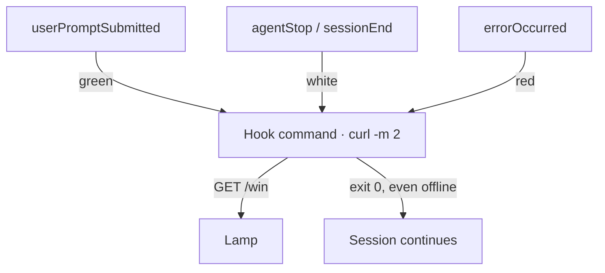

I want to know whether an agent task is still running without keeping its terminal in view. A desk lamp that breathes green while the agent works and turns white when it stops is a small answer to that. It is also a good way to learn hooks, because a hook is the only honest source for the signal. The lamp cannot watch a model think. It can only hear about events the runtime names.

## A hook is a command bound to an event

The coding-agent CLI I use runs hooks: shell commands it executes at named points in a session. Claude Code, Cursor, and Gemini CLI have them too, and a later section moves the lamp to those. This CLI reads hooks from JSON files, usually in one of two places:

```sh
~/.copilot/hooks/lamp.json   # every session on this machine
.github/hooks/lamp.json      # sessions in this repository only
```

A lamp belongs to a desk, not a repository, so the user-level file fits. This is the whole integration:

```json
{
  "version": 1,
  "hooks": {
    "userPromptSubmitted": [
      { "bash": "curl -sm 2 -o /dev/null \"http://$LAMP/win&T=1&R=0&G=255&B=0&FX=2\" || true" }
    ],
    "agentStop": [
      { "bash": "curl -sm 2 -o /dev/null \"http://$LAMP/win&T=1&R=255&G=255&B=255&FX=0\" || true" }
    ],
    "sessionEnd": [
      { "bash": "curl -sm 2 -o /dev/null \"http://$LAMP/win&T=1&R=255&G=255&B=255&FX=0\" || true" }
    ],
    "errorOccurred": [
      { "bash": "curl -sm 2 -o /dev/null \"http://$LAMP/win&T=1&R=255&G=0&B=0&FX=1\" || true" }
    ]
  }
}
```

`$LAMP` holds the lamp's address on the local network, exported from my shell profile; hooks inherit the environment of the session that runs them. The lamp runs WLED, open-source LED firmware with a URL API: `R`, `G`, and `B` set the color, `FX` picks an effect (0 solid, 1 blink, 2 breathe), and `T=1` turns it on. Each hook is one GET request.

The file maps each event name to a list of commands, and `version` is always `1`. An entry's `type` defaults to `command`. `bash` holds the command, and a `powershell` field would cover Windows. An entry can also set `timeoutSec`, which defaults to 30 seconds; curl's `-m 2` is a tighter bound of its own.

## Four events, three states

| Event | Fires when | Light |
| --- | --- | --- |
| `userPromptSubmitted` | A prompt is submitted | Breathing green |
| `agentStop` | The agent finishes a turn | Solid white |
| `sessionEnd` | The session terminates | Solid white |
| `errorOccurred` | An error occurs | Blinking red |

Two events share white on purpose. `agentStop` marks the normal end of a turn. `sessionEnd` is the backstop for sessions that close another way: its payload's `reason` can be `abort`, `timeout`, or `user_exit`. There is no `sessionStart` hook. Opening a session is not work, and the lamp is already white from the last stop, so a start hook would only add a second writer for a state that is already set.

White means an end event arrived, not that the work succeeded. That is a more modest signal than "done," and a more honest one. Each state also has its own motion, so the lamp does not rely on color alone.



## Every hook gets a payload and may answer

The runtime pipes each hook a JSON payload on stdin. This is what `userPromptSubmitted` received in a test session, with the ID shortened and the path tidied:

```json
{
  "sessionId": "dd0a6d2d-…",
  "timestamp": 1794458667656,
  "cwd": "/tmp/lamp-test",
  "prompt": "Reply with the single word: ok"
}
```

The lamp ignores it, but the payload is what makes hooks more than triggers. `agentStop` adds a `stopReason`, `sessionEnd` a `reason`, and `errorOccurred` the error and whether it is recoverable.

Stdout is the way back. When a hook exits 0, the runtime parses what it printed as the hook's answer, and some events act on that answer: a `preToolUse` hook can allow or deny the tool call about to run. A status hook has nothing to say, so `-o /dev/null` keeps the lamp's own response out of that channel.

## The event decides what failure means

For the four events here, a hook that exits non-zero is logged and the session carries on. A hook that runs past its timeout is killed, and the session carries on too. That is fail-open, and it is right for an optional light: losing it costs visibility, not work. The `|| true` goes one step further and makes an unplugged lamp a non-event instead of a logged failure.

The same command on `preToolUse`, say to flash the lamp on every tool call, would behave differently. That event is fail-closed: a crash or non-zero exit denies the tool call, and only a timeout fails open. A flaky lamp script would start blocking the agent's work. The command did not change; the event did.

So I would test the boundary rather than trust it: point `$LAMP` at an address nothing answers, then check that sessions still run and no hook outlasts curl's two-second limit.

## The command travels, the wiring doesn't

Nothing in the curl command belongs to one harness. It reads `$LAMP` and sends one request, so any harness that runs a shell command on an event can drive the lamp. What changes is the wiring around it: the file, the event names, how entries nest, and what a failing hook does.

Claude Code [reads hooks](https://code.claude.com/docs/en/hooks) from `~/.claude/settings.json` for every project, or from `.claude/settings.json` inside one. Each event holds a list of matcher groups, and each group holds its own handlers, so the same four commands sit a level deeper:

```json
{
  "hooks": {
    "UserPromptSubmit": [
      { "hooks": [{ "type": "command", "command": "curl -sm 2 -o /dev/null \"http://$LAMP/win&T=1&R=0&G=255&B=0&FX=2\" || true" }] }
    ],
    "Stop": [
      { "hooks": [{ "type": "command", "command": "curl -sm 2 -o /dev/null \"http://$LAMP/win&T=1&R=255&G=255&B=255&FX=0\" || true" }] }
    ],
    "SessionEnd": [
      { "hooks": [{ "type": "command", "command": "curl -sm 2 -o /dev/null \"http://$LAMP/win&T=1&R=255&G=255&B=255&FX=0\" || true" }] }
    ],
    "StopFailure": [
      { "hooks": [{ "type": "command", "command": "curl -sm 2 -o /dev/null \"http://$LAMP/win&T=1&R=255&G=0&B=0&FX=1\" || true" }] }
    ]
  }
}
```

A matcher narrows a group to certain tools or end reasons. These events need none, so each group holds only `hooks`. Commands run through a shell, so `$LAMP` expands as before. I ran this file twice against a fake lamp, a local server that logs each request: once with a local stand-in for the model API, and once with an expired login. The first run went green, then white at `Stop` and again at `SessionEnd`. The second went green, then red at `StopFailure`, then white as the one-shot session closed. In an interactive session nothing would follow the failure, so red would hold until the next prompt.

The three states map onto each harness's own events:

| Harness | Green | White | Red |
| --- | --- | --- | --- |
| The CLI above | `userPromptSubmitted` | `agentStop`, `sessionEnd` | `errorOccurred` |
| Claude Code | `UserPromptSubmit` | `Stop`, `SessionEnd` | `StopFailure` |
| Cursor | `beforeSubmitPrompt` | `stop`, `sessionEnd` | `stop`, when `status` is `error` |
| Gemini CLI | `BeforeAgent` | `AfterAgent`, `SessionEnd` | None documented |

I fired every event in the first two rows except `errorOccurred`, which comes from that CLI's documentation. The Cursor and Gemini CLI rows come from [Cursor hooks](https://cursor.com/docs/hooks) and the [Gemini CLI hooks reference](https://geminicli.com/docs/hooks/reference/).

Claude Code's file is the nearest thing to a shared format, because other harnesses read it. The CLI above loads `.claude/settings.json` from a repository, though not from the home directory. I ran the file above through it unchanged: the green and white hooks fired, and their payloads arrived with Claude Code's snake_case fields, `session_id` where the native format has `sessionId`. Cursor [imports Claude Code hooks](https://cursor.com/docs/reference/third-party-hooks) by default and maps their event names onto its own. Gemini CLI reads hooks only from its own settings files, which nest the same way, but `gemini hooks migrate --from-claude` [copies a project's Claude Code hooks](https://github.com/google-gemini/gemini-cli/blob/aeb6c04b093eb00c33585ba587c4889ae4c5e957/packages/cli/src/commands/hooks/migrate.ts#L22-L33) into `.gemini/settings.json`, renaming the events and converting timeouts to milliseconds.

Red is the part that doesn't carry over. Neither the CLI above nor Cursor lists `StopFailure`, and Gemini CLI's migration copies it unchanged, though no Gemini CLI event has that name. Cursor maps `Stop` to its own `stop`, which fires however the loop ended, so loaded there, this file paints a failure white.

## Harnesses disagree most about failure

A lamp shows the last event it heard. When a harness has no event for how a turn ended, the lamp shows the wrong state: green over an idle session, or white over a failure. In Claude Code, neither `Stop` nor `StopFailure` fires when you interrupt a turn, so after Esc the lamp keeps breathing green. Cursor reports every ending through `stop` and puts the outcome in a `status` field, so red there takes a short script that reads stdin and picks a color. Gemini CLI documents no failure event. In the source I read, an API error [still ends the turn through `AfterAgent`](https://github.com/google-gemini/gemini-cli/blob/aeb6c04b093eb00c33585ba587c4889ae4c5e957/packages/core/src/core/client.ts#L1007-L1023), which turns the lamp white as though the work had finished, while an authentication error [skips it](https://github.com/google-gemini/gemini-cli/blob/aeb6c04b093eb00c33585ba587c4889ae4c5e957/packages/core/src/core/turn.ts#L440-L443) and leaves the lamp green.

The rules for a failing hook move too. Claude Code, Cursor, and Gemini CLI read exit code 2 as a decision rather than a crash: it blocks whatever the event guards. On Claude Code's `UserPromptSubmit` that is the prompt itself, and on `Stop` it keeps the agent working. Other non-zero codes fail open in all three, while the CLI above denies a `preToolUse` call on any non-zero exit. curl exits 2 when it doesn't recognize a flag, so without `|| true`, one mistyped flag would block every prompt in those three harnesses. Timeouts change units as well as defaults: `"timeout": 5` means five seconds in Claude Code and Cursor, and five milliseconds in Gemini CLI.

One design choice keeps the overlap safe. Each request sets a state rather than toggling one, so a hook that fires twice does no harm. Harnesses that read each other's files make that likely: the CLI above and Cursor both run matching hooks from every source they load.

## One lamp, many sessions

User-level hooks load into every session on the machine, so two sessions, in one harness or several, mean two writers, and the last one wins. If one session finishes while another is still working, its `agentStop` paints the lamp white over active work. The payload already carries the key for a fix: `sessionId`, or `session_id` in Claude Code's format. Track which sessions are busy and stay green while any of them is. That takes a small script instead of four curl lines, which is the point where I would move the logic out of the JSON.

The lamp is not a window into a model's mind. It is a readout of events the runtime names, and the hook file is the whole contract: which event, which command, and what happens when that command fails. That limit is what makes the signal testable.
