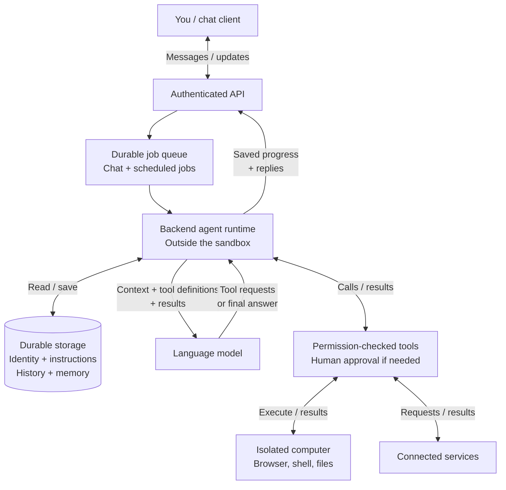

Think of assistants like **Grok Bot**, **Muse**, and **Dots**: this is a
conceptual design for how an always-on assistant could work, not their verified
internals or a claim about their features.

## One system, not just a model

<figure class="diagram">

<figcaption>Scroll horizontally to follow the diagram.</figcaption>
</figure>

The model requests actions; software authorizes and executes them; storage
remembers. "Always-on" means durable state and scheduled work, not a model
thinking forever.

## Capabilities of this design

| Capability | What makes it possible |
| --- | --- |
| Identity and ongoing conversations | Load the assistant's identity, instructions, saved history, and relevant memory into each run. |
| Multi-step tool use | Return tool results to the model so it can request another step or produce a final answer. |
| An isolated workspace | Use a browser, files, and shell inside a sandbox; keep the controlling runtime outside it. |
| Connected apps | Reach external services through tools with explicitly granted, scoped permissions. |
| Scheduled and background work | Submit scheduled jobs to the same durable queue; the chat window need not stay open. |
| Visible progress and history | Save progress, tool results, and replies so the user can inspect work and return to it later. |
| Human approval | Pause actions that require consent and deny unauthorized requests before execution. |
