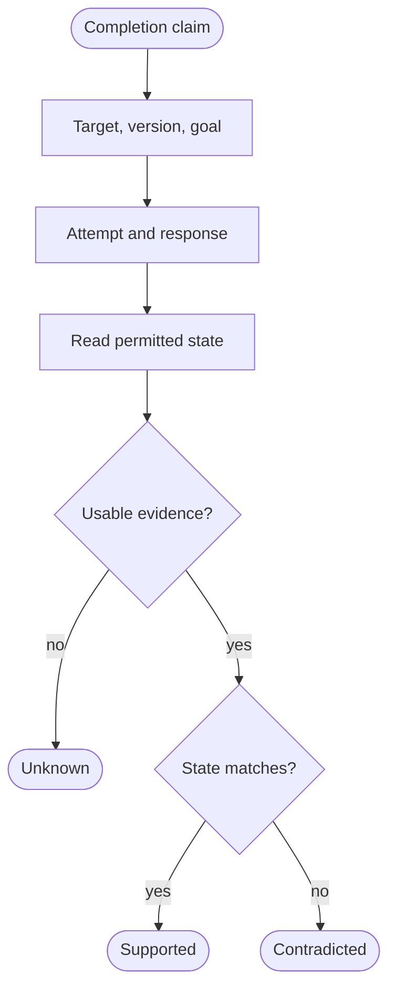

"Done" is a claim about a change somewhere else. A record was updated, a message
was sent, a file was saved. The sentence itself doesn't establish that any of
those things happened.

The distinction I care about is between **what the agent says, what the tool
reports, and what the destination shows**. Each is useful evidence. They answer
different questions, and a confident summary can quietly collapse them into one.

Think of a parcel weighing station. The printed receipt names the parcel and
reports its weight. The scale checks the parcel itself. Reading the receipt
again doesn't weigh anything.

## A successful response can answer the wrong question

A tool response is closer to the action than the agent's retelling, but its
meaning still depends on the operation.

The HTTP standard makes this explicit for
[accepted requests](https://www.rfc-editor.org/rfc/rfc9110.html#section-15.3.3):
`202 Accepted` means processing has been accepted but has not finished. The
request might never be acted upon. A receipt can acknowledge queuing without
confirming the requested change.

Even a response that means the write completed can describe the wrong write.
Updating a task in the wrong workspace can be a successful API call and an
unsuccessful answer to the user's request. The service need not malfunction for
this to happen; it may have faithfully changed exactly the record it was given.

So I would preserve the attempted operation, target identifiers, relevant
arguments, response, and time, rather than keep only a prose conclusion. That
record lets someone distinguish a bad target from a rejected request or an
unfinished operation. Preserve only what is needed, with sensitive values
removed or access restricted.

## Name the record before declaring it changed

Consider a **fictional task system**. The request is:

> In the North workspace, change task 47 from Open to Ready for review, starting
> from version 12. Leave its owner and due date unchanged.

Assume the service rejects a write when the starting version no longer matches,
and provides an authorized, current read of its authoritative record. Those are
properties of this example, not promises about every task service.

The success criteria now have an address and a scope. We know which record,
which starting version, the desired status, and two fields that must be
preserved. The version condition also limits what the agent may change: a newer
record is not silently interchangeable with the one the user approved.

Here are three possible runs, not stages that necessarily follow each other:

| What the run leaves behind | What it supports |
| --- | --- |
| A summary says "Task 47 is ready," with no attempt record or destination read. | Claimed success. The requested state is unknown, not disproved. |
| The request is rejected because the record is already version 13. A current read shows task 47 in North is Open. | This attempt failed. The observed status contradicts the completion claim. |
| A successful response identifies task 47 in North. A current read returns version 13, Ready for review, with the original owner and due date. | The specified state is supported at that observation. |

In the last case, the returned version belongs in the report. "Ready for review,
version 13, observed after the request" is more useful than "Everything is
done." It leaves something a person can inspect.

It still doesn't establish who caused that state. Another actor could have made
the same change. Attribution needs additional evidence tying an operation to a
revision, such as a trustworthy audit record. State agreement alone cannot
supply that history.

## Unknown deserves its own outcome

A failed attempt and an unknown effect are different things.

If a request times out, the caller may have lost the response after the service
performed the change. The standard's
[retry guidance](https://www.rfc-editor.org/rfc/rfc9110.html#section-9.2.2)
explicitly considers a lost response even when the original request succeeded.
It warns against automatically retrying operations that might produce another
effect unless the client knows retrying is safe or the first attempt was never
applied.

A read can also be too early to settle the question. With eventual consistency,
different copies of a record can temporarily disagree.
[Official read-consistency documentation](https://docs.aws.amazon.com/amazondynamodb/latest/developerguide/HowItWorks.ReadConsistency.html)
describes reads that may omit a recently completed write. An old value from
such a read is not yet a contradiction.

The destination check needs the right object, a source that owns the state, and
enough freshness for the claim. An authorized status endpoint may settle whether
a queued operation finished; a current record read may settle what values
exist. They need not settle the same question.

These are verdicts about the checked state, within the observation's scope.
"Contradicted" does not mean the requested state never existed. "Unknown" means
the available evidence cannot settle it, whether because processing is pending,
the read might be stale, or access is unavailable.

Verification is not permission to search another account or request broader
credentials. If the permitted view cannot answer, report that limit. Where the
service supports it, a bounded wait and another permitted read may help. An
uncertain write is not a reason to repeat the write blindly.

## Matching state leaves questions open

There is a useful precedent in
[agent benchmark research](https://arxiv.org/html/2406.12045v1#S3): part of the
evaluation compares the final database with an annotated goal state, rather
than accepting the conversation as evidence of completion. The same paper notes
that a passing reward can still miss a policy violation, such as acting without
required confirmation.

A matching state is evidence for a defined result, not a certificate for
everything that happened along the way.

One read doesn't prove permanence. Someone can edit the record immediately
afterward. Nor does a final snapshot prove several changes happened atomically,
with no intermediate state visible. Those claims require different guarantees
and evidence.

And many tasks include qualities that a state comparison cannot decide. A saved
proposal may still be unpersuasive; a delivered explanation may still be
confusing. Confirming that the artifact exists removes one uncertainty. Judging
its quality remains work.

For the next completion report, I would ask for the exact target and version,
the attempted action, the observed result, and what remains unknown. Keep the
summary short. Give it something firmer than its own wording to stand on.
