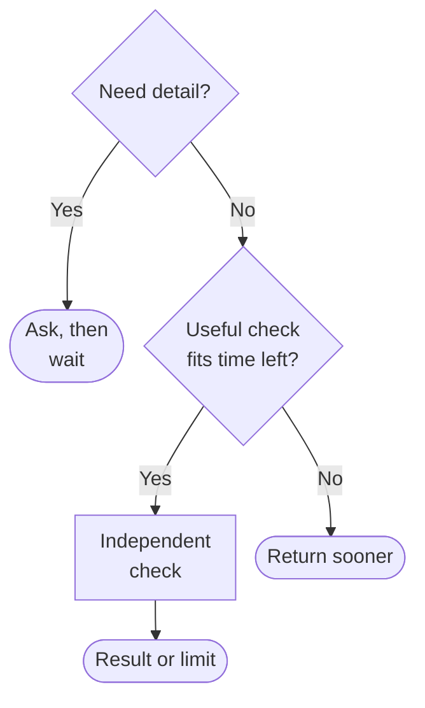

When an AI response gets faster, who gets the saved time?

The obvious answer is the person waiting. A pause in a conversation is not an
empty slot that software ought to fill with more work. Sometimes the best use
of faster inference is exactly the same useful answer, sooner.

But speed also opens choices within an unchanged response-time budget. A check
that used to take too long might now fit. An ambiguous request could receive a
question before the system spends its time answering the wrong thing.

I would treat that budget as a ceiling, not a spending target. Faster inference
gives us room to choose; it does not establish that extra reasoning improves
correctness, or grant permission to expand the task.

## Count the whole wait

The clock starts when someone makes a request, not when the model receives its
input. Reading a file, reaching a remote service, and waiting for a tool to
finish all belong to the experience. If a slow download dominates the wait,
making the explanation faster leaves most of that delay intact.

In his
[1967 argument about limits to parallel computing](https://users.cs.duke.edu/~lkw34/papers/amdahl-afips1967.pdf),
Gene Amdahl described how sequential work constrains the benefit of accelerating
the rest. That paper concerns computer architecture, not conversational
software. The principle I would borrow is narrower: for a fixed task, time
spent in work you have not accelerated still counts. It cannot predict the
speedup of a particular AI feature.

Before deciding what to do with saved time, distinguish **first useful feedback**
from **completed work with the promised checks**. A quick acknowledgment can
tell someone that a request arrived. A streamed paragraph might help them begin
reading. Neither means the requested comparison, calculation, or external
operation has finished.

[Jakob Nielsen's response-time guidance](https://www.nngroup.com/articles/response-times-3-important-limits/)
connects delays with interrupted thought and the need for feedback. It also
recommends reporting actual work completed when the total amount of work is
unknown. These are interface-design guidelines, not a universal deadline for
every AI task.

For an assistant, I would make the feedback literal: “Reading the second file”
only while that is happening; “Totals checked” only after the check completes.
A progress percentage that advances because time passed describes a timer,
not the work. A prompt acknowledgment followed by a long unexplained silence
is still a poor experience.

## A check needs something to check against

Consider a **hypothetical task**: someone supplies two budget files and asks
what changed. The system reads both and drafts an explanation. Faster inference
might leave enough time to recompute the totals from the source rows with a
calculator, then compare them with the amounts mentioned in the explanation.

The calculation supplies evidence that does not depend on the explanation
sounding plausible. It checks arithmetic, not whether the files contain every
expense. If the wrong rows were extracted, the calculator can faithfully total
the wrong inputs. The check must retain a way to trace its inputs back to the
files.

Asking the generator to read its own answer again is a different proposal.
In a [2024 study of reasoning self-correction](https://arxiv.org/html/2310.01798v2),
researchers examined models revising answers without external feedback. In
their evaluated settings, this could reduce accuracy rather than improve it.
The study concerns particular models, prompts, and reasoning tasks; it is not
proof that every later model or correction method must fail.

It does challenge the assumption that another pass deserves to be called
verification. Repeated agreement is not independent confirmation: several
answers can share the same mistaken reading. Extra reasoning may help a
particular method, but a shorter runtime does not demonstrate that benefit.

For the budget comparison, “recomputed totals from these rows” is an honest
claim. “Verified the budget” promises much more. The extra step should earn its
place by catching an error that matters, not by making the answer appear more
thorough.

## Ask before spending the rest

Now remove a detail from the hypothetical request. The person asks, “What
changed in the budget?” but supplies several versions without identifying the
baseline. A fast, polished comparison could still compare the wrong pair.

Here I would spend the response on a narrow question: “Which version should I
compare with the current one?” More computation cannot supply the person's
intention. Asking gets the uncertainty into the conversation sooner.

It does not necessarily finish the task sooner. The person may need time to
answer. Record that as waiting for input, not completed work. Conversely, if
the baseline is already explicit, asking again adds a needless interruption.
Clarify when the missing detail would materially change the answer.

For optional work inside an agreed response budget, the choice looks like this:

“Useful” means the check can affect what the system reports. “Fits” includes
time to inspect its result, not just launch it. If the check overruns or
disagrees, report what remains unresolved rather than quietly starting another
round.

The return-sooner branch assumes required checks are already satisfied. A
mandatory check cannot become optional because the clock is running out.
When it cannot finish in time, the response should say the task is pending,
or explain why a completed answer is unavailable.

Nor does spare time authorize editing the budget or sending it to someone
else. The request was a comparison. The response budget limits waiting; it
does not enlarge permission.

## Leave room to stop

An extra check is a bad trade when its delay costs more than the uncertainty
it can remove. A wording suggestion may be useful immediately and easy to
reject. Holding it back for repeated critiques can obstruct the person's
editing rhythm. A check that makes another slow network call may consume the
whole saving before it produces evidence.

I would compare a proposed check with simply returning sooner on the same
representative tasks. Measure errors caught and introduced, unnecessary
questions, and both clocks: useful feedback and completed work. Include slow
tool responses, not just the clean demonstration.

Keep the added step when that comparison justifies the wait. Otherwise, give
the time back.
