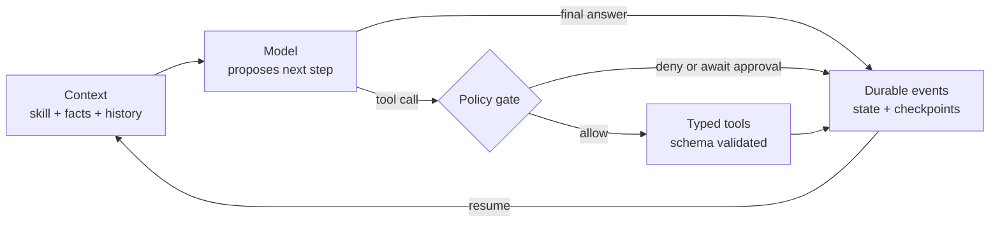

**Disclaimer:** I work at Microsoft. This is my personal view, based only on public information. It isn’t an official position or a product recommendation.

An agent needs more than a model call. The model proposes a next step; the
runtime validates it, checks policy, executes it, records what happened and
decides when to stop. That runtime is the **harness**.

Building a small one by hand makes those boundaries easier to see. Framework
docs then become a set of choices you can evaluate for your system, rather
than a black box to accept wholesale.

In this tutorial, you will build a harness in TypeScript with
[Bun](https://bun.sh). It uses a deterministic scripted model, so there is no
API key, network call or randomness. The behavior is repeatable and testable.
By the end, you will have:

- a provider-neutral model contract and a scripted model;
- a typed tool registry that validates everything a model sends;
- a bounded, cancellable agent loop with a trace;
- skill loading, context projection and an evaluation report;
- an event-sourced runtime that recovers after a crash;
- policy gates, idempotent writes and durable human approval.

The central idea: **agent systems are workflow systems.** The model chooses a semantic next step. The harness owns state, execution, policy, limits, errors and observability.



This walkthrough follows the [build-your-harness](https://github.com/ragmha/build-your-harness) exercise. The core harness steps are covered by its 38 tests. The final coding-agent section is an extension beyond the exercise; its file tools are shown separately and are not included in that test count.

## Prerequisites

Before you begin, ensure you have the following installed:

- [Bun](https://bun.sh/docs/installation) 1.3.14 or later. It runs TypeScript directly, installs packages and runs tests, so you do not need Node.js.
- The [GitHub CLI](https://cli.github.com/), or a browser to copy the template.
- Basic TypeScript.

## Project setup

Create your own copy of the exercise template and install its dependencies:

```bash
gh repo create build-your-harness --template ragmha/build-your-harness --public --clone
cd build-your-harness
bun install --frozen-lockfile
bun run typecheck
```

The template ships the type contracts, fixtures, tests and a Dev Container. The methods you will write throw `Not implemented` until you replace them.

There are only two runtime dependencies:

- **[zod](https://zod.dev/)** validates arguments that a model invents.
- **[zod-to-json-schema](https://github.com/StefanTerdell/zod-to-json-schema)** turns those schemas into the JSON Schema a model sees.

When you are done, the project looks like this:

```text
build-your-harness/
├── evals/evals.json              # evaluation cases
├── fixtures/sample-skill/        # SKILL.md + references
├── src/
│   ├── core/                     # contracts, errors, agent loop
│   ├── providers/                # scripted model
│   ├── tools/                    # registry + lookup_code tool
│   ├── skills/                   # skill loader
│   ├── context/                  # context projection
│   ├── evals/                    # evaluation runner + CLI
│   └── durable/                  # events, store, policy, harness
└── tests/step1..6.test.ts        # graded checks
```

Each step ends with a grading command. Run it before moving on; the tests are cumulative, so a later step cannot quietly break an earlier one.

## Step 1: Define the model boundary

Start with the smallest possible contract: messages go in, a response comes out. Nothing here names a vendor, so a real API, a local model and the scripted model all fit behind the same interface.

```ts title="src/core/contracts.ts"
export type MessageRole = "system" | "user" | "assistant" | "tool";

export interface ToolCall {
  id: string;
  name: string;
  arguments: unknown;
}

export interface Message {
  role: MessageRole;
  content: string;
  toolCallId?: string;
  name?: string;
  toolCalls?: ToolCall[];
}

export interface ModelRequest {
  messages: readonly Message[];
  tools: readonly ToolDefinition[];
}

export interface ModelResponse {
  content: string;
  toolCalls?: ToolCall[];
}

export interface ToolDefinition {
  name: string;
  description: string;
  inputSchema: Record<string, unknown>;
}

export interface ModelAdapter {
  complete(request: ModelRequest, signal: AbortSignal): Promise<ModelResponse>;
}

export type TraceEvent =
  | { type: "run.started"; at: string }
  | { type: "model.requested"; at: string; step: number }
  | { type: "model.responded"; at: string; step: number; toolCallCount: number }
  | { type: "tool.started"; at: string; step: number; toolCallId: string; toolName: string }
  | { type: "tool.finished"; at: string; step: number; toolCallId: string; toolName: string }
  | { type: "run.finished"; at: string; step: number }
  | { type: "run.failed"; at: string; step: number; error: string };

export type TraceListener = (event: TraceEvent) => void;
```

Notice `arguments: unknown`. Whatever a model sends is untrusted input until the harness proves otherwise.

Failures get a typed error, so callers can branch on `error.code` instead of parsing messages:

```ts title="src/core/errors.ts"
export type HarnessErrorCode =
  | "UNKNOWN_TOOL"
  | "INVALID_ARGUMENTS"
  | "MAX_STEPS"
  | "ABORTED"
  | "MODEL_EXHAUSTED"
  | "RUN_EXISTS"
  | "RUN_NOT_FOUND"
  | "VERSION_CONFLICT"
  | "DUPLICATE_TOOL_CALL"
  | "APPROVAL_NOT_FOUND"
  | "APPROVAL_CONFLICT";

export class HarnessError extends Error {
  constructor(
    public readonly code: HarnessErrorCode,
    message: string,
    options?: ErrorOptions,
  ) {
    super(message, options);
    this.name = "HarnessError";
  }
}
```

Now the model itself. `ScriptedModel` returns one canned response per call:

```ts title="src/providers/scripted-model.ts"
import type { ModelAdapter, ModelRequest, ModelResponse } from "../core/contracts";
import { HarnessError } from "../core/errors";

export class ScriptedModel implements ModelAdapter {
  readonly #responses: readonly ModelResponse[];
  #cursor = 0;

  constructor(responses: readonly ModelResponse[]) {
    this.#responses = structuredClone(responses);
  }

  async complete(_request: ModelRequest, signal: AbortSignal): Promise<ModelResponse> {
    if (signal.aborted) {
      throw new HarnessError("ABORTED", "Model request was cancelled", {
        cause: signal.reason,
      });
    }

    const response = this.#responses[this.#cursor];
    if (!response) {
      throw new HarnessError("MODEL_EXHAUSTED", "Scripted model has no responses left");
    }
    this.#cursor += 1;
    return structuredClone(response);
  }

  get remaining(): number {
    return this.#responses.length - this.#cursor;
  }
}
```

Three small decisions carry a lot of weight:

1. **Check cancellation first**, before consuming a response.
2. **Fail with a typed `HarnessError`**, not a plain `Error`.
3. **Return a clone**, so no caller can mutate the script and change a later answer.

Run the Step 1 checks:

```bash
bun run grade:step1
```

## Step 2: Build a safe tool-calling loop

The model may propose a tool name and arguments. Your code decides which tools exist, validates the input, bounds the loop and records what happened.

### A tool is a schema plus a function

```ts title="src/tools/lookup-code.ts"
import { z } from "zod";
import type { Tool } from "./registry";

const entries: Readonly<Record<string, string>> = {
  ALPHA: "Alpha is the first synthetic entry.",
  BRAVO: "Bravo is the second synthetic entry.",
};

export const lookupCodeTool: Tool<{ code: string }, { found: boolean; value: string | null }> = {
  name: "lookup_code",
  description: "Look up a value in a small synthetic, read-only code table.",
  schema: z.object({
    code: z.string().trim().min(1).transform((value) => value.toUpperCase()),
  }),
  execute({ code }) {
    const value = entries[code];
    return { found: value !== undefined, value: value ?? null };
  },
};
```

The schema does double duty. It is converted to JSON Schema to tell the model what the tool accepts, and it parses the model's reply before anything runs. One source of truth means the advertised shape and the enforced shape cannot drift apart. The `transform` also normalizes input, so `alpha` and `ALPHA` find the same entry.

### The registry is the allowlist

```ts title="src/tools/registry.ts"
import type { ZodType } from "zod";
import { zodToJsonSchema } from "zod-to-json-schema";
import type { ToolDefinition } from "../core/contracts";
import { HarnessError } from "../core/errors";

export interface ToolContext {
  signal: AbortSignal;
  runId?: string;
  toolCallId?: string;
  idempotencyKey?: string;
}

export interface Tool<TInput, TOutput> {
  name: string;
  description: string;
  effect?: "read" | "write";
  schema: ZodType<TInput>;
  execute(input: TInput, context: ToolContext): Promise<TOutput> | TOutput;
}

type AnyTool = Tool<unknown, unknown>;

export class ToolRegistry {
  readonly #tools = new Map<string, AnyTool>();

  register<TInput, TOutput>(tool: Tool<TInput, TOutput>): this {
    if (this.#tools.has(tool.name)) {
      throw new Error(`Tool "${tool.name}" is already registered`);
    }
    this.#tools.set(tool.name, tool as AnyTool);
    return this;
  }

  definitions(): ToolDefinition[] {
    return [...this.#tools.values()].map((tool) => ({
      name: tool.name,
      description: tool.description,
      inputSchema: zodToJsonSchema(tool.schema) as Record<string, unknown>,
    }));
  }

  effectOf(name: string): "read" | "write" {
    const tool = this.#tools.get(name);
    if (!tool) {
      throw new HarnessError("UNKNOWN_TOOL", `Unknown tool: ${name}`);
    }
    return tool.effect ?? "read";
  }

  async execute(name: string, input: unknown, context: ToolContext): Promise<unknown> {
    const tool = this.#tools.get(name);
    if (!tool) {
      throw new HarnessError("UNKNOWN_TOOL", `Unknown tool: ${name}`);
    }

    const parsed = tool.schema.safeParse(input);
    if (!parsed.success) {
      const issues = parsed.error.issues
        .map((issue) => `${issue.path.join(".") || "(input)"}: ${issue.message}`)
        .join("; ");
      throw new HarnessError("INVALID_ARGUMENTS", `Invalid arguments for ${name}: ${issues}`);
    }

    return await tool.execute(parsed.data, context);
  }
}
```

A hallucinated tool name fails as `UNKNOWN_TOOL`. Malformed arguments fail as `INVALID_ARGUMENTS`, with a message specific enough to feed back to a model. Code only runs after both checks pass. `effect` defaults to `read`; it matters in Step 5.

### The loop

This is the heart of the harness. It bounds the number of steps, combines caller cancellation with a timeout, calls the model, runs the requested tools one at a time and emits a trace event for each transition.

```ts title="src/core/agent.ts"
import type {
  Message,
  ModelAdapter,
  TraceEvent,
  TraceListener,
} from "./contracts";
import { HarnessError } from "./errors";
import type { ToolRegistry } from "../tools/registry";
import {
  projectContext,
  type ContextProjectionOptions,
} from "../context/project-context";

export interface AgentOptions {
  maxSteps?: number;
  timeoutMs?: number;
  signal?: AbortSignal;
  onTrace?: TraceListener;
  context?: ContextProjectionOptions;
}

export interface AgentResult {
  output: string;
  messages: Message[];
  trace: TraceEvent[];
  steps: number;
}

export async function runAgent(
  model: ModelAdapter,
  tools: ToolRegistry,
  initialMessages: readonly Message[],
  options: AgentOptions = {},
): Promise<AgentResult> {
  const maxSteps = options.maxSteps ?? 8;
  const messages: Message[] = structuredClone([...initialMessages]);
  const trace: TraceEvent[] = [];
  const emit = (event: TraceEvent) => {
    trace.push(event);
    options.onTrace?.(event);
  };
  const now = () => new Date().toISOString();

  const timeout = new AbortController();
  const timer =
    options.timeoutMs === undefined
      ? undefined
      : setTimeout(
          () => timeout.abort(new Error(`Agent run timed out after ${options.timeoutMs}ms`)),
          options.timeoutMs,
        );
  const signal = options.signal
    ? AbortSignal.any([options.signal, timeout.signal])
    : timeout.signal;

  let step = 0;
  emit({ type: "run.started", at: now() });

  try {
    while (true) {
      if (signal.aborted) {
        throw abortedError(signal.reason);
      }
      if (step >= maxSteps) {
        throw new HarnessError("MAX_STEPS", `Agent exceeded ${maxSteps} model steps`);
      }

      step += 1;
      emit({ type: "model.requested", at: now(), step });
      const context = options.context
        ? projectContext(messages, options.context).messages
        : messages;
      const response = await model.complete(
        { messages: context, tools: tools.definitions() },
        signal,
      );
      const toolCalls = response.toolCalls ?? [];
      emit({ type: "model.responded", at: now(), step, toolCallCount: toolCalls.length });

      messages.push({
        role: "assistant",
        content: response.content,
        ...(toolCalls.length > 0 ? { toolCalls } : {}),
      });

      if (toolCalls.length === 0) {
        emit({ type: "run.finished", at: now(), step });
        return { output: response.content, messages, trace, steps: step };
      }

      for (const call of toolCalls) {
        emit({ type: "tool.started", at: now(), step, toolCallId: call.id, toolName: call.name });
        const result = await tools.execute(call.name, call.arguments, {
          signal,
          toolCallId: call.id,
        });
        emit({ type: "tool.finished", at: now(), step, toolCallId: call.id, toolName: call.name });
        messages.push({
          role: "tool",
          content: JSON.stringify(result),
          toolCallId: call.id,
          name: call.name,
        });
      }
    }
  } catch (error) {
    const failure = signal.aborted ? abortedError(signal.reason) : error;
    emit({
      type: "run.failed",
      at: now(),
      step,
      error: failure instanceof Error ? failure.message : String(failure),
    });
    throw failure;
  } finally {
    clearTimeout(timer);
  }
}

export function abortedError(reason?: unknown): HarnessError {
  const message = reason instanceof Error ? reason.message : "Agent run was cancelled";
  return new HarnessError("ABORTED", message, { cause: reason });
}
```

A few things to notice:

- **The run ends when the model stops asking for tools.** No tool calls means the content is the final answer.
- **`maxSteps` is checked before each model request**, so a confused model cannot loop forever and quietly spend your budget.
- **`AbortSignal.any`** merges the caller's signal and the deadline. The model and every tool get the same signal.
- **Model and tool calls share one `try`**, so every failure emits `run.failed` and is normalized to `ABORTED` when cancellation caused it.
- **The trace is not the context.** Trace events describe execution for you. They are never sent to the model.
- **`options.context`** is used in Step 3. Without it, the model sees the full history.

Run the Step 2 checks:

```bash
bun run grade:step2
```

### Run it

Create `demo.ts` in the project root:

```ts title="demo.ts"
import { runAgent } from "./src/core/agent";
import { ScriptedModel } from "./src/providers/scripted-model";
import { ToolRegistry } from "./src/tools/registry";
import { lookupCodeTool } from "./src/tools/lookup-code";

const model = new ScriptedModel([
  { content: "", toolCalls: [{ id: "call-1", name: "lookup_code", arguments: { code: "alpha" } }] },
  { content: "Alpha is the first synthetic entry." },
]);
const tools = new ToolRegistry().register(lookupCodeTool);

const result = await runAgent(
  model,
  tools,
  [{ role: "user", content: "What does ALPHA mean?" }],
  { onTrace: (event) => console.log(event.type) },
);
console.log(result.output);
```

```bash
bun run demo.ts
```

```text
run.started
model.requested
model.responded
tool.started
tool.finished
model.requested
model.responded
run.finished
Alpha is the first synthetic entry.
```

That trace is the whole agent loop made visible: two model steps with one tool call between them. Swap `ScriptedModel` for an adapter around any real provider and nothing else changes.

## Step 3: Skills, context and evaluations

A working loop is not yet a useful agent. It needs repeatable instructions, deliberate context and evidence that it behaves.

### Load a skill

A skill is a `SKILL.md` with optional `references/*.md`. The template includes one:

```markdown title="fixtures/sample-skill/SKILL.md"
# Synthetic Code Helper

You answer questions about a tiny synthetic code table.

## Instructions

1. Use `lookup_code` when the user asks what a code means.
2. Return the tool's value exactly when the code is found.
3. Say `Code not found.` when the lookup returns no value.
4. Never invent entries or use external data.
```

```markdown title="fixtures/sample-skill/references/codes.md"
# Available codes

- `ALPHA`: first synthetic entry
- `BRAVO`: second synthetic entry

The tool result is authoritative. This reference is context, not a substitute for calling the tool.
```

The loader reads the instructions, finds the references with `Bun.Glob`, and sorts them so the same skill always renders the same prompt:

```ts title="src/skills/load-skill.ts"
import { join } from "node:path";

export interface LoadedReference {
  path: string;
  content: string;
}

export interface LoadedSkill {
  root: string;
  instructions: string;
  references: LoadedReference[];
}

export async function loadSkill(root: string): Promise<LoadedSkill> {
  const instructions = await Bun.file(join(root, "SKILL.md")).text();

  const paths: string[] = [];
  for await (const path of new Bun.Glob("references/**/*.md").scan({ cwd: root })) {
    paths.push(path.replaceAll("\\", "/"));
  }
  paths.sort();

  const references = await Promise.all(
    paths.map(async (path) => ({
      path,
      content: await Bun.file(join(root, path)).text(),
    })),
  );

  return { root, instructions, references };
}

export function renderSkillPrompt(skill: LoadedSkill): string {
  const references = skill.references
    .map((reference) => `\n## Reference: ${reference.path}\n\n${reference.content.trim()}`)
    .join("\n");

  return `${skill.instructions.trim()}${references}\n`;
}
```

### Project context instead of sending everything

Keep three ideas apart:

- **State** is what the runtime knows now: the cursor, the step count.
- **History** is what happened: every message and trace event.
- **Context** is what you choose to send the model this turn.

`projectContext` puts the instructions first, adds known facts as one sorted system message, then keeps the newest history that fits a message budget:

```ts title="src/context/project-context.ts"
import type { Message } from "../core/contracts";

export interface ContextProjectionOptions {
  instructions?: string;
  facts?: Readonly<Record<string, string>>;
  historyMessageTarget?: number;
}

export interface ContextProjection {
  messages: Message[];
  includedHistoryMessages: number;
  omittedHistoryMessages: number;
}

export function projectContext(
  history: readonly Message[],
  options: ContextProjectionOptions = {},
): ContextProjection {
  const messages: Message[] = [];
  if (options.instructions) {
    messages.push({ role: "system", content: options.instructions });
  }

  const facts = Object.entries(options.facts ?? {}).sort(([left], [right]) =>
    left < right ? -1 : left > right ? 1 : 0,
  );
  if (facts.length > 0) {
    const lines = facts.map(([key, value]) => `${key}: ${value}`);
    messages.push({ role: "system", content: ["Known facts:", ...lines].join("\n") });
  }

  // Walk blocks from newest to oldest. The block that crosses the target is
  // kept whole, so a tool result never arrives without its tool call.
  const target = options.historyMessageTarget ?? history.length;
  const blocks = toBlocks(history);
  const selected: Message[][] = [];
  let included = 0;
  for (let index = blocks.length - 1; index >= 0 && included < target; index -= 1) {
    const block = blocks[index]!;
    selected.unshift(block);
    included += block.length;
  }

  messages.push(...structuredClone(selected.flat()));
  return {
    messages,
    includedHistoryMessages: included,
    omittedHistoryMessages: history.length - included,
  };
}

function toBlocks(history: readonly Message[]): Message[][] {
  const blocks: Message[][] = [];
  for (const message of history) {
    const previous = blocks.at(-1);
    if (message.role === "tool" && previous?.[0]?.toolCalls) {
      previous.push(message);
    } else {
      blocks.push([message]);
    }
  }
  return blocks;
}
```

One rule makes it correct: an assistant tool call and its tool results form an indivisible block. The projection may exceed the budget rather than send a tool result whose call was cut off, which most providers reject. The budget is a message count, not a tokenizer, to keep the idea visible.

### Evaluate behavior

`evals/evals.json` pairs a prompt with a scripted model and an expected answer:

```json title="evals/evals.json (one case)"
{
  "id": "lookup-alpha",
  "prompt": "What does ALPHA mean?",
  "expectedOutput": "Alpha is the first synthetic entry.",
  "script": [
    {
      "content": "",
      "toolCalls": [
        { "id": "call-alpha", "name": "lookup_code", "arguments": { "code": "alpha" } }
      ]
    },
    { "content": "Alpha is the first synthetic entry." }
  ]
}
```

The report has a fixed shape:

```ts title="src/evals/types.ts"
import type { ModelResponse } from "../core/contracts";

export interface EvaluationCase {
  id: string;
  prompt: string;
  expectedOutput: string;
  script: ModelResponse[];
}

export interface EvaluationResult {
  id: string;
  passed: boolean;
  expectedOutput: string;
  actualOutput: string;
  steps: number;
}

export interface EvaluationReport {
  generatedAt: string;
  totals: {
    cases: number;
    passed: number;
    failed: number;
  };
  results: EvaluationResult[];
}
```

The runner validates the file with Zod, gives each case a fresh model and registry (a `ScriptedModel` has a cursor, so sharing one would leak state between cases) and compares outputs:

```ts title="src/evals/run-evals.ts"
import { z } from "zod";
import type { EvaluationCase, EvaluationReport, EvaluationResult } from "./types";
import { renderSkillPrompt, type LoadedSkill } from "../skills/load-skill";
import { runAgent } from "../core/agent";
import { ScriptedModel } from "../providers/scripted-model";
import { ToolRegistry } from "../tools/registry";
import { lookupCodeTool } from "../tools/lookup-code";

const evaluationCaseSchema = z.object({
  id: z.string().min(1),
  prompt: z.string().min(1),
  expectedOutput: z.string(),
  script: z.array(
    z.object({
      content: z.string(),
      toolCalls: z
        .array(
          z.object({
            id: z.string().min(1),
            name: z.string().min(1),
            arguments: z.unknown(),
          }),
        )
        .optional(),
    }),
  ),
});

export async function loadEvaluationCases(path: string): Promise<EvaluationCase[]> {
  const value: unknown = await Bun.file(path).json();
  return z.array(evaluationCaseSchema).parse(value).map((evaluationCase) => ({
    id: evaluationCase.id,
    prompt: evaluationCase.prompt,
    expectedOutput: evaluationCase.expectedOutput,
    script: evaluationCase.script.map((response) => ({
      content: response.content,
      ...(response.toolCalls
        ? {
            toolCalls: response.toolCalls.map((toolCall) => ({
              id: toolCall.id,
              name: toolCall.name,
              arguments: toolCall.arguments,
            })),
          }
        : {}),
    })),
  }));
}

export async function runEvaluations(
  skill: LoadedSkill,
  cases: readonly EvaluationCase[],
): Promise<EvaluationReport> {
  const systemPrompt = renderSkillPrompt(skill);
  const results: EvaluationResult[] = [];

  for (const evaluationCase of cases) {
    const model = new ScriptedModel(evaluationCase.script);
    const tools = new ToolRegistry().register(lookupCodeTool);
    const run = await runAgent(model, tools, [
      { role: "system", content: systemPrompt },
      { role: "user", content: evaluationCase.prompt },
    ]);

    results.push({
      id: evaluationCase.id,
      passed: run.output === evaluationCase.expectedOutput,
      expectedOutput: evaluationCase.expectedOutput,
      actualOutput: run.output,
      steps: run.steps,
    });
  }

  const passed = results.filter((result) => result.passed).length;
  return {
    generatedAt: new Date().toISOString(),
    totals: { cases: results.length, passed, failed: results.length - passed },
    results,
  };
}

export async function writeEvaluationReport(
  report: EvaluationReport,
  outputPath: string,
): Promise<void> {
  await Bun.write(outputPath, `${JSON.stringify(report, null, 2)}\n`);
}
```

A small CLI writes the report and fails the process when a case fails, so CI can block a change that makes the agent worse:

```ts title="src/evals/cli.ts"
import { dirname, resolve } from "node:path";
import { mkdir } from "node:fs/promises";
import { loadEvaluationCases, runEvaluations, writeEvaluationReport } from "./run-evals";
import { loadSkill } from "../skills/load-skill";

const root = resolve(import.meta.dir, "../..");
const outputPath = resolve(root, "reports/eval-report.json");

const skill = await loadSkill(resolve(root, "fixtures/sample-skill"));
const cases = await loadEvaluationCases(resolve(root, "evals/evals.json"));
const report = await runEvaluations(skill, cases);

await mkdir(dirname(outputPath), { recursive: true });
await writeEvaluationReport(report, outputPath);

console.log(JSON.stringify(report.totals));
if (report.totals.failed > 0) {
  process.exitCode = 1;
}
```

Run the checks and the evaluation:

```bash
bun run grade:step3
bun run eval
```

```text
{"cases":2,"passed":2,"failed":0}
```

`reports/eval-report.json` now holds per-case results. Exact-match checks are deliberately simple. The point is the plumbing; you can swap in richer graders later without changing it.

## Step 4: Make execution durable and recoverable

An in-memory call stack disappears when a process stops. A durable harness records facts before moving to the next side effect, then rebuilds current state by replaying those facts.

### Events, state and checkpoints

The template defines the durable contracts. Read them before writing the reducer:

```ts title="src/durable/contracts.ts"
import type {
  Message,
  ModelResponse,
  ToolCall,
} from "../core/contracts";
import type { HarnessErrorCode } from "../core/errors";

export type RunStatus =
  | "running"
  | "waiting_for_approval"
  | "completed"
  | "failed";

export type PolicyDecision =
  | { kind: "allow" }
  | { kind: "deny"; reason: string }
  | { kind: "require_approval"; reason: string };

export interface ApprovalRequest {
  approvalId: string;
  runId: string;
  toolCall: ToolCall;
  reason: string;
}

export interface ApprovalCommand {
  approvalId: string;
  commandId: string;
  decision: "approve" | "reject";
}

export interface ApprovalResolution extends ApprovalCommand {
  toolCallId: string;
}

export type RunEvent =
  | {
      type: "run.started";
      initialMessages: readonly Message[];
      maxSteps: number;
    }
  | { type: "model.responded"; response: ModelResponse }
  | {
      type: "policy.decided";
      toolCallId: string;
      decision: PolicyDecision;
    }
  | { type: "approval.requested"; request: ApprovalRequest }
  | { type: "approval.resolved"; resolution: ApprovalResolution }
  | {
      type: "tool.completed";
      toolCall: ToolCall;
      result: unknown;
      idempotencyKey: string;
    }
  | { type: "tool.denied"; toolCall: ToolCall; reason: string }
  | { type: "run.completed"; output: string }
  | {
      type: "run.failed";
      code: HarnessErrorCode;
      message: string;
    };

export interface EventEnvelope {
  runId: string;
  version: number;
  eventId: string;
  at: string;
  event: RunEvent;
}

export interface RunState {
  runId: string;
  status: RunStatus;
  steps: number;
  maxSteps: number;
  pendingToolCalls: ToolCall[];
  seenToolCallIds: string[];
  policyDecisions: Record<string, PolicyDecision>;
  approvalRequests: Record<string, ApprovalRequest>;
  approvalResolutions: Record<string, ApprovalResolution>;
  output?: string;
  failure?: { code: HarnessErrorCode; message: string };
}

export interface RunSnapshot {
  state: RunState;
  history: Message[];
}

export interface RunCheckpoint {
  throughVersion: number;
  snapshot: RunSnapshot;
}

export interface StoredRun {
  version: number;
  events: EventEnvelope[];
  checkpoint?: RunCheckpoint;
}

export interface CommitRequest {
  runId: string;
  expectedVersion: number;
  events: readonly RunEvent[];
}

export interface RunStore {
  read(runId: string): Promise<StoredRun | undefined>;
  commit(request: CommitRequest): Promise<StoredRun>;
  saveCheckpoint(
    runId: string,
    expectedVersion: number,
    snapshot: RunSnapshot,
  ): Promise<StoredRun>;
}

export interface PolicyInput {
  runId: string;
  call: ToolCall;
  effect: "read" | "write";
}

export interface PolicyGate {
  evaluate(input: PolicyInput): PolicyDecision;
}

export type DurableRunResult =
  | {
      runId: string;
      status: "completed";
      output: string;
      state: RunState;
    }
  | {
      runId: string;
      status: "waiting_for_approval";
      approval: ApprovalRequest;
      state: RunState;
    };
```

Four objects, four jobs:

1. `RunEvent` records what happened. The event list is the source of truth.
2. `RunState` is the current control position.
3. `RunSnapshot` is state plus message history.
4. `RunCheckpoint` caches a snapshot up to one version. It is only an optimization.

### The reducer

State is a pure function of events. Nothing in here performs I/O:

```ts title="src/durable/reducer.ts"
import type { Message, ToolCall } from "../core/contracts";
import { HarnessError } from "../core/errors";
import type {
  EventEnvelope,
  RunCheckpoint,
  RunEvent,
  RunSnapshot,
  StoredRun,
} from "./contracts";

export function initialSnapshot(runId: string): RunSnapshot {
  return {
    state: {
      runId,
      status: "running",
      steps: 0,
      maxSteps: 0,
      pendingToolCalls: [],
      seenToolCallIds: [],
      policyDecisions: {},
      approvalRequests: {},
      approvalResolutions: {},
    },
    history: [],
  };
}

export function applyRunEvent(
  snapshot: RunSnapshot,
  event: RunEvent,
): RunSnapshot {
  const next = structuredClone(snapshot);
  const { state, history } = next;

  switch (event.type) {
    case "run.started":
      state.maxSteps = event.maxSteps;
      history.push(...structuredClone(event.initialMessages));
      break;
    case "model.responded":
      for (const call of event.response.toolCalls ?? []) {
        if (state.seenToolCallIds.includes(call.id)) {
          throw new HarnessError("DUPLICATE_TOOL_CALL", `Tool call "${call.id}" was already used`);
        }
        state.seenToolCallIds.push(call.id);
      }
      state.steps += 1;
      state.pendingToolCalls = structuredClone(event.response.toolCalls ?? []);
      history.push(assistantMessage(event));
      break;
    case "policy.decided":
      state.policyDecisions[event.toolCallId] = structuredClone(event.decision);
      break;
    case "approval.requested":
      state.approvalRequests[event.request.approvalId] = structuredClone(event.request);
      state.status = "waiting_for_approval";
      break;
    case "approval.resolved":
      state.approvalResolutions[event.resolution.approvalId] = structuredClone(event.resolution);
      state.status = "running";
      break;
    case "tool.completed":
      state.pendingToolCalls = withoutPendingCall(state.pendingToolCalls, event.toolCall.id);
      history.push(toolMessage(event.toolCall, event.result));
      break;
    case "tool.denied":
      state.pendingToolCalls = withoutPendingCall(state.pendingToolCalls, event.toolCall.id);
      history.push(toolMessage(event.toolCall, { denied: true, reason: event.reason }));
      break;
    case "run.completed":
      state.status = "completed";
      state.output = event.output;
      break;
    case "run.failed":
      state.status = "failed";
      state.failure = { code: event.code, message: event.message };
      break;
  }

  return next;
}

export function replayEvents(
  runId: string,
  events: readonly EventEnvelope[],
  checkpoint?: RunCheckpoint,
): RunSnapshot {
  const start = checkpoint ? structuredClone(checkpoint.snapshot) : initialSnapshot(runId);
  const throughVersion = checkpoint?.throughVersion ?? 0;
  return events
    .filter((entry) => entry.version > throughVersion)
    .reduce((snapshot, entry) => applyRunEvent(snapshot, entry.event), start);
}

function toolMessage(call: ToolCall, result: unknown): Message {
  return {
    role: "tool",
    content: JSON.stringify(result),
    toolCallId: call.id,
    name: call.name,
  };
}

export function replayStoredRun(stored: StoredRun): RunSnapshot {
  const runId = stored.events[0]?.runId;
  if (!runId) {
    throw new HarnessError("RUN_NOT_FOUND", "Stored run has no events");
  }
  return replayEvents(runId, stored.events, stored.checkpoint);
}

export function assistantMessage(event: Extract<RunEvent, { type: "model.responded" }>): Message {
  const message: Message = {
    role: "assistant",
    content: event.response.content,
  };
  if (event.response.toolCalls) {
    message.toolCalls = structuredClone(event.response.toolCalls);
  }
  return message;
}

export function withoutPendingCall(
  calls: readonly ToolCall[],
  toolCallId: string,
): ToolCall[] {
  return calls.filter((call) => call.id !== toolCallId);
}
```

Two details matter. `replayEvents` starts from a checkpoint but still applies every event after `throughVersion`. And a repeated tool call ID throws `DUPLICATE_TOOL_CALL`, so a misbehaving model cannot make the harness run the same call twice.

### The store

`InMemoryRunStore` uses optimistic concurrency. Every commit says which version it expects; a stale writer gets `VERSION_CONFLICT` instead of silently overwriting another worker's progress:

```ts title="src/durable/in-memory-store.ts"
import { HarnessError } from "../core/errors";
import type {
  CommitRequest,
  EventEnvelope,
  RunSnapshot,
  RunStore,
  StoredRun,
} from "./contracts";

export class InMemoryRunStore implements RunStore {
  readonly #runs = new Map<string, StoredRun>();

  async read(runId: string): Promise<StoredRun | undefined> {
    return structuredClone(this.#runs.get(runId));
  }

  async commit(request: CommitRequest): Promise<StoredRun> {
    const current = this.#runs.get(request.runId) ?? { version: 0, events: [] };
    if (request.expectedVersion !== current.version) {
      throw versionConflict(request.runId, request.expectedVersion, current.version);
    }

    const events = request.events.map((event, index) =>
      envelope(request.runId, current.version + index + 1, event),
    );
    const next: StoredRun = {
      ...current,
      version: current.version + events.length,
      events: [...current.events, ...events],
    };
    this.#runs.set(request.runId, structuredClone(next));
    return structuredClone(next);
  }

  async saveCheckpoint(
    runId: string,
    expectedVersion: number,
    snapshot: RunSnapshot,
  ): Promise<StoredRun> {
    const current = this.#runs.get(runId);
    if (!current) {
      throw new HarnessError("RUN_NOT_FOUND", `Run "${runId}" was not found`);
    }
    if (expectedVersion !== current.version) {
      throw versionConflict(runId, expectedVersion, current.version);
    }

    const next: StoredRun = {
      ...current,
      checkpoint: { throughVersion: current.version, snapshot: structuredClone(snapshot) },
    };
    this.#runs.set(runId, next);
    return structuredClone(next);
  }
}

export function versionConflict(
  runId: string,
  expectedVersion: number,
  actualVersion: number,
): HarnessError {
  return new HarnessError(
    "VERSION_CONFLICT",
    `Run "${runId}" expected version ${expectedVersion}, found ${actualVersion}`,
  );
}

export function envelope(
  runId: string,
  version: number,
  event: EventEnvelope["event"],
): EventEnvelope {
  return {
    runId,
    version,
    eventId: `event:${JSON.stringify([runId, version])}`,
    at: new Date().toISOString(),
    event: structuredClone(event),
  };
}
```

It survives reconstructing the harness inside one process, which is enough to test restart behavior. In production, the same interface would sit on a database.

## Step 5: Add policy gates and idempotent effects

Durability prevents lost progress. It does not decide whether a proposed tool is allowed, or close the gap between performing an effect and recording that it happened.

### Policy is data

Before any tool runs, a `PolicyGate` returns `allow`, `deny` or `require_approval`:

```ts title="src/durable/policy.ts"
import type {
  PolicyDecision,
  PolicyGate,
  PolicyInput,
} from "./contracts";

export class StaticToolPolicy implements PolicyGate {
  constructor(
    private readonly decisions: Readonly<Record<string, PolicyDecision>>,
    private readonly fallback: PolicyDecision = {
      kind: "deny",
      reason: "Tool is not allowed by policy",
    },
  ) {}

  evaluate(input: PolicyInput): PolicyDecision {
    const decision = Object.hasOwn(this.decisions, input.call.name)
      ? this.decisions[input.call.name]
      : undefined;
    return structuredClone(decision ?? this.fallback);
  }
}

export const allowAllPolicy: PolicyGate = {
  evaluate: () => ({ kind: "allow" }),
};
```

The fallback is `deny`: a tool nobody configured does not run. `Object.hasOwn` matters too, so a tool named `constructor` cannot inherit a decision from `Object.prototype`. The harness persists the decision before acting, so a policy change mid-run cannot silently alter a call that was already judged.

### Close the effect-before-commit window

A write tool can succeed, then the process can die before `tool.completed` is recorded. On retry, the tool would run again. The fix is an idempotency key derived from the run, tool, call ID and canonicalized arguments, which a destination uses to return the original result instead of repeating the effect. The sample destination honours it atomically:

```ts title="src/durable/effect-sink.ts"
export interface EffectRecord<T> {
  key: string;
  value: T;
}

export class InMemoryEffectSink<T> {
  readonly #records = new Map<string, T>();

  recordOnce(key: string, value: T): { created: boolean; value: T } {
    if (!this.#records.has(key)) {
      this.#records.set(key, structuredClone(value));
      return { created: true, value: structuredClone(value) };
    }
    return { created: false, value: structuredClone(this.#records.get(key) as T) };
  }

  records(): EffectRecord<T>[] {
    return [...this.#records.entries()].map(([key, value]) => ({
      key,
      value: structuredClone(value),
    }));
  }
}
```

This only works if the real destination honours the key. Many external systems do not, which is a design question worth asking before you let an agent write to them.

Run the checks for Steps 4 and 5:

```bash
bun run grade:step4
bun run grade:step5
```

## Step 6: Pause and resume with durable approval

Human approval cannot be a `Promise` waiting in memory. It must be a persisted state that a different process, maybe hours later, can resolve.

Here is the complete durable harness. It ties the last three steps together: every loop iteration rereads the store, replays the run and takes exactly one next action.

```ts title="src/durable/harness.ts"
import type { Message, ModelAdapter, ToolCall } from "../core/contracts";
import { HarnessError } from "../core/errors";
import { projectContext, type ContextProjectionOptions } from "../context/project-context";
import type { ToolRegistry } from "../tools/registry";
import { replayStoredRun } from "./reducer";
import type {
  ApprovalCommand,
  DurableRunResult,
  PolicyGate,
  RunEvent,
  RunSnapshot,
  RunStore,
  StoredRun,
} from "./contracts";

export type FaultPoint =
  | "after-model-response-commit"
  | "after-policy-commit"
  | "after-tool-execute-before-commit";

export interface DurableHarnessOptions {
  maxSteps?: number;
  signal?: AbortSignal;
  context?: ContextProjectionOptions;
  fault?: (point: FaultPoint) => void;
}

export class DurableHarness {
  constructor(
    private readonly model: ModelAdapter,
    private readonly tools: ToolRegistry,
    private readonly store: RunStore,
    private readonly policy: PolicyGate,
    private readonly options: DurableHarnessOptions = {},
  ) {}

  async start(
    runId: string,
    initialMessages: readonly Message[],
  ): Promise<DurableRunResult> {
    if (await this.store.read(runId)) {
      throw new HarnessError("RUN_EXISTS", `Run "${runId}" already exists`);
    }
    const stored = await this.store.commit({
      runId,
      expectedVersion: 0,
      events: [
        {
          type: "run.started",
          initialMessages,
          maxSteps: this.options.maxSteps ?? 8,
        },
      ],
    });
    await this.store.saveCheckpoint(runId, stored.version, replayStoredRun(stored));
    return await this.drive(runId);
  }

  async resume(runId: string): Promise<DurableRunResult> {
    requireStoredRun(runId, await this.store.read(runId));
    return await this.drive(runId);
  }

  async resolveApproval(
    runId: string,
    command: ApprovalCommand,
  ): Promise<DurableRunResult> {
    const stored = requireStoredRun(runId, await this.store.read(runId));
    const { state } = replayStoredRun(stored);

    const request = state.approvalRequests[command.approvalId];
    if (!request) {
      throw new HarnessError(
        "APPROVAL_NOT_FOUND",
        `Approval "${command.approvalId}" was not found`,
      );
    }

    const existing = state.approvalResolutions[command.approvalId];
    if (existing) {
      if (
        existing.commandId !== command.commandId ||
        existing.decision !== command.decision
      ) {
        throw new HarnessError(
          "APPROVAL_CONFLICT",
          `Approval "${command.approvalId}" was already resolved`,
        );
      }
      return await this.drive(runId);
    }

    // Bind the decision to the persisted call; the command cannot change it.
    await this.record(runId, stored, {
      type: "approval.resolved",
      resolution: {
        approvalId: request.approvalId,
        commandId: command.commandId,
        decision: command.decision,
        toolCallId: request.toolCall.id,
      },
    });
    return await this.drive(runId);
  }

  private async drive(runId: string): Promise<DurableRunResult> {
    while (true) {
      const stored = requireStoredRun(runId, await this.store.read(runId));
      const snapshot = replayStoredRun(stored);
      const { state } = snapshot;
      const call = pendingToolCall(snapshot);

      if (state.status === "completed") {
        return completedResult(snapshot);
      }
      if (state.status === "failed" && state.failure) {
        throw new HarnessError(state.failure.code, state.failure.message);
      }
      if (state.status === "waiting_for_approval" && call) {
        return waitingResult(snapshot, call);
      }

      if (call) {
        await this.processToolCall(stored, snapshot, call);
      } else if (state.steps > 0 && snapshot.history.at(-1)?.role === "assistant") {
        // The last model response asked for no tools: it is the final answer.
        const output = snapshot.history.at(-1)?.content ?? "";
        await this.record(runId, stored, { type: "run.completed", output });
      } else if (state.steps >= state.maxSteps) {
        await this.record(runId, stored, {
          type: "run.failed",
          code: "MAX_STEPS",
          message: `Run exceeded ${state.maxSteps} model steps`,
        });
      } else {
        const messages = this.options.context
          ? projectContext(snapshot.history, this.options.context).messages
          : snapshot.history;
        const response = await this.model.complete(
          { messages, tools: this.tools.definitions() },
          this.signal(),
        );
        await this.record(runId, stored, { type: "model.responded", response });
        this.options.fault?.("after-model-response-commit");
      }
    }
  }

  private async processToolCall(
    stored: StoredRun,
    snapshot: RunSnapshot,
    call: ToolCall,
  ): Promise<void> {
    const { runId } = snapshot.state;
    const decision = snapshot.state.policyDecisions[call.id];

    if (!decision) {
      const decided = this.policy.evaluate({
        runId,
        call: structuredClone(call),
        effect: this.tools.effectOf(call.name),
      });
      await this.record(runId, stored, {
        type: "policy.decided",
        toolCallId: call.id,
        decision: decided,
      });
      this.options.fault?.("after-policy-commit");
      return;
    }

    if (decision.kind === "deny") {
      await this.record(runId, stored, {
        type: "tool.denied",
        toolCall: call,
        reason: decision.reason,
      });
      return;
    }

    if (decision.kind === "require_approval") {
      const id = approvalId(runId, call);
      const resolution = snapshot.state.approvalResolutions[id];
      if (!resolution) {
        await this.record(runId, stored, {
          type: "approval.requested",
          request: { approvalId: id, runId, toolCall: call, reason: decision.reason },
        });
        return;
      }
      if (resolution.decision === "reject") {
        await this.record(runId, stored, {
          type: "tool.denied",
          toolCall: call,
          reason: "Approval was rejected",
        });
        return;
      }
    }

    const key = idempotencyKey(runId, call);
    const result = await this.tools.execute(call.name, call.arguments, {
      signal: this.signal(),
      runId,
      toolCallId: call.id,
      idempotencyKey: key,
    });
    this.options.fault?.("after-tool-execute-before-commit");
    await this.record(runId, stored, {
      type: "tool.completed",
      toolCall: call,
      result,
      idempotencyKey: key,
    });
  }

  // Commit one event, then checkpoint the projection through it.
  private async record(
    runId: string,
    stored: StoredRun,
    event: RunEvent,
  ): Promise<void> {
    const next = await appendEvent(this.store, stored, event);
    await this.store.saveCheckpoint(runId, next.version, replayStoredRun(next));
  }

  private signal(): AbortSignal {
    return this.options.signal ?? new AbortController().signal;
  }
}

function waitingResult(snapshot: RunSnapshot, call: ToolCall): DurableRunResult {
  const { runId } = snapshot.state;
  const approval = snapshot.state.approvalRequests[approvalId(runId, call)];
  if (!approval) {
    throw new HarnessError("APPROVAL_NOT_FOUND", `No approval request for "${call.id}"`);
  }
  return {
    runId,
    status: "waiting_for_approval",
    approval: structuredClone(approval),
    state: structuredClone(snapshot.state),
  };
}

export function approvalId(runId: string, call: ToolCall): string {
  return `approval:${JSON.stringify([runId, call.id])}`;
}

export function idempotencyKey(runId: string, call: ToolCall): string {
  return `tool:${JSON.stringify([
    runId,
    call.name,
    call.id,
    canonicalize(call.arguments),
  ])}`;
}

function canonicalize(value: unknown): unknown {
  if (Array.isArray(value)) {
    return value.map(canonicalize);
  }
  if (value !== null && typeof value === "object") {
    return Object.fromEntries(
      Object.entries(value)
        .sort(([left], [right]) => (left < right ? -1 : left > right ? 1 : 0))
        .map(([key, entry]) => [key, canonicalize(entry)]),
    );
  }
  return value;
}

export function requireStoredRun(
  runId: string,
  stored: StoredRun | undefined,
): StoredRun {
  if (!stored) {
    throw new HarnessError("RUN_NOT_FOUND", `Run "${runId}" was not found`);
  }
  return stored;
}

export function completedResult(snapshot: RunSnapshot): DurableRunResult {
  if (snapshot.state.status !== "completed" || snapshot.state.output === undefined) {
    throw new Error("Run is not completed");
  }
  return {
    runId: snapshot.state.runId,
    status: "completed",
    output: snapshot.state.output,
    state: structuredClone(snapshot.state),
  };
}

export function pendingToolCall(snapshot: RunSnapshot): ToolCall | undefined {
  return snapshot.state.pendingToolCalls[0];
}

export async function appendEvent(
  store: RunStore,
  stored: StoredRun,
  event: RunEvent,
): Promise<StoredRun> {
  const runId =
    stored.events[0]?.runId ?? stored.checkpoint?.snapshot.state.runId;
  if (!runId) {
    throw new HarnessError("RUN_NOT_FOUND", "Stored run has no run ID");
  }
  return await store.commit({
    runId,
    expectedVersion: stored.version,
    events: [event],
  });
}
```

Walk through `drive` once and the design becomes clear:

- **One action, then commit.** Each pass records a single event, then the loop rereads the store. If the process dies anywhere, the next harness picks up from the last committed event.
- **Model responses are committed before tools run.** A crash after the model answers does not pay for the model call twice.
- **Policy first, then effects.** A pending tool call gets a persisted decision, then is denied, paused for approval, or executed with its idempotency key.
- **Approval is a command bound to recorded intent.** `resolveApproval` only takes an approval ID, a command ID and a decision. It cannot change the tool call. Sending the same command twice is a safe retry; a conflicting decision fails with `APPROVAL_CONFLICT`.
- **The `fault` hook** lets tests stop the harness at the three dangerous points and prove recovery works.

### Run it

Create `demo-approval.ts`. It registers a write tool, requires approval for it, starts a run, then resolves the approval from a brand-new harness instance, as if the process had restarted:

```ts title="demo-approval.ts"
import { z } from "zod";
import { DurableHarness } from "./src/durable/harness";
import { InMemoryRunStore } from "./src/durable/in-memory-store";
import { StaticToolPolicy } from "./src/durable/policy";
import { ScriptedModel } from "./src/providers/scripted-model";
import { ToolRegistry } from "./src/tools/registry";

const tools = new ToolRegistry().register({
  name: "send_note",
  description: "Send a short note.",
  effect: "write",
  schema: z.object({ text: z.string() }),
  execute: ({ text }) => ({ sent: text }),
});
const policy = new StaticToolPolicy({
  send_note: { kind: "require_approval", reason: "Writes need a human" },
});
const store = new InMemoryRunStore();

const firstModel = new ScriptedModel([
  { content: "", toolCalls: [{ id: "c1", name: "send_note", arguments: { text: "hi" } }] },
]);
const first = await new DurableHarness(firstModel, tools, store, policy).start("run-1", [
  { role: "user", content: "Send hi" },
]);
console.log(first.status);
if (first.status !== "waiting_for_approval") throw new Error("expected a pause");

// A brand-new harness, as if the process restarted, resumes from the store.
const model = new ScriptedModel([{ content: "Note sent." }]);
const done = await new DurableHarness(model, tools, store, policy).resolveApproval("run-1", {
  approvalId: first.approval.approvalId,
  commandId: "cmd-1",
  decision: "approve",
});
console.log(done.status, done.status === "completed" ? done.output : "");
```

```bash
bun run demo-approval.ts
```

```text
waiting_for_approval
completed Note sent.
```

The first harness paused without executing the tool. The second harness read the events, saw the approval, ran the exact recorded call, asked the model for its final answer and completed.

## Run the full suite

```bash
bun run typecheck
bun test
```

```text
 38 pass
 0 fail
 100 expect() calls
Ran 38 tests across 6 files.
```

If you copied the template to GitHub, push to `main` after each step and the exercise grades your work in Actions.

## Turn the harness into a coding agent

The same loop can power a small coding agent: the model reads a file, lists a directory, proposes a change, then explains what it did. This is the core idea behind [“How to code Claude Code in ~200 lines of code”](https://youtu.be/s7ZzkdvCMDY): the first useful coding agent is a model loop connected to a few tools, not a giant framework.

Keep its reach narrow. Give it one workspace directory, no shell tool, and three file tools. Reading and listing are harmless; editing is a write, so route it through the durable harness's existing approval policy.

### Add workspace-scoped file tools

These tools use Bun's built-in file APIs and Node's path helpers. Every requested path is resolved and canonicalized before use, so `../` paths and symlinks that point outside the workspace are rejected. `list_files` shows only the immediate directory and skips symlinks; it does not recursively walk the workspace.

```ts title="src/tools/filesystem.ts"
import { readdir, readFile, realpath, writeFile } from "node:fs/promises";
import { isAbsolute, relative, resolve, sep } from "node:path";
import { z } from "zod";
import { ToolRegistry } from "./registry";

async function workspacePath(root: string, requested: string): Promise<string> {
  if (isAbsolute(requested)) throw new Error("Use a workspace-relative path");

  const workspace = await realpath(root);
  const path = await realpath(resolve(workspace, requested || "."));
  const fromRoot = relative(workspace, path);
  if (fromRoot === ".." || fromRoot.startsWith(`..${sep}`) || isAbsolute(fromRoot)) {
    throw new Error("Path is outside the workspace");
  }
  return path;
}

export function registerFileTools(tools: ToolRegistry, root: string): void {
  tools.register({
    name: "list_files",
    description: "List files and directories directly inside a workspace directory.",
    schema: z.object({ path: z.string().default("") }),
    async execute({ path }) {
      const entries = await readdir(await workspacePath(root, path ?? ""), {
        withFileTypes: true,
      });
      return entries
        .filter((entry) => !entry.isSymbolicLink())
        .map((entry) => ({
          name: entry.name,
          type: entry.isDirectory() ? "directory" : "file",
        }));
    },
  });

  tools.register({
    name: "read_file",
    description: "Read a UTF-8 text file inside the workspace.",
    schema: z.object({ path: z.string().min(1) }),
    async execute({ path }) {
      return await readFile(await workspacePath(root, path), "utf8");
    },
  });

  tools.register({
    name: "edit_file",
    description: "Replace one exact, unique text range in an existing workspace file.",
    effect: "write",
    schema: z.object({
      path: z.string().min(1),
      oldText: z.string().min(1),
      newText: z.string(),
    }),
    async execute({ path, oldText, newText }) {
      const file = await workspacePath(root, path);
      const contents = await readFile(file, "utf8");
      const start = contents.indexOf(oldText);
      if (start < 0 || contents.indexOf(oldText, start + oldText.length) >= 0) {
        throw new Error("Expected text must match exactly once; file was not changed");
      }
      await writeFile(
        file,
        contents.slice(0, start) + newText + contents.slice(start + oldText.length),
      );
      return { path, changed: true };
    },
  });
}
```

Register the tools and make policy explicit. The durable harness records the decision before it acts; a paused edit can be approved later, while a denied call never reaches `writeFile`.

```ts title="src/coding-agent.ts"
import { DurableHarness } from "./durable/harness";
import { InMemoryRunStore } from "./durable/in-memory-store";
import { StaticToolPolicy } from "./durable/policy";
import { ScriptedModel } from "./providers/scripted-model";
import { registerFileTools } from "./tools/filesystem";
import { ToolRegistry } from "./tools/registry";

const tools = new ToolRegistry();
registerFileTools(tools, "./workspace");

const policy = new StaticToolPolicy({
  list_files: { kind: "allow" },
  read_file: { kind: "allow" },
  edit_file: { kind: "require_approval", reason: "Review the proposed file change" },
});

const model = new ScriptedModel([
  {
    content: "",
    toolCalls: [{
      id: "read-1",
      name: "read_file",
      arguments: { path: "notes.txt" },
    }],
  },
  {
    content: "",
    toolCalls: [{
      id: "edit-1",
      name: "edit_file",
      arguments: { path: "notes.txt", oldText: "TODO", newText: "Done" },
    }],
  },
  { content: "Updated notes.txt." },
]);

const harness = new DurableHarness(
  model,
  tools,
  new InMemoryRunStore(),
  policy,
);
const run = await harness.start("coding-demo", [
  { role: "user", content: "Replace TODO with Done in notes.txt." },
]);
if (run.status === "waiting_for_approval") {
  console.log(run.status);
  console.log(JSON.stringify(run.approval.toolCall.arguments));
}
```

With `workspace/notes.txt` containing `TODO`, the demo reads the file, then pauses before editing:

```text
waiting_for_approval
{"path":"notes.txt","oldText":"TODO","newText":"Done"}
```

Review the arguments, then resume with `harness.resolveApproval(...)` as in the earlier approval demo. The edit operation is intentionally exact-match, not “rewrite this file however you like.” If the model's old text is missing or ambiguous, it fails without writing. A stronger editor can add a diff preview and ask for approval on the diff itself; the essential rule remains the same: validate the target, show the exact change, then authorize that specific write.

### Swap in a real model

`ScriptedModel` already implements `ModelAdapter`. To use a real provider, write an adapter whose `complete(request, signal)` sends `request.messages` and `request.tools` to that provider, then maps its response into `ModelResponse`. Pass the signal to the HTTP client and keep credentials in environment variables. Provider APIs use different tool-call formats, so that mapping is the only provider-specific code; the registry, validation, approval gate, event log and recovery code stay the same.

Start with the scripted model and switch only after the file tools and approval flow pass their tests.

This is a small coding agent, not a production clone of Claude Code. It has no shell access, recursive search, patch application, terminal session, or multi-file plan. Add a capability only when a real task needs it; keep each new write behind approval.

## Summary

You now have a complete agent harness in about a dozen small files with two dependencies. It:

- talks to any model through one interface;
- only runs allowlisted tools, with validated arguments;
- cannot loop forever and can be cancelled at any point;
- traces every step without leaking that trace into the prompt;
- projects context deliberately and proves behavior with evaluations;
- recovers after a crash without repeating paid or dangerous work;
- asks a person before acting, and resumes safely afterwards;
- can be extended into a coding agent with workspace-scoped file tools.

None of this depends on a particular model, cloud or industry. Whether your agent triages support tickets, reconciles invoices or files maintenance orders, the questions are the same: which actions exist, who may approve them, what happens on retry, and how you will know it still works tomorrow.

## Where to go next

- **Use a real model.** Write a `ModelAdapter` around any provider's chat API. Map its tool-call format to `ToolCall`, pass the `AbortSignal` to its HTTP client, and nothing else in the harness changes.
- **Use a real store.** Implement `RunStore` on a database with a unique `(runId, version)` constraint to get the same optimistic concurrency.
- **Expose tools over MCP.** The [Model Context Protocol tools specification](https://modelcontextprotocol.io/specification/latest/server/tools) standardizes discovery and invocation between processes. The registry here is the in-process version of the same idea.

What this deliberately leaves out is just as instructive: plugin loading, dependency injection, streaming and multi-agent orchestration. Add them when a real requirement asks for them, and you will know exactly which seam they plug into.

## Learn more

- [build-your-harness exercise](https://github.com/ragmha/build-your-harness)
- [Bun documentation](https://bun.sh/docs)
- [Zod](https://zod.dev/)
- [AbortSignal.any](https://developer.mozilla.org/en-US/docs/Web/API/AbortSignal/any_static)
- [Event sourcing pattern](https://learn.microsoft.com/azure/architecture/patterns/event-sourcing)
- [Idempotent Consumer pattern](https://microservices.io/patterns/communication-style/idempotent-consumer.html)
