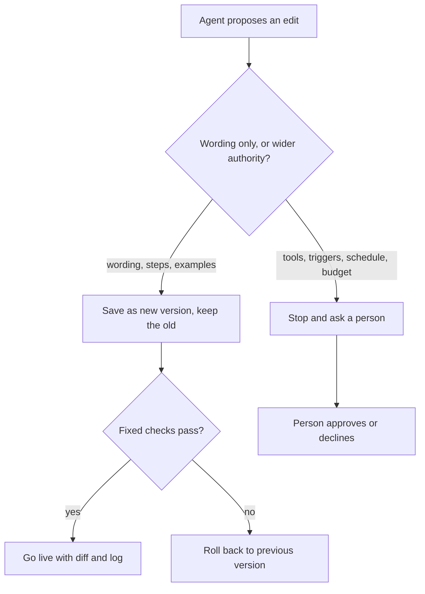

When a scheduled agent fails, the obvious next step is to hand it the log and
let it fix its own instructions.

I think that idea bundles two different changes under the word "improvement".
One edits what the automation is told: wording, order of steps, examples. The
other edits what it is allowed to do: its tools, triggers, schedule and budget.

My position is that the first can be applied automatically, inside a fixed
envelope, with a diff, a log and a way back. The second changes what the system
may do, so a person should decide it. **The safety boundary is the envelope, not
how clever the proposed edit is.**

## Two kinds of change

An instruction edit changes how the automation uses authority it already has.
"Put the date range in the first line" is one. A widening changes the authority
itself: a new tool, a new event that starts a run, hourly instead of daily, a
higher cap on spend or retries.

The distinction is old. Saltzer and Schroeder's
[1975 tutorial on protecting information](https://web.mit.edu/Saltzer/www/publications/protection/)
lists least privilege among its design principles: "Every program and every user
of the system should operate using the least set of privileges necessary to
complete the job." They say it limits the damage from an accident or error. The
same paper separates controls that an object's creator can change from ones that
are "out of the hands" of the people they limit. An agent that can widen its own
tools holds the first kind over itself. The paper concerns shared computer
systems, not language models: a principle I'm borrowing, not a result about
agents.

The practical consequence is that **the envelope has to be enforced outside the
text the agent edits.** If the permitted tools sit in the same prompt the agent
rewrites, an "instruction edit" can be a widening in disguise. Keep a manifest
of tools, triggers, schedule, budget and targets apart from the instructions,
and let the runtime enforce it. Classify a proposal by diffing the manifest, not
by asking the agent what kind of edit it made. An
[agent harness](/writing/build-your-agent-harness/) takes the same stance toward
model output: untrusted until checked.

Prose can still widen reach inside the same tools: "also tidy the other
folders" uses an existing tool on new targets. So the manifest needs scopes and
rate limits, not just a tool list. Anything that touches the manifest waits for
a person. A wording edit goes live as a new version with a diff, and the
previous version returns if the fixed checks fail.

## Four options

| Option | What it costs | When it wins |
| --- | --- | --- |
| 1. Humans maintain the prompt | Every fix waits for a person; instructions go stale | Rare runs, high stakes, or an automation too new to know its failures |
| 2. Agent proposes, a person reviews every diff | Reviewer time grows with failures; small diffs get skimmed | Moderate failure volume, or while you learn what proposals look like |
| 3. Agent applies edits inside a fixed envelope, with rollback | Building the envelope: separate manifest, versioned instructions, checks the agent can't edit | Frequent, low-stakes failures where a bad edit is cheap to undo |
| 4. Unconstrained self-modification | Nothing fixed says what the system may do, so no run has a reference | Only where the whole system is disposable. I have no production case |

Option 3 isn't option 2 with the person removed. A person still sets the
envelope, reads the log, and decides every widening, so review moves from every
sentence to every change in authority plus the cumulative drift. Whether that is
cheaper depends on how many proposals widen authority, which the test below
measures.

Four questions decide where an automation sits. What is the worst a bad edit
could make one run do? Is there a check outside the agent that it cannot edit?
Can the effects of a bad run be undone, or only the instructions? And how many
diffs a week can a person read?

## Why "it improved" is hard to prove

The envelope limits damage. It doesn't show an edit helped.

**There is no stable metric.** An edit written after a failure is tested on
that failure, which it was written to fix. The real question is whether it hurts
runs that currently succeed, and the failure log can't answer that. You need
checks fixed before the edit, including runs that already pass. Even then they
gate regressions; they don't prove improvement.

**The author is also the judge.** Huang et al.,
[*Large Language Models Cannot Self-Correct Reasoning Yet*](https://arxiv.org/abs/2310.01798)
(ICLR 2024), study "intrinsic self-correction", where a model revises its own
answer without external feedback. They report that models struggle to do it for
reasoning and sometimes get worse. Their subject is answers to reasoning
questions, not rewritten standing instructions, and not agents that get real
feedback such as test results. I take a design rule from it: the proposing agent
shouldn't be the only judge of its own edit.

**Feedback loops feed on the visible signal.** DeepMind's
[specification gaming](https://deepmind.google/blog/specification-gaming-the-flip-side-of-ai-ingenuity/)
post defines it as behavior that satisfies the literal specification without
achieving the intended outcome. It also notes that an agent acting in the real
world may be able to manipulate the stored representation of its objective. Its
examples come from reinforcement learning, not prompt editing, so I read it as a
design caution. If the signal is "the run finished without errors", the
cheapest edit that raises it is "skip the step that errors". Keep the checks, the success criteria and the log
outside what the agent can edit, and check outcomes (the summary has the right
date range), not completion.

**Drift is silent.** Each edit is small and passes its checks. After enough of
them the instructions say something nobody chose. This is my reasoning, not a
sourced finding. A diff against the previous version is readable; the
cumulative change is not. Compare against the last human-approved version on a
schedule, and cap how much may change between approvals.

**Rollback needs versions.** Store each instruction set as an immutable numbered
version, make every run record the version it used, and make rollback mean
"point back to version N", not "edit it back". Without that you can't say which
edit caused which failure. Rollback restores the instructions, not the world: an
email sent under a bad version stays sent, so bound what a single run can do.

## Replaying past failures

I haven't run this. It needs a real automation and its log of failed runs.

1. **Freeze the baseline.** Keep the current instructions as version zero. Write
   fixed checks before any proposal exists, covering each kind of failure and
   some runs that already pass. Hold out part of the log.
2. **Collect proposals.** For each failed run in the rest of the log, give the
   agent the run record and ask for an instruction edit. Don't show it the
   checks.
3. **Classify every proposal** as narrowing, keeping or widening authority, by
   diffing the manifest and reading the prose for implied reach. Have two
   people classify independently and record where they disagree.
4. **Replay.** Run the failures and the held-out runs with version zero, with
   each accepted edit alone, and with all of them applied in sequence. Record
   failures fixed, regressions, and changes the checks don't score, such as steps
   skipped or tool calls made.

Evidence for the claim: some proposals widen authority, wording-only edits fix
failures without regressing the held-out runs, and the cumulative run passes the
checks while behaving differently from version zero.

Evidence against it, any of these:

- Almost no proposals widen authority. Then the review gate costs more than it
  protects.
- Reviewers can't agree on what counts as a widening. Then the boundary isn't
  something a team can operate.
- Wording-only edits regress held-out runs about as often as they fix failures.
  Then auto-apply isn't safe even inside the envelope, and option 2 is the floor.
- Accepted edits don't beat version zero on the checks. Then option 1 is enough.

One rare widening that would have caused a real side effect can justify the
gate, so severity matters as well as the count. The main limitation is that past
failures are a biased sample: they are the failures the current instructions let
through. The checks are also a proxy I wrote, which brings back the
visible-signal problem. One automation won't generalize, and replaying runs with
side effects needs a sandbox or recorded tool output, which can't reproduce the
real world.

## What the envelope doesn't settle

Whether authority written in prose can be classified reliably enough to automate
that step. How much cumulative change is safe between approvals. And whether the
external feedback an automation has, such as test results or tool errors,
changes the self-correction picture for instruction edits the way it might for
answers.
