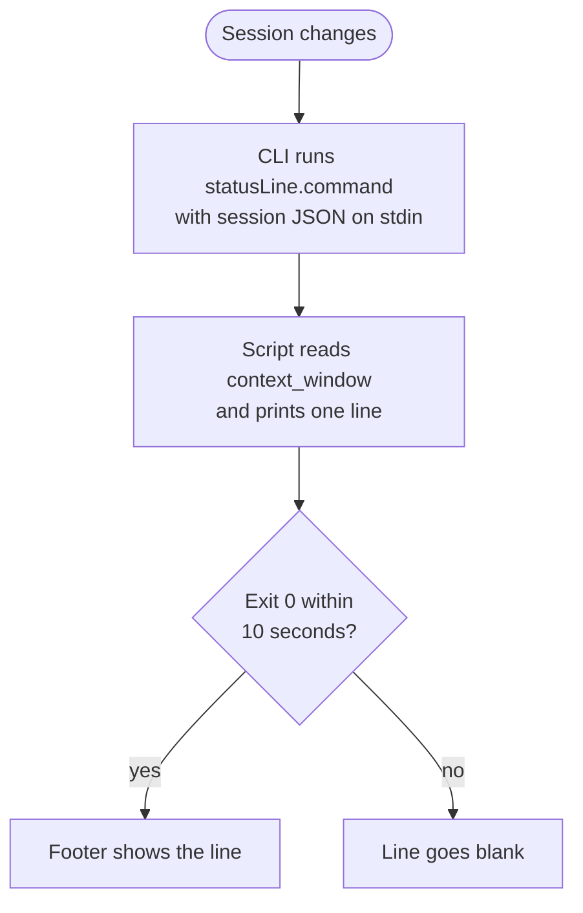

A long session in the GitHub Copilot CLI fills its context window quietly.
Every file it reads, every tool result and every reply takes space, and when
the window is nearly full the CLI compacts or drops older history. `/context`
shows the breakdown, but only when I remember to ask. I wanted the level in
view the whole time, the way a boiler has a sight glass so nobody has to open
the drum to check the water.

My first attempt was [copilotstatusline](https://github.com/ragmha/copilotstatusline),
a full status line tool: an interactive configurator, 15 widgets and about
2,500 lines of code. Then I looked properly at the CLI's own footer. It could
already show the context window, and version 1.0.51 lists a customizable status
line with the model, git branch and more. What was left for me to add fits in
22 lines.

This tutorial covers that remainder: a gauge that turns amber at 60% and red at
80%, with the token counts beside it.

## Start with the built-in footer

Before writing any code, check whether the footer already does enough. Run
`/statusline` (alias `/footer`) in a session and turn on `context-used`. It
shows the percentage of the window used and is off by default.

| Option | What you see | When it wins |
| --- | --- | --- |
| `/context` | A full breakdown of what is using the window | You want to know what to trim |
| Built-in footer item | The percentage, always on screen | Most sessions |
| The script below | A colored bar plus used and total tokens | You want a warning before compaction |
| A full status line tool | Many widgets and themes | You want lots of widgets and will maintain the tool |

The script earns its place only if a color change gets your attention faster
than a number does. For me it did, which is why the rest of this post exists.

## How the status line hook works

The footer has one extension point: a `statusLine` command in
`~/.copilot/settings.json`. When the session changes, the CLI runs that command,
writes a JSON snapshot of the session to its standard input, and shows whatever
it prints below the input box.



The
[configuration reference](https://docs.github.com/en/copilot/reference/copilot-cli-reference/cli-config-dir-reference)
documents the contract. Three details shape the script:

- **A failure is quiet.** A non-zero exit, a crash or a run longer than 10
  seconds leaves the line blank rather than showing an error.
- **Colors pass through.** ANSI escape codes in the output render in the footer.
- **The command runs often.** It fires at session start, when the model loads
  and around each reply, so it has to be fast. This one takes about 30 ms.

## Build the gauge

You need bash, [jq](https://jqlang.org/), and CLI 1.0.51 or later. On Windows,
run the script from Git Bash or WSL, or see Bart Wullems'
[PowerShell setup](https://bartwullems.blogspot.com/2026/05/always-know-where-you-stand-setting-up.html).

1. Download the script from its gist and make it executable:

   ```sh
   curl -fsSL https://gist.githubusercontent.com/ragmha/d84819c7411e5c9f5a13158733981382/raw/statusline.sh -o ~/.copilot/statusline.sh
   chmod +x ~/.copilot/statusline.sh
   ```

   Or copy it from here into `~/.copilot/statusline.sh`:

   ```bash
   #!/usr/bin/env bash
   # Context gauge for the GitHub Copilot CLI status line. Needs jq.
   # Save as ~/.copilot/statusline.sh, run chmod +x on it, then add to
   # ~/.copilot/settings.json:
   #   "statusLine": { "type": "command", "command": "~/.copilot/statusline.sh" }
   IFS=$'\t' read -r pct used limit < <(jq -r '[
     (.context_window.current_context_used_percentage // 0 | floor),
     (.context_window.current_context_tokens // 0),
     (.context_window.displayed_context_limit // 0)
   ] | @tsv')

   if   (( pct >= 80 )); then color='\033[31m'
   elif (( pct >= 60 )); then color='\033[33m'
   else                       color='\033[32m'
   fi

   bar=''
   for ((i = 0; i < 10; i++)); do
     if (( i < pct / 10 )); then bar+='█'; else bar+='░'; fi
   done

   printf '%b%s %d%%\033[0m %dk/%dk\n' "$color" "$bar" "$pct" $((used / 1000)) $((limit / 1000))
   ```

2. Add the command to `~/.copilot/settings.json`, keeping any settings already
   there:

   ```json
   {
     "statusLine": { "type": "command", "command": "~/.copilot/statusline.sh" }
   }
   ```

3. Quit the CLI and start a new session. After the first reply, the footer
   shows a line like this, in yellow once usage passes 60%:

   ```text
   ██████░░░░ 64% 174k/272k
   ```

If the line stays empty, run `/statusline` and check that the custom item is
on. Then test the script by hand; it should print a green, empty gauge:

```sh
echo '{}' | ~/.copilot/statusline.sh
```

The `// 0` fallbacks are there for that case. At the start of a session the
context fields aren't set yet, and without a default jq stops with an error
instead of passing on a number.

## Which percentage to read

The JSON has more than one measure of context. The `current_*` fields arrived in
1.0.35, which the changelog describes as status line fields that match the model
badge and `/context`. The gauge reads those, so its number agrees with what
`/context` reports when you open it for detail. The limit varies by model, so
the script prints it rather than assuming one.

The thresholds are a choice, not a rule. Compaction starts as the window nears
its limit, and 80% leaves room to finish a task, start a fresh session or trim what you
loaded. Move them if your sessions run differently.

## The post and the gist do different jobs

- **This post** explains the hook and keeps a snapshot of the script to read
  and copy.
- **[The gist](https://gist.github.com/ragmha/d84819c7411e5c9f5a13158733981382)**
  holds the current script. Fixes land there, and its revisions record
  what changed. The `curl` command above always fetches the latest version.
- **The changelog below** records what changed in this post after it was
  published, including CLI changes that affect it.

A single 22-line script with no build step doesn't need a repository, issues
or releases. A gist is enough, and it is the version to trust if this snapshot
and the gist ever differ.

Two posts helped me get here: Tugdual Grall's
[walkthrough of the statusLine payload](https://tgrall.github.io/blog/2026/05/02/copilot-cli-customize-statusline/)
and Bart Wullems' guide linked above. The behavior described here comes from
the [CLI changelog](https://github.com/github/copilot-cli/blob/main/changelog.md),
the configuration reference, and running the script in the CLI.

## Changelog

### Nov 8, 2026

Checked against CLI 1.0.108, and against 1.0.52, the release current when this
post went up. The three context fields exist in both, and the script runs
unchanged.

- Moved the script into
  [a public gist](https://gist.github.com/ragmha/d84819c7411e5c9f5a13158733981382),
  so fixes to it get their own revisions.
- CLI changes since May that touch the status line:
  - A failing command now logs a warning once; run with `--log-level all` to
    see why it failed.
  - 1.0.55 lets `/statusline` run while the agent is working.
  - 1.0.62 adds the allow-all state to the JSON the command receives.
  - 1.0.65 lets you save the custom command from `/settings`.
  - The configuration reference now documents `refreshInterval`, which reruns
    the command on a timer. The gauge doesn't need it: context only changes on
    session events.
- Two things seen in a live session. The first run arrives before the context
  fields are set, so the gauge reads 0% for about a second. And after one
  reply, `used_percentage` read 10 while `current_context_used_percentage`
  read 8, which is why the gauge reads the `current_*` fields.
