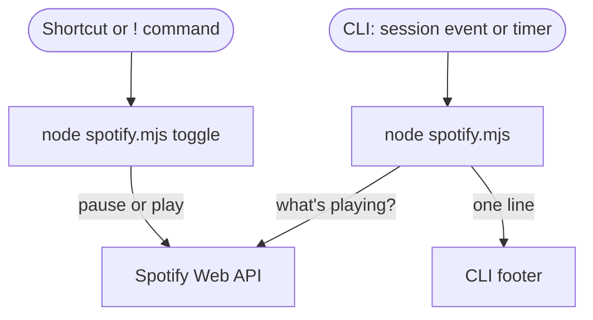

The footer already tells me about the coding session. I want it to tell me
what's playing—and let me pause Spotify without leaving the terminal. But the
hook only prints a status line; it doesn't receive clicks or key presses, so
status and control need separate paths.

This post builds both paths for the GitHub Copilot CLI with one Node.js script,
the same file on macOS and Windows. The footer shows the track, and a key
pauses or resumes it.

The script has been checked with mocked Spotify responses. Live Spotify
playback and execution on Windows are not yet verified.

## Give the footer something new to say

Run `/statusline` (alias `/footer`) and you can turn on built-in items for the
directory, branch, model and context window. Those are facts about the session.
The custom item is different: the CLI runs a command you choose and shows what
it prints. I first used it for a
[context gauge](https://gist.github.com/ragmha/d84819c7411e5c9f5a13158733981382),
then noticed the built-in item already shows that percentage.

The custom item earns its place with something the session can't know on its
own: the next meeting, whether a deploy finished, or the track that's playing.

## How the command runs

The command lives under `statusLine` in `~/.copilot/settings.json`. The CLI
writes a JSON snapshot of the session to the command's standard input and shows
its standard output below the prompt. Three rules from the
[configuration reference](https://docs.github.com/en/copilot/reference/copilot-cli-reference/cli-config-dir-reference)
shape the script:

- **It runs on session events, and on a timer if you ask.** A new song isn't a
  session event, so a music line needs `refreshInterval`, which reruns the
  command every few seconds. It arrived in
  [version 1.0.76](https://github.com/github/copilot-cli/blob/main/changelog.md#1076---2026-07-29).
- **A failure blanks the line.** If the command exits non-zero, crashes or runs
  past 10 seconds, the footer stays empty and the CLI logs a warning once. Run
  the CLI with `--log-level all` to see why.
- **Nothing comes back from the footer.** The command receives session JSON,
  never a click or a key press. With mouse support on, the CLI uses clicks for
  its own interface.

That last rule is why the pause key needs its own path:



## Show the track

The script talks to the
[Spotify Web API](https://developer.spotify.com/documentation/web-api), not to
the Spotify app, which is what lets the same file run on macOS and Windows. You
need:

- **Spotify Premium.** Since February 2026, an app in Spotify's
  [Development Mode](https://developer.spotify.com/documentation/web-api/concepts/quota-modes)
  works only while its owner has Premium, and the
  [pause](https://developer.spotify.com/documentation/web-api/reference/pause-a-users-playback)
  and play endpoints are Premium-only.
- **Node.js 22 or later.** The script uses only built-in modules.
- **CLI 1.0.76 or later**, for `refreshInterval`.

1. Create an app in the
   [Spotify Developer Dashboard](https://developer.spotify.com/dashboard). Add
   `http://127.0.0.1:8765/callback` as its redirect URI, select the Web API,
   and copy the Client ID. You don't need the client secret: the script signs
   in with
   [PKCE](https://developer.spotify.com/documentation/web-api/tutorials/code-pkce-flow),
   the flow for apps that can't keep one.

2. Save this as `.copilot/spotify.mjs` in your home folder:

   ```js
   // Shows the current Spotify track in a CLI status line, and pauses or
   // resumes it. Needs Node.js 22 or later and your Spotify app's Client ID.
   //   node spotify.mjs login <client-id>   sign in once; saves spotify.json
   //   node spotify.mjs                     print what's playing
   //   node spotify.mjs toggle              pause or resume
   import { createHash, randomBytes } from 'node:crypto'
   import { readFileSync, renameSync, writeFileSync } from 'node:fs'
   import { createServer } from 'node:http'

   const file = new URL('spotify.json', import.meta.url)
   const redirect_uri = 'http://127.0.0.1:8765/callback'
   let auth = {}

   async function token(params) {
     const res = await fetch('https://accounts.spotify.com/api/token', {
       method: 'POST',
       body: new URLSearchParams({ client_id: auth.client_id, ...params }),
     })
     if (!res.ok) {
       const reason = `${res.status} ${await res.text()}`
       throw new Error(`Spotify sign-in failed (${reason}). Run login again.`)
     }
     const { access_token, refresh_token, expires_in } = await res.json()
     auth = {
       ...auth,
       access_token,
       refresh_token: refresh_token ?? auth.refresh_token,
       expires_at: Date.now() + expires_in * 1000,
     }
     // Write a new file, then rename it over the old one, so two sessions
     // refreshing at once can't leave a half-written file.
     const temp = new URL(`spotify.json.${process.pid}`, import.meta.url)
     writeFileSync(temp, JSON.stringify(auth), { mode: 0o600 })
     renameSync(temp, file)
   }

   async function player(method, path) {
     if (Date.now() > auth.expires_at - 60_000) {
       await token({
         grant_type: 'refresh_token',
         refresh_token: auth.refresh_token,
       })
     }
     const res = await fetch(`https://api.spotify.com/v1/me/player${path}`, {
       method,
       headers: { Authorization: `Bearer ${auth.access_token}` },
     })
     const body = await res.text()
     if (!res.ok) throw new Error(`Spotify ${res.status}: ${body}`)
     return body ? JSON.parse(body) : null
   }

   async function login(client_id) {
     if (!client_id) {
       throw new Error('Usage: node spotify.mjs login <client-id>')
     }
     auth = { client_id }
     const verifier = randomBytes(64).toString('base64url')
     const state = randomBytes(16).toString('hex')
     const challenge = createHash('sha256')
       .update(verifier)
       .digest('base64url')
     const query = new URLSearchParams({
       client_id, redirect_uri, state, response_type: 'code',
       scope: 'user-read-currently-playing user-modify-playback-state',
       code_challenge_method: 'S256',
       code_challenge: challenge,
     })
     const code = await new Promise((resolve, reject) => {
       const server = createServer((req, res) => {
         const params = new URL(req.url, redirect_uri).searchParams
         res.writeHead(200, { Connection: 'close' })
         res.end('You can close this tab and go back to the terminal.')
         server.close()
         const got = params.get('code')
         if (got && params.get('state') === state) resolve(got)
         else reject(new Error('Sign-in failed. Run login again.'))
       })
       server.on('error', reject).listen(8765, '127.0.0.1', () => {
         const url = `https://accounts.spotify.com/authorize?${query}`
         console.log(`Open this URL to sign in:\n${url}`)
       })
     })
     await token({
       grant_type: 'authorization_code',
       code,
       redirect_uri,
       code_verifier: verifier,
     })
     console.log('Signed in.')
   }

   try {
     const [command, arg] = process.argv.slice(2)
     if (command === 'login') {
       await login(arg)
     } else {
       auth = JSON.parse(readFileSync(file, 'utf8'))
       const now = await player('GET', '/currently-playing')
       if (command === 'toggle') {
         await player('PUT', now?.is_playing ? '/pause' : '/play')
         console.log(now?.is_playing ? 'Paused' : 'Playing')
       } else if (now?.item) {
         const artists = now.item.artists.map((a) => a.name).join(', ')
         const icon = now.is_playing ? '▶' : '⏸'
         console.log(`${icon} ${now.item.name} · ${artists}`)
       }
     }
   } catch (error) {
     console.error(error.message)
     process.exitCode = 1
   }
   ```

3. Sign in once, from a macOS terminal or PowerShell:

   ```sh
   node "$HOME/.copilot/spotify.mjs" login YOUR_CLIENT_ID
   ```

   Open the link it prints and approve. The script saves `spotify.json` next to
   itself. Keep that file private and out of version control: its tokens grant
   access to what's playing and control of playback. The refresh token
   [expires after six months](https://developer.spotify.com/documentation/web-api/tutorials/refreshing-tokens).
   When it expires, the line goes blank; run `login` again.

4. Add the command to `~/.copilot/settings.json`, keeping any settings already
   there. On Windows, write `$USERPROFILE` instead of `$HOME`; the CLI fills in
   `$` variables from your environment before it runs the command.

   ```json
   {
     "statusLine": {
       "type": "command",
       "command": "node \"$HOME/.copilot/spotify.mjs\"",
       "refreshInterval": 10
     }
   }
   ```

5. Start a new session. The footer shows the track, with ⏸ instead of ▶ while
   it's paused, and nothing when nothing is playing:

   ```text
   ▶ So What · Miles Davis
   ```

Each status refresh makes a playback request, from every session you have
open. Session events add runs between timer ticks, and renewing a token makes
a separate authorization request. Spotify counts an app's API requests over a
[rolling 30 seconds](https://developer.spotify.com/documentation/web-api/concepts/rate-limits),
so pick the longest interval you can live with. If you hit the limit, the line
goes blank until Spotify accepts requests again.

## Pause it with a key

The `toggle` command pauses whatever is playing, or resumes it. It goes through
Spotify's servers, so it can reach whichever device is playing: this computer,
a phone or a speaker.

Inside the CLI, put `!` in front of it. That runs a shell command without the
agent. On Windows, `!` commands run in PowerShell, which also understands
`$HOME`:

```sh
!node "$HOME/.copilot/spotify.mjs" toggle
```

It prints `Paused` or `Playing`. Like any `!` command, the command and its
output join the conversation for the agent's next turn.

Outside the CLI, bind the same command to a key. Use node's full path, which
`command -v node` prints on macOS and `(Get-Command node).Source` prints in
PowerShell:

- **macOS:** In the Shortcuts app, make a shortcut with a **Run Shell Script**
  action, turn on **Allow Running Scripts** in the Advanced settings, then
  [add a keyboard shortcut](https://support.apple.com/guide/shortcuts-mac/apd163eb9f95/mac).
  Shortcuts can also run it from the menu bar, if you'd rather click.
- **Windows:** Create a desktop shortcut whose target is the command, with the
  script's full path. In its properties, set **Run** to **Minimized** and pick
  a **Shortcut key**; Windows adds Ctrl+Alt to the key you press. Double-click
  the shortcut to use the mouse instead.

## What to print next

I don't want a music player in the terminal. I want one glance to tell me
what's playing, and one key to pause it. The split carries over to anything
else: print what you'd otherwise switch windows to check, and give the action
that goes with it a key of its own.
