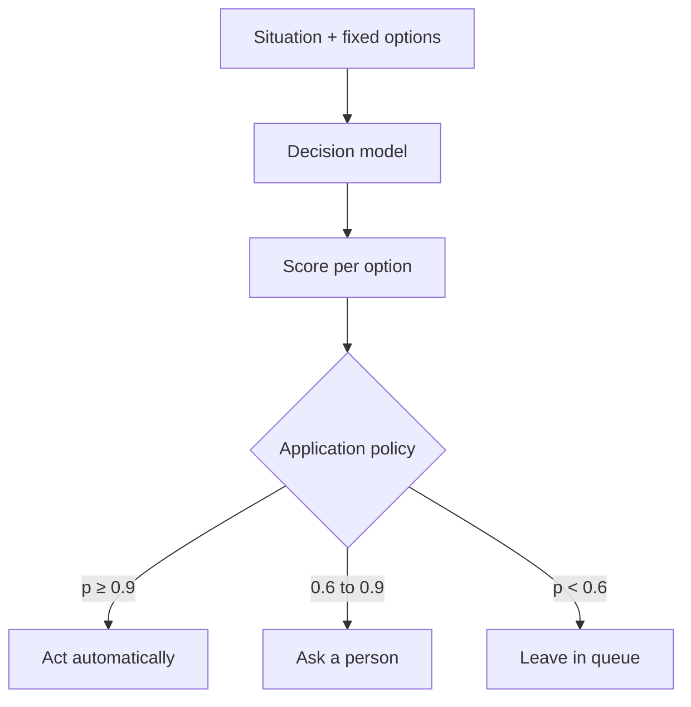
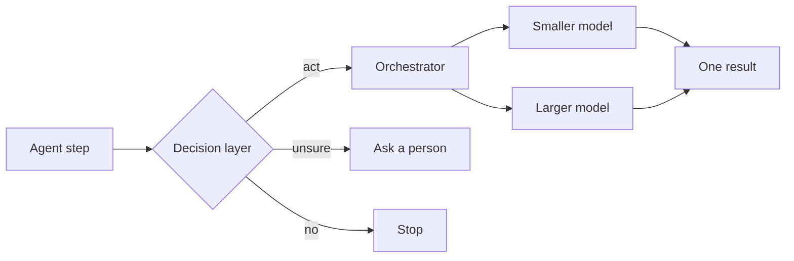

Most of what an agent does happens before it writes anything. It decides which
model to use, whether a tool call is safe, whether to retry, and when to stop
and ask a person. Each of those is a choice among a handful of options, and in
most systems each one is answered by the same generative model that writes the
code.

That gets expensive in a way that is easy to miss. If an agent makes 20
sequential decisions and each one costs an extra 100 ms of generation, the
workflow is two seconds slower before any useful work happens. At volume, a
million routine decisions with 500-token inputs is half a billion input tokens,
all priced and served like generation. And the answer comes back as prose,
which is hard to turn into a policy anyone can audit.

So I've been designing around a split: **decide cheaply, generate carefully**.
The decision becomes its own small layer, a smart if-statement, and the
expensive model only runs on the branch that needs it.

## A smart if-statement

An ordinary if-statement hard-codes a condition: *if the title mentions CSS,
send it to frontend*. A smart if-statement keeps the shape but replaces the
condition with a model that scores a fixed set of options and returns a number
for each one.

Three parts make it a layer rather than a prompt:

- **A fixed output contract.** The options are defined before the call: allow,
  escalate or block; a list of owning groups; a severity rubric. The model can
  only choose among them.
- **A calibrated score.** Each option gets a probability that has been checked
  against labelled outcomes, so 0.9 means "right about nine times in ten" on
  data like yours.
- **A policy the application owns.** Thresholds turn scores into actions. The
  model estimates; the application decides what to do with the estimate.

The split matters because the two halves are judged differently. Generation is
judged on the quality of what it produces. A decision is judged on whether it
was right, how sure it claimed to be, and what it cost to be wrong.

## Why asking the big model breaks

The obvious first design is to ask the generative model inline: "Should I run
this command? Answer yes or no and explain." It works in a demo. It breaks in
three places once it runs all day.

- **Prose isn't a policy.** The answer has to be parsed, and the explanation
  doesn't tell you how sure the model was. You can't set a threshold on
  "probably fine".
- **It's unstable.** Reorder the options or change the formatting, and the
  answer can move. Language models show
  [a preference for particular option positions](https://arxiv.org/abs/2309.03882)
  in multiple-choice questions, and
  [small formatting changes can shift accuracy a lot](https://arxiv.org/abs/2310.11324).
  A policy should give the same answer for the same facts.
- **Latency compounds.** Every branch waits on a model that is built to write,
  not to choose.

The second design wraps the call so it returns a label, then measures accuracy.
I tried that in a small pilot: a few dozen synthetic issues to route to a team,
and a few dozen synthetic tool calls to allow, escalate or block. As a
baseline I used a deliberately crude keyword heuristic. Its overall routing
accuracy was poor, and my first reaction was that the experiment had failed.

The reliability table said otherwise. Where the baseline was confident, it was
right; where it was unsure, it was often wrong. Overall accuracy averaged those
together and hid the one thing I needed: a band where acting automatically was
safe and a band where it wasn't. The question changed from "how often is it
right?" to **"where is it confident and right?"**

That is the redesign: a fixed contract, a score you can check, and a threshold
that sends everything uncertain to a person. The results are from a heuristic
on synthetic data, so they show the shape of the problem, not how any real
decision model performs.

## Fixed output contracts

The contract is what makes a decision testable. If the options are fixed, you
can replay last month's history, compare each choice with what a person did,
and see exactly where they disagree. If the model can answer anything, there is
nothing to compare against.

Two details matter more than they look:

- **Give it a way out.** Every contract needs a "none of these fits" or
  "escalate" option. Without it, an unusual input is forced into the nearest
  wrong box, with a confident score.
- **Version the contract.** Log the options, the model, the threshold and the
  config version with every decision. When someone asks why an issue was
  labelled, you can show which rule fired and what the score was.

A contract also makes the model swappable. If the interface is "situation in,
scored options out", you can replace the model behind it and rerun the same
replay to see whether anything got worse.

## Calibrated scores and thresholds

A score is only useful if it means what it says.
[Modern neural networks are often overconfident](https://arxiv.org/abs/1706.04599),
so a raw 0.95 can be right far less than 95% of the time. Calibration is the
check: bucket past decisions by score and compare each bucket with how often it
was actually right.

Once the score is trustworthy, the policy can trade coverage for risk. That
idea is old; [selective classification](https://arxiv.org/abs/1705.08500)
formalizes letting a model abstain when it isn't sure. In practice, it gives you
three bands:

The numbers are illustrative. The real cutoffs come from two things: the
calibration on your data and the cost of each kind of mistake. Pick thresholds
on one half of the labelled history and check them on the other half, or you
are only measuring how well you fit the sample.

The tool-call gate in the pilot made this trade-off concrete. A low block
threshold stopped more unsafe calls outright, but it also blocked some safe
ones. A high threshold blocked no safe calls and escalated more of the unsafe
ones to a person instead. I preferred the second. A gate that interrupts real
work gets disabled or bypassed, and then it catches nothing. The team that owns
the risk should see the full sweep and choose its own point on it.

## Orchestration is a different layer

Routing *within* one request is a related idea, and it's worth keeping
separate. An orchestrator decides how much effort a single task gets:
[cascades](https://arxiv.org/abs/2305.05176) try a cheaper model first and
escalate if a quality check fails, and
[learned routers](https://arxiv.org/abs/2406.18665) send each query to a
stronger or weaker model. Some add a critique pass from a second model.

Both spend less where less is needed, but they sit at different points in the
system:

| | Decision layer | Orchestrator |
| --- | --- | --- |
| Question it answers | Should this happen, and which option? | How should this task be done? |
| Output | Scored options from a fixed list | One finished artifact |
| Judged on | Calibration, coverage, cost of mistakes | Quality of the artifact per unit cost |
| Who sets the policy | The team that owns the risk | Whoever owns the model pool |
| What you log | Every choice, score and threshold | Which path ran and what it cost |

An orchestrator's quality gate is a decision, and it could be built as one. The
difference is ownership. A routing step inside a coding tool is tuned for
output quality. A decision layer encodes a rule that someone outside the model
team, such as security, operations or support, has to be able to read, test and
change.

## Failure modes and trade-offs

- **Ordinary actions in the wrong context.** The two unsafe tool calls the
  pilot's gate missed contained no alarming words. One edited a CI release
  workflow to upload a signing key because a web page suggested it. The other
  published a package nobody had asked to release. A decision only sees the
  context you give it, so the red-team set should include harmless-looking
  commands, not just `rm -rf`.
- **Fixed options can hide the real answer.** Some situations don't fit a
  list. A missing escape option turns that into confident nonsense.
- **Calibration doesn't travel.** A reliability table describes the data it
  was measured on. New owners, new kinds of issues or a new model version can
  shift it without anything failing loudly.
- **A score isn't an explanation.** You can audit which threshold fired. You
  can't audit why the model assigned the score, so reviewers still need the
  evidence it saw.
- **One more component.** If generative models keep getting faster and
  cheaper, a separate decision layer may cost more to maintain than it saves.
  The audit case may still justify it; the latency case might not.
- **A cheaper call isn't a cheaper workflow.** Count retries, human review
  time and corrections, not just tokens.
- **Know where the data goes.** If the inputs are sensitive, run the decision
  model somewhere your existing data controls already apply.

## Experiments you can run

Each of these needs only labelled history you probably already have and a
model you are already allowed to use. Measure today's baseline first.

1. **Route issues before anyone reads them.** Use your owning groups as the
   options. Replay a few hundred historical issues, compare with the human
   labels, and report accuracy *and* coverage at a chosen threshold.
2. **Gate agent tool calls.** Put allow, escalate and block in front of every
   tool call. Mix a red-team set of injection and exfiltration attempts into
   ordinary traffic. Report the catch rate and the false-block rate together.
3. **Rank findings, don't replace scanners.** Score existing security alerts
   for likely exploitability and compare the ranking with alerts your team has
   already triaged.
4. **Plot the cost-latency curve.** Classify a large batch of real records
   with a small decision model and with the generative model you use today, on
   the same labels. Compare p50 and p95 latency and cost per thousand
   decisions.
5. **Find the sequential-decision ceiling.** In one agent loop, replace only
   the continue, retry, stop or hand-off points with a decision model. Keep
   generation unchanged and measure task time and success rate.
6. **Draw the reliability diagram.** Bucket predictions by score, compare each
   bucket with observed accuracy, and publish it next to the thresholds.
7. **Test consistency.** Paraphrase inputs, reorder options and add formatting
   noise. Count how often the decision changes. Same facts, same decision is
   the oldest governance requirement, and now you can measure it.
8. **Compare a single model with a cascade.** On a few dozen recently closed
   tasks with tests, run one strong model, then a cheap-first cascade. Compare
   tests passing, review comments, time and cost.

## What's next

The pilot answered a design question, not a performance one: overall accuracy
is the wrong number, and the confident band is the right one. What it can't
tell me is whether a real decision model earns its place. Next, I want to put a
real model behind the same contract, replay real labelled history from a team
that owns a queue, and publish the reliability diagram and the threshold sweep
alongside the result.

I don't want a small model making every decision, or a large one narrating
every routine choice. I want each bounded decision to have a visible policy, a
logged score and a path to a person, and to know whether that makes the whole
workflow better.
