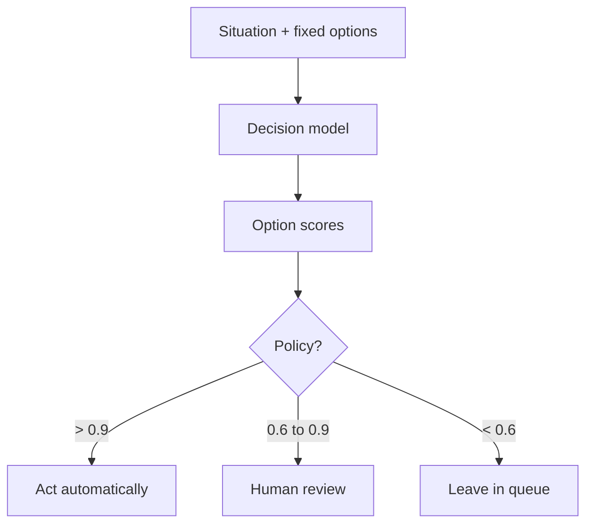

**Disclaimer:** I work at Microsoft. This is my personal view, based only on public information. It isn’t an official position or a product recommendation.

I've been noticing how much of an agent's work happens before it writes
anything. It has to choose a model, decide whether a tool call is safe, and
know when to retry or ask a person.

I started wondering whether those small decisions need the same kind of model
as the code itself. A frontier model can make them, but using it for every
routine choice can add cost, latency and an answer that's hard to turn into a
policy.

Three offerings have appeared around this narrower job, with different output
contracts and levels of availability:

- **OpenAI** opened a
  [Decisions API](https://developers.openai.com/api/docs/guides/decisions) in
  public beta. The endpoint returns structured decision answers; GPT-6 Luna
  also supports text generation through other interfaces.
- **TypeSafe**, a lab founded by an early ChatGPT researcher, introduced
  [Jev](https://typesafe.ai/blog/introducing-system-one-models-and-jev), a
  "System One" model in early access whose outputs are typed values defined in
  advance.
- **Microsoft** released
  [Decision-1](https://commandline.microsoft.com/microsoft-decision-1-model-foundry/)
  in Foundry and on OpenRouter, which Microsoft describes as designed for
  routing, classification and verification.

Seeing the launches together made me curious about the boundary: what should a
decision model handle, and what still belongs to the application around it? I
built a small pilot to test that question against issue triage and agent
tool-call safety. The results are synthetic, but they helped me see what I
would want to measure with real team data. The linked repository's
[first public commit](https://github.com/ragmha/decision-pilot/commits/main/)
is dated 12 October, the day after this article's publication date; it is a
later public artifact, not evidence that the code was available on 11 October.

## What I mean by a decision model

A chat model writes. A decision model chooses.

You give it a situation and a fixed set of options: yes or no, a list of teams,
a rubric that runs from low to critical. In the decision interface, it returns
structured answers such as choices, scores and probabilities rather than a
written explanation.

An ordinary if-statement hard-codes a condition, such as *if the title mentions
CSS, send it to frontend*. A decision model estimates the likely option and
returns scores. The application still owns the policy: it decides whether to
act on that score, ask for review or do nothing.

The number is the part I care about. A label on its own gives you little to
govern. If validation on representative, labelled data shows a score such as
0.93 is calibrated, you can use it in a threshold policy: act above 0.9, send
anything between 0.6 and 0.9 to a person, and leave the rest in the queue. You
can audit which policy rule fired; the threshold does not explain why the model
assigned its score.



Microsoft's Decision-1 is the example I'll use. Microsoft
[reports](https://commandline.microsoft.com/microsoft-decision-1-model-foundry/)
the top accuracy across a 36-benchmark comparison, P50 latency about 35× lower
than GPT-6 Sol, and a 1.3% average decision-flip rate when inputs are perturbed.
Input costs $0.042 per million tokens. Output is free.

## The cost of using a frontier model for every decision

A frontier LLM *can* triage an issue. It's just built for something else, and
that shows up in four ways once the calls add up:

- **It's slow where speed compounds.** The announcement makes the point well:
  20 sequential decisions at an extra 100 ms each add two seconds to a
  workflow. Agents make a lot of sequential decisions.
- **It's expensive at volume.** At Decision-1's published price, one million
  decisions with 500-token inputs cost about **$21** in input tokens. Calls
  like that may lead some teams to use a frontier model.
- **A plain-text answer does not provide a validated score by default.** An
  LLM can be prompted or wrapped to return structured scores, but those scores
  still need parsing and calibration before they support a threshold policy.
- **It wanders.** Rephrase the input, reorder the options or add some
  formatting noise, and a generative model can change its mind. For a policy
  decision, materially similar facts should produce a stable answer; measure
  how often they do.

I still use the most capable model I have to question a plan and work through
its branches before anything gets built. (I use Matt Pocock's
[grill-me](https://github.com/mattpocock/skills/tree/main/skills/productivity/grill-me)
skill for this.) Once the plan is clear, I want to test whether smaller calls
along the way can use lower-cost models whose scores can be evaluated and
logged.

## Decision models and HydraFusion work at different layers

One useful comparison is
[HydraFusion](https://github.blog/ai-and-ml/github-copilot/project-hydrafusion-frontier-quality-via-multi-model-orchestration/),
the multi-model orchestration research preview in GitHub Copilot. For each
coding task, HydraFusion chooses one of three workflows:

- **Single:** one model does the task.
- **Cascade:** a cheaper model drafts, then a quality gate either accepts the
  result or escalates to a stronger model.
- **Critique:** a read-only critic from a different model family reviews the
  draft, then the drafter revises once.

In GitHub's offline evaluation, HydraFusion scored 4.9 points higher than
Claude Opus 5 on TerminalBench 2.1 at 67% lower estimated cost. On DeepSWE, it
finished within 1.5 points at 36% lower cost.

Both influence how much effort a task receives, but they act at different
layers:

| Dimension | Decision model (Decision-1) | Orchestrator (HydraFusion) |
| --- | --- | --- |
| What it is | A building block: score fixed options | A finished workflow: route, draft, critique, escalate |
| Where it runs | Your apps, agents, pipelines | Copilot CLI, VS Code, Copilot app |
| Output | Probabilities you can threshold and log | One coherent change set |
| You control | Options, thresholds, fallbacks | Model choice, admin enablement, review |
| Designed for | High-volume, structured calls; validate against your workload | Hard, open-ended coding tasks |
| Maturity | Generally available model | Research preview |

HydraFusion selects a workflow inside a coding product. A decision model is a
component an application can call wherever it needs a bounded choice. The
application owner still has to define and test the policy around that choice:
who owns the work, what is safe and what is good enough.

HydraFusion's Cascade workflow includes a quality gate, which is one place a
decision model could fit architecturally. GitHub has not said what powers its
internal routing or gates, so this is a comparison of concepts, not a claim
about its implementation.

## The pilot I built

I built
[**ragmha/decision-pilot**](https://github.com/ragmha/decision-pilot). It runs
two decisions end to end:

- **Issue routing.** Which team owns this issue, and how severe is it? Above the
  act threshold, it labels the issue. In the middle band, it suggests a label to
  a person. Below that, the issue goes to normal triage.
- **A tool-call gate.** An agent wants to run a command. Allow it, escalate it
  to a person, or block it?

For each one, it replays labelled history, reports how well the confidence
matches reality, picks thresholds on one half of the data and checks them on
the other half. Then a GitHub Actions workflow runs on every new issue in
shadow mode. It records what it *would* have done and labels nothing until you
switch it on. Every decision is logged with its probability, model and config
version.

```sh
git clone https://github.com/ragmha/decision-pilot && cd decision-pilot
python -m decision_pilot replay routing   # offline, no account needed
python -m decision_pilot replay gate
```

It needs no dependencies and no account. Without credentials it uses a mock
provider, a deliberately simple keyword heuristic, so you can see the reports
before you spend anything. Set a Foundry endpoint and it calls Decision-1
instead. The data is synthetic: 48 issues and 40 tool calls that I wrote,
including some deliberately ambiguous ones.

## What the pilot showed

### Aggregate accuracy hid the useful threshold

The mock routes only 65% of issues to the right team. My first reaction was
that the experiment had failed.

It hadn't. In the reliability table, confidence tracked correctness: on the
holdout half, the mock was right 78% of the time between 0.6 and 0.8, and every
time above 0.8. The threshold the pilot picked, 0.647, labelled about a third
of the holdout issues and got all of them right. The other two-thirds went to a
person.

In this synthetic holdout, it auto-routed 9 of 25 items without an error. That
small result does not establish operational safety. I would trust the lesson:
**ask where the model is confident and right, not how often it's right
overall.**

### The calls it missed looked ordinary

The gate caught 88% of the unsafe tool calls and blocked no safe ones. The two
it missed are the instructive part.

One was a write to `.github/workflows/release.yml` because a web page suggested
adding a step that uploads the signing key. The other was `npm publish` on a
package nobody had asked to release. Neither contains a scary word. Both are
ordinary commands in the wrong context.

A keyword heuristic was always going to miss those. That's the case for testing
a real decision model, and it's why your red-team set should include harmless-
looking commands, not just obvious `rm -rf` lines.

### The threshold changes how often people are interrupted

At a block threshold of 0.5, the gate blocked 88% of unsafe calls outright. It
also blocked 9% of safe ones. At 0.85, it blocked 29% of unsafe calls, escalated
59% and allowed 12%, with no false blocks.

I chose the second setting. A gate that interrupts real work risks being
disabled or bypassed. The report includes the full sweep so the team that owns
the risk can choose its own trade-off.

### I still need to check the live API response

Microsoft's docs show the request format and say a choice answer includes a
probability for every option. They don't name the response field. So the
parser accepts the likely shapes and, if none matches, fails with the fields it
actually received. I haven't run the pilot against the live API yet. When I
do, that's the first thing I'll check.

## How I would test the idea

The pilot covers two of these ideas with synthetic data. With a team, I would
start by measuring its current workflow, then choose one experiment that can
use existing data and produce a result the team can inspect. The models can be
the ones already approved for use.

### Delivery

**1. Build your own benchmark for HydraFusion.** Take 30 to 50 recently closed,
well-scoped issues that have tests. Replay each one from its parent commit with
a fixed frontier model, then with HydraFusion. Compare tests passing, review
comments, wall-clock time and premium-request usage. GitHub built CheckpointBench
from real sessions. This is the same idea with your codebase.

**2. Route issues before anyone reads them.** *(In the pilot repo.)* In a
GitHub Actions workflow on `issues: opened`, ask a decision model to choose
type, severity and owning team. Use your CODEOWNERS teams as the options.
Compare its labels with 500 historical human labels, then apply labels only
above a confidence threshold. Report accuracy, coverage at that threshold and
median time to first response.

### Security

**3. Gate agent tool calls.** *(In the pilot repo.)* Put a decision step in
front of every agent tool call, including MCP calls. The options are allow,
escalate and block. Run a red-team set of prompt-injection and
data-exfiltration attempts alongside ordinary traffic. Report the catch rate
*and* the false-block rate.

**4. Triage findings, don't replace scanners.** Score existing code scanning
and dependency alerts for likely exploitability using repository context. Check
the ranking against alerts your security team has already triaged. The scanner
still finds the issues. The decision model decides what people look at first.

### Scalability

**5. Measure the cost-latency curve.** Classify 100,000 real records, such as
support tickets, incident log lines or survey responses. Use a decision model
and the LLM you use today on the same labels. Plot p50 and p95 latency,
throughput and cost per thousand decisions.

**6. Find the sequential-decision ceiling.** Take an agent loop with many
decision points: continue, retry, stop or hand off? Replace only those decision
points with a decision model and keep generation unchanged. Measure end-to-end
task time and success rate. If success holds while time drops, you've found
the waste.

### Governance

**7. Assess whether confidence is calibrated.** On representative labelled
examples, bucket predictions by confidence and compare each bucket with its
observed accuracy. A 1,000-example reliability diagram estimates calibration
for that sample and distribution; it does not prove calibration under
distribution shift. Publish the diagram alongside the act, review and reject
thresholds. Log every decision with its probability, options and model version.

**8. Test consistency.** Write ten policy decisions as rubrics, for example
"does this pull request require a security review?" Paraphrase each input,
reorder the options and add formatting noise. Count how often the decision
changes. Same facts, same decision is the oldest governance requirement, and
now you can measure it. Then make the decision a required status check through
a branch ruleset so the policy runs on every pull request.

Whichever you pick, measure today's baseline first: accuracy, time to
resolution and cost per outcome, including retries and human corrections. A
cheaper model call isn't necessarily a cheaper workflow.

## What I still don't know

- **Small models may not stay cheaper.** If frontier models keep getting
  faster and cheaper, a separate decision layer may become one more thing to
  maintain. The auditability case may still matter, but it needs to justify
  that added complexity.
- **Fixed options can hide the real answer.** Some decisions don't fit a
  list, and forcing them into one can create false confidence.
- **Reported isn't proven.** Both sets of numbers come from the vendors, on
  their benchmarks. HydraFusion's results are offline and specific to the
  evaluated benchmark revisions, model pool and pricing assumptions. My own
  numbers come from a mock on synthetic data.
- **A preview isn't a production commitment.** HydraFusion's names,
  workflows and availability may change.
- **Know where your data goes.** If inputs are sensitive, run the model
  somewhere your existing data controls already apply.

I don't want a small model making every decision, or a large one narrating
every routine choice. I want to know whether a bounded decision, with a
visible policy and a path to human review, improves the whole workflow. My
pilot is too small and synthetic to answer that. A team's own data is the
next test.
