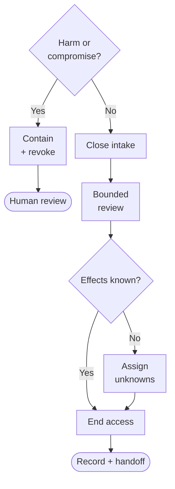

Deleting an agent's prompt removes its instructions. It doesn't tell you what
happened to the last request it sent.

Consider a fictional Friday supplies agent. It reads a stock sheet, opens
restocking tickets, and emails an office coordinator a summary. The team decides
a weekly manual review would be simpler. Someone disables the schedule.
Meanwhile, a ticket request has timed out, a summary waits in a queue, and
another workflow still expects the agent's output.

What, exactly, has been retired?

I'd treat retirement as a set of closure decisions: what may still run, what
already happened, what can still authenticate, and what must survive without
the agent. Removing the prompt answers none of those.

## Planned retirement is not emergency containment

For this small workflow, I'd agree on a cutoff, a short review deadline, and a
person responsible for closing it down. Planned retirement can allow a known,
safe action to finish within that window. Canceling everything immediately is
also an option, but it can leave partial work to reconcile.

Active harmful behavior or suspected compromise changes the order, whenever
it is discovered. Contain execution and revoke implicated access promptly.
Do not drain dangerous work for the sake of a tidy shutdown. A separately
authorized human should reconcile remote effects after containment, without
reactivating the suspect agent.

An unknown outcome is not permission to keep the agent alive indefinitely.
Assigning it to a person lets authority be removed while reconciliation remains
open.

## Close every way work can arrive

Start with the schedule, but look for webhooks, manual buttons, queue consumers,
and other workflows that can invoke the same task. Disable automatic retries
and prevent a deployment or restart from restoring the old trigger. Record the
cutoff and verify that new work is no longer being accepted.

The [schedule suspension documentation](https://kubernetes.io/docs/concepts/workloads/controllers/cron-jobs/#schedule-suspension)
explicitly says suspending a recurring schedule does not affect jobs it has
already started. That describes one scheduler, not every automation system.
It is a good reason to inspect your scheduler's behavior rather than equate
"disabled" with "nothing running."

For the supplies agent, take an inventory of queued items, active runs, and
requests already sent elsewhere. Include any tasks it delegated. Freeze queued
work so it cannot quietly become new work during the review. The waiting email
needs a decision even if the schedule will never fire again.

## The last request may have happened

Give each outstanding item a disposition:

- **Not started:** cancel it or explicitly transfer it to the replacement.
- **Running locally:** allow only known, safe work to finish within the agreed
  deadline, or stop it and record any partial result.
- **Sent elsewhere:** check the destination for completion or supported
  cancellation. Stopping the local process does not establish either.
- **Outcome unknown:** hold further attempts, assign a human, and record what
  evidence is missing.

Suppose the ticket service accepted the supplies request but its response never
reached the agent. Sending the request again could create a second ticket.
"Timed out" describes what the caller observed, not whether the ticket exists.

The human should use the original request identifier and destination records
to investigate. A missing search result is not proof: the request might still
be processing. Retry only after establishing that the original action did not
and cannot still take effect, or that the destination's duplicate-prevention
mechanism applies to this exact request. Otherwise, leave it marked **unknown**,
with an owner and a review date.

At the deadline, stop remaining local execution and transfer unresolved remote
work. Do not extend the agent's access just because an external service is slow
to answer.

## Remove the ability to come back

Credentials have their own shutdown problem. A refresh token can obtain new
access tokens; an access token is what a destination accepts as authority.
Stopping renewal and stopping use are related, but different.

[The token revocation standard](https://www.rfc-editor.org/rfc/rfc7009.html#section-2)
requires support for revoking refresh tokens but only recommends support for
revoking access tokens. Its revocation rules also recognize propagation delays
and differing policies for related tokens. Revoking a refresh token is therefore
not proof that every previously issued access token is already unusable.

Inspect the destination's actual enforcement and documented expiry and
revocation behavior. Use authorized administrative checks and audit evidence;
do not make test writes with retired credentials. If access can survive until
expiry, record that interval and the destination-side restriction used to
contain it. Access remains an open item until blocked or expired.

Remove renewal routes too: stored secrets, grants, signing credentials, and
identity permissions that could obtain fresh access. Identify shared credentials
before the planned cutoff. A dependent workflow needs separate access or an
agreed outage, not an accidental failure hidden inside another agent's
retirement.

The standard does not certify that a particular service implements immediate
revocation everywhere.

## Keep the obligation, not the whole transcript

The restocking tickets do not become invalid because their author stops
running. Transfer their ownership. Decide whether the waiting summary is still
useful, and label any retained report with its last refresh date. Update the
workflow that expects Friday's output so silence cannot be mistaken for an
empty supplies list.

The replacement need not be another agent. Have an actual person accept next
Friday's review and the unresolved ticket investigation. Record that acceptance,
not just the name of a team.

For the retirement record, I'd keep action identifiers, timestamps, destination
references, outcome status, the relevant configuration revision, and the closure
decisions. Preserve only the content needed to understand those decisions, not
every prompt and transcript. Do not preserve working credentials as evidence.

For retained records and surviving artifacts, decide the purpose, permitted
readers, deletion or review date, and any required exceptions with the records
owner. Apply access controls. Local deletion says nothing about a recipient's
copy or a destination's backups; record those limits rather than promise
erasure you cannot verify.

Before calling it retired, confirm that intake is closed, local work has
stopped, old access is blocked or expired, and every unresolved effect has an
accepted human owner. Retained material has an explicit purpose and an end date
or review decision.

Only then does deleting the prompt become housekeeping.
