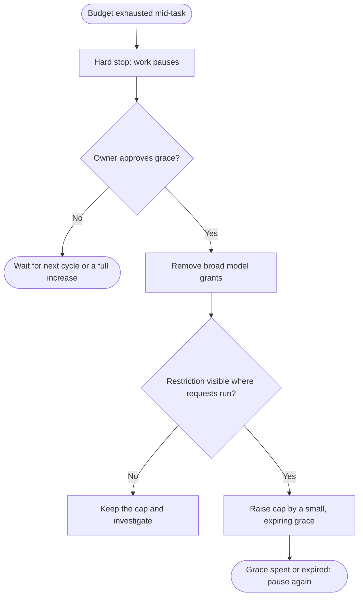
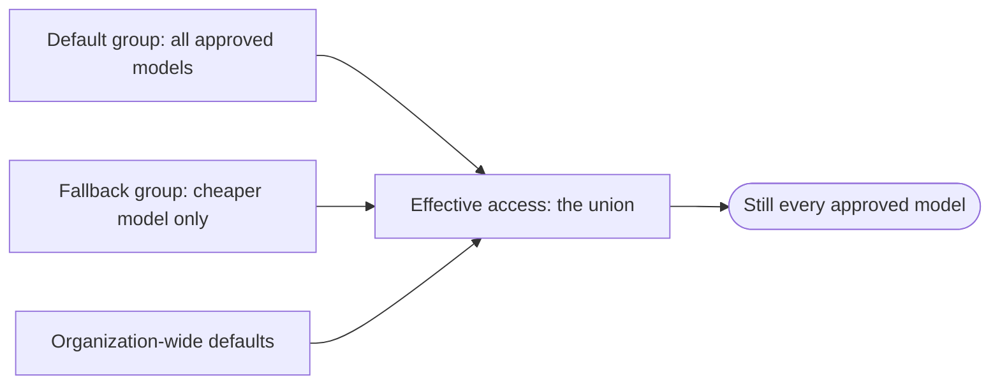

A per-person spending limit on an AI assistant does exactly one thing well: it
stops spending. It says nothing about the half-finished task the person was in
the middle of when it fired.

I kept coming back to that moment. The budget is correct, the stop is correct,
and the work is still stranded. The only ways forward are to wait for the next
cycle or to ask someone for a bigger budget, which restores everything,
including the most expensive models.

So I designed a third path: a small grace allowance that someone explicitly
approves, that expires, and that only buys access to a cheaper model. This post
is about that design, what it has to guarantee, and the two assumptions that
didn't survive contact with how access control actually works. It's a private
prototype. I haven't piloted it, and I have no savings to report.

## Two people, one limit

Two people meet at the limit, and they want different things.

**The person working** wants to finish the task. They need to know why the
assistant stopped and how to ask for more.

**The budget owner** sets the spending rules and the model policy. They decide
how much extra consumption to allow, and for how long.

A hard stop serves the budget owner completely and the person working not at
all. A blanket budget increase does the opposite. The grace path is an attempt
to give the person working a way to continue that the budget owner can still
reason about: bounded in amount, bounded in time, and bounded in what it can
buy.

The prototype automates the budget owner's routine work: reading reported
usage, changing model-access group memberships, and applying approved budget
changes. It never approves its own spending. A person approves every increase.

## How much, and which models

Before building anything, I had to separate two controls that are easy to
blur:

- A **budget** answers "how much may this person consume?"
- A **model policy** answers "which models may this person use?"

A request goes through only if both say yes. Changing one doesn't supply the
other. Permission to use a cheaper model doesn't make it free, and it doesn't
override an exhausted budget.

There's a second distinction inside the budget. Capacity is often pooled
across a whole organization, while a per-person cap is an additional limit on
top of that pool. A person can be blocked by their own cap while the pool
still has room. Raising their cap doesn't buy or reserve anything; it permits
more consumption, which may cost money once the pool runs dry. Any limit set
higher up, for a team or the whole organization, still applies.

That gave the grace path a strict order: **restrict which models first, then
raise how much**. Reverse the order and the grace allowance funds the
expensive models it was meant to avoid.

## The grace path

The operating model borrows from how some workspace products already handle
usage: give everyone a normal allowance, make extra usage an explicit
decision, and let a temporary exception expire instead of becoming a
permanent entitlement. My addition was to tie the exception to a narrower set
of models.

A few rules keep the grace path from turning into a loophole:

- **Once per person per cycle.** In my policy, grace is available once a
  month. Switching groups doesn't reset tracked consumption or authorize
  another grant.
- **Grace is small.** It's meant to finish the current task, not replace a
  budget conversation.
- **Expiry is the default.** At the end of the cycle the exception goes away
  without anyone having to remember to remove it.
- **Retries are safe.** Each operation is recorded, so a retried job doesn't
  request the same increase twice.

One administrative trap showed up immediately: increments versus totals. My
prototype accepts "add 20 units." An approval screen that sets a new total
reads the same request differently. If the cap is already 20 and the approver
means "add 20," the new total is 40, not 20. Any system that passes budget
changes between tools needs to say which one it means.

## First attempt: a narrower group

My first design was simple. When someone ran out, add them to a temporary
group that only grants the cheaper model.

It doesn't work, and the reason applies well beyond this one system. Model
access was built from a **union of grants**: a person can use any model that
any of their groups grants, plus anything enabled for everyone. Adding a
narrower group adds nothing to remove.

In a union of grants, a narrower grant can't restrict anything. Restriction
has to come from removing grants.

The redesign follows from that:

- Use **dedicated model-access groups** that do nothing else. If the same
  group also controls repository permissions or licenses, removing someone
  from it breaks unrelated things.
- During the transition, **remove the broad grant** instead of adding a
  narrow one.
- **Review every other source of the grant**, including organization-wide
  defaults and other groups. One successful removal doesn't prove the person
  has lost access.

I also had to account for a deployment-wide risk: if enabling group-based model
policy changes how model access is managed across an organization, a one-person
test could affect more than its participant. That's not a switch to flip
casually.

## Second break: accepted isn't applied

The prototype runs as scheduled jobs against the platform's admin APIs. The
platform's own budgets still do the enforcing; my jobs only change
memberships and caps.

The obvious next step was to remove the broad grant, see a successful
response, and raise the cap. That's the second assumption that broke. A
**control plane accepting a change isn't evidence that every enforcement
point has applied it**. Clients cache what they're allowed to do. An open
session may keep the model it started with. I found no supported signal that
says every client and session now sees the restriction, and a fixed delay
doesn't turn a guess into proof.

So the design puts a person at that point. The budget owner checks the
restriction in the clients the person actually uses, and only then approves
the grace allowance. Verify where the change is used, not where it was made.

That means the grace path isn't seamless. There's still a pause: reconciliation
runs on a schedule, a person has to verify, and the person working may need to
refresh their client or pick the cheaper model themselves. "Keep shipping" is
the question I'm exploring, not a result I can claim because the automation
runs.

## Trade-offs and failure modes

| Path | Protects the budget | Keeps work moving | Main risk |
| --- | --- | --- | --- |
| Hard stop | Fully | No | Stranded work, workarounds outside policy |
| Full increase | Only as far as the approver checks | Yes | Pays top-model prices for the tail of the task |
| Cheaper-model grace | Bounded amount, time, and models | Partly, after a pause | The cheaper model can't finish the task |

The last risk is the one that decides whether this is worth doing. A cheaper
model is only useful if it can do the remaining work. The task might need
context, tools, or reasoning that the cheaper model lacks. More retries can
erase the saving, and waiting for approval can erase the continuity.

Compared with a hard stop, grace authorizes more consumption. Compared with a
full increase, it might reduce the cost of finishing. Whether that trade is
worth it needs evidence I don't have yet.

## What's next

I haven't run a live pilot, so there are no measured savings or delivery
improvements here. A plain approved increase may be the simpler answer in
many cases. If I pilot this, I'd measure:

- whether the person finishes the task at acceptable quality;
- the total cost of getting there, including retries, not just the per-token
  price;
- the time spent blocked, switching models, or waiting for approval;
- the effort it takes the budget owner to run and recover the workflow.

The comparison isn't only an expensive model against a cheap one. It's this
custom transition against an ordinary approved increase.

Open questions I'm still working through:

- Can the restriction be verified automatically at the enforcement point, or
  does that check always need a person?
- Should grace be sized in money, in tokens, or in tasks?
- What should happen to a session that started on an expensive model when the
  grace path begins?

This is Part 1 of the Keep Shipping series. Part 2 turns the sketch into
explicit policy: which budget applies, what each transition is allowed to
change, and what must stay untouched.
[Subscribe to the writing RSS feed](/writing/feed.xml) to follow along.

A spending limit can be correct while the experience around it still deserves
better design.
