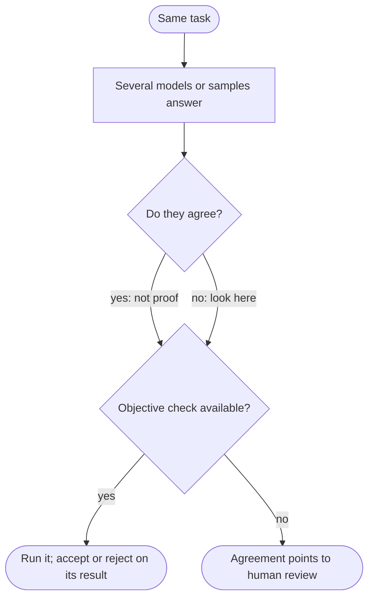

When an answer matters, the instinct is to ask again. Ask three models, or the
same model three times, and trust the answer most of them give. It feels like a
second opinion, and sometimes it is one.

The catch is a hidden assumption: that the errors are independent. A second
opinion is worth something because the second person could have been wrong in
a different way. If every voter read the same wrong textbook, three matching
votes are one mistake counted three times.

My position is that **agreement is only as strong as the independence behind
it.** When a task has an objective check, such as a test suite, a type checker,
an executable specification or a calculation, run the check instead of counting
votes. Keep model agreement for what it is good at: a cheap signal about where
to look.

## One mistake, counted three times

Take three voters that are each right 70% of the time. If their errors are fully
independent, the majority is right about 78% of the time (0.7³ + 3 × 0.7² × 0.3
= 0.784). If they always make the same errors, the majority is right 70% of the
time: no gain, at three times the cost. Those are two illustrative cases, not
bounds: errors can overlap in ways that leave the majority worse than any single
voter. The arithmetic is an illustration, not data, and how your models' errors
overlap is what you would want to measure on your own task.

Why would model errors overlap? My reasoning is that models are trained on
overlapping public text, with similar architectures and similar recipes, so some
questions are hard for all of them in the same direction. There is a
measurement behind the worry. [Goel and colleagues
(2025)](https://arxiv.org/abs/2502.04313) propose a similarity metric based on
overlap in model mistakes, adjusted for the agreement two accurate models would
show by chance. They report that judge scores favor models similar to the
judge, and "a concerning trend": model mistakes becoming more similar as
capabilities increase.

That paper does not show that voting fails on your task. It shows that
independence is something to measure, not assume.

The failure is also silent. When every answer agrees and all of them are wrong,
the output looks exactly like unanimous agreement on a right answer.

## Five ways to ask

| Approach | Cost | Wins when | Fails when |
| --- | --- | --- | --- |
| 1. One model, one pass | One call | A mistake is cheap or reversible, or a person reviews the result anyway | Nothing catches a wrong answer |
| 2. Same model, sampled N times, majority vote | About N times the generation cost; latency can stay flat if calls run in parallel | Short, comparable answers, and errors that vary from sample to sample | The model is consistently wrong, so the vote makes it consistently confident |
| 3. Different models cross-check | N times the cost, plus the work of integrating several providers | Their blind spots differ | They share them |
| 4. One model judges another | One extra call per answer; no answer key needed | There is no objective check, quality is partly preference, and the judge has been compared with people | The judge has its own biases or shares the writer's blind spots |
| 5. An objective verifier | Building the check once; usually cheap to run | The answer can be run, compiled, tested or calculated | The check is incomplete, or none exists |

### Sampling and voting

[Wang and colleagues (2022)](https://arxiv.org/abs/2203.11171) sample several
reasoning paths and pick the most consistent answer. Their abstract reports
gains over greedy chain-of-thought decoding on arithmetic and commonsense
benchmarks, for example +17.9% on GSM8K. It does not show gains on open-ended
output, and it does not say that wrong answers never repeat.

The mechanism is noisy, independent errors canceling out. It wins when the model
is usually right, its slips differ from sample to sample, and the answer is
short enough to compare. A cheap diagnostic, which I have not run: look at how
the wrong answers are distributed. If they scatter while the right answer
repeats more often than any of them, voting helps. If one wrong answer comes
back as often as the right one, or more often, the error is systematic and the
vote locks it in.

### Cross-model checks

Different families can have different blind spots, which is the appeal. Whether
they do is an empirical question, and the Goel result is a reason to check
rather than assume. The cost multiplies with every model you add, and two
accurate models agree often just because both are right, so the useful question
is how they behave where they are wrong.

### Judges

[Zheng and colleagues (2023)](https://arxiv.org/abs/2306.05685) examined
LLM-as-a-judge and name position, verbosity and self-enhancement biases, plus
limited reasoning ability. Their result is that strong judges matched human
preferences with over 80% agreement on their benchmarks, the same level as
between humans.

That is evidence a judge can approximate human preference on open-ended chat.
It is not evidence that a judge can tell whether code runs or a number is
right. Combined with the Goel finding that judge scores favor models similar to
the judge, I would use a judge from a different family, swap the order of the
answers, and compare it with human labels on a sample before relying on it.

Asking the same model "are you sure?" is a weak version of this. [Huang and
colleagues (2023)](https://arxiv.org/abs/2310.01798) report that models
struggle to self-correct their reasoning without external feedback, and
sometimes get worse. That says nothing against feedback from a real source, and
a test result is exactly that.

### Verifiers

An objective check does not vote. A deterministic test gives the same verdict
every time. The costs are real: someone has to write the check, and it is
only as good as what it tests. Tests written by the same model that wrote the
code can share its misreading of the specification, which is the independence
problem again, one level down.

## A pointer, not a verdict

The practical pattern is to use the two signals for different jobs.

Disagreement is cheap and useful: it tells you which cases to look at first.
Agreement is weaker. It lowers the odds of a noisy slip, but it says nothing
about an error all the models share. So where a check exists, it decides.
Where none does, agreement only sets the order of review, and I would still
sample some unanimous cases by hand, because those are the ones nobody opens.

An earlier post describes [a score threshold that hands uncertain cases to a
person](/writing/decide-cheaply-generate-carefully/), which is one way to act on
that pointer.

## Counting unanimous mistakes

This is a proposal. I have not run it.

**Setup.** Collect tasks from your own work where the answer is known or
runnable: functions with a hidden test suite, questions with one verified
numeric answer, refactors with behavioral tests that pass or fail. Use enough, a
hundred or more, that each bucket below has more than a handful of items. Fix
the answer key before running any model. Run three or more models from
different families once each, and one of them five times at a nonzero
temperature. Record versions and settings.

**Measure**, using the objective check as ground truth:

- Accuracy of each model alone, of the majority vote across models, and of the
  majority vote across one model's samples.
- Accuracy when all answers agree versus when they split.
- The unanimous-wrong rate: how often every answer agrees and is wrong, and
  what share of all errors that is.
- Optionally, a judge from another family scoring the same answers with the
  order swapped, compared with the key.

**What would count for the claim:** unanimous-wrong answers make up a
meaningful share of errors, and voting beats the best single model by little
relative to its cost.

**What would count against it:** unanimous answers are almost never wrong on
your task, and the vote beats the best single model by enough to cover its
cost. Then voting is a
good enough signal there, and a verifier may not earn its cost.

**Limitations.** Unanimity correlates with easy tasks, so compare within
difficulty bands, for instance by each model's solo pass rate. Tasks with an
answer key are not the open-ended ones where no check exists, so the result
says little about those. And models change behind stable names, so the result
is only good for the period you ran it.

## How correlated are the errors?

I do not know how correlated errors are across current model families on any
particular task. I do not know whether diversity can be bought more cheaply
with different prompts than with different models, or how much swapping answer
order shrinks judge bias in practice. Those are measurable, and the
unanimous-wrong rate is the number I would want first.
