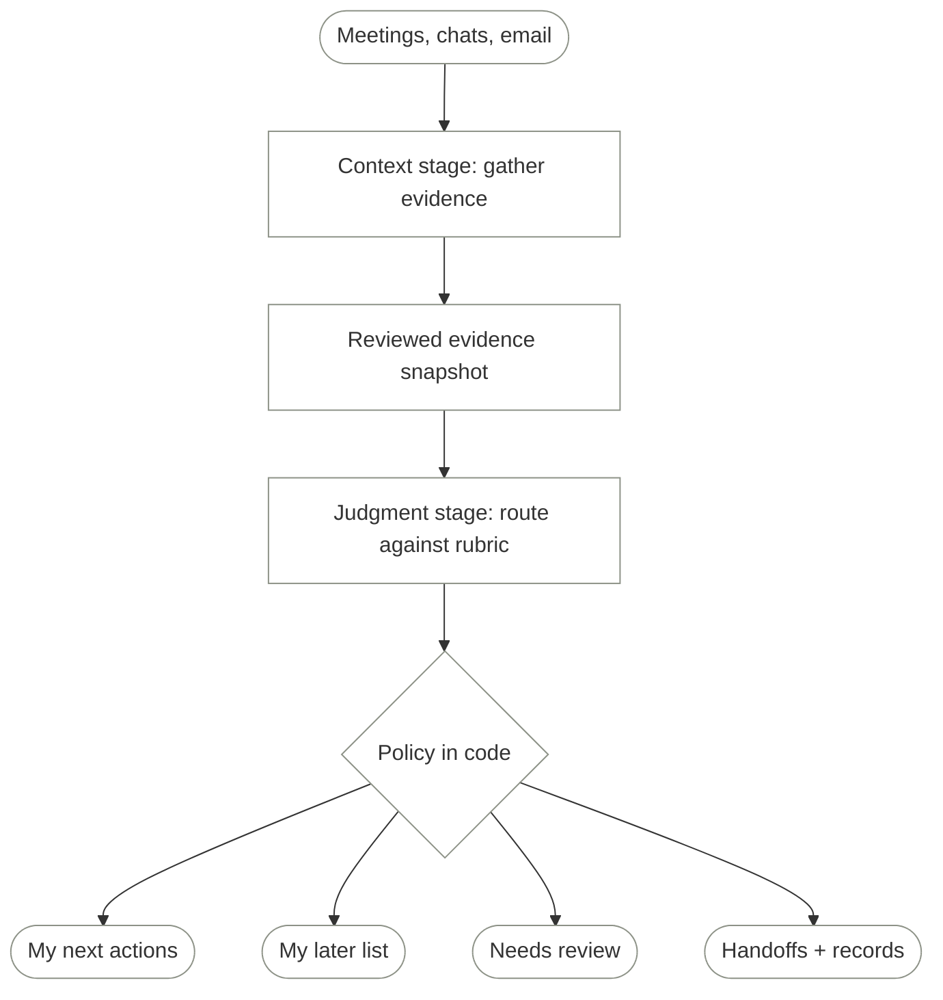

Every meeting ends with work.

Some of it never reaches a list. The rest lands on one big list, all mixed
together: things only I can do, things a teammate already owns, things an agent
could draft, and decisions dressed up as tasks.

I picture my work on the Eisenhower matrix: urgent against important, four
boxes. Do what is both. Schedule what matters but can wait. Delegate what is
urgent but doesn't matter. Delete the rest.

That works when everything on the list is already mine. A meeting list isn't.

**The question isn't just "Is it important?" It's "Is it mine?"**

A to-do list that holds everything isn't a plan. It's a backlog with my name on
it. This post is about the small system I designed to make that list shorter
without making it lossy, and why it is split the way it is.

## Where the matrix breaks

The matrix borrows a line Dwight Eisenhower
[quoted in a 1954 speech](https://www.presidency.ucsb.edu/documents/address-the-second-assembly-the-world-council-churches-evanston-illinois),
from a former college president: "I have two kinds of problems, the urgent and
the important. The urgent are not important, and the important are never
urgent." The four boxes came later. They assume what a meeting list doesn't
give me: that every item is mine to sort.

**Ownership comes before importance.** An item can be urgent and important and
still belong to a named teammate. The matrix puts it in Do, but it isn't mine
to do. Its Delegate box also assumes I hand work off only when it doesn't
matter. On a team, who owns a task is a separate question from how much it
matters.

**Delete loses work.** An item that isn't mine and isn't urgent still belongs
to someone. Dropping it from my list is fine. Dropping it from the record is
how work gets lost.

**Two states have no box.** Some "action items" are decisions already made and
recorded somewhere else. Others have no owner and no deadline yet. Neither can
be placed: a settled decision isn't work, and an unclear item can't be judged
until someone answers.

So I keep urgency, swap important for mine, and give the other two states their
own place.

<figure class="excalidraw-figure responsive-diagram">
  <picture>
    <source
      media="(max-width: 60rem)"
      srcSet="/diagrams/urgent-mine-grid-portrait.svg"
      width="456"
      height="836"
    />
    
  </picture>
</figure>

A meeting summary can tell me what was said. It cannot, by itself, tell me
which box an item belongs in. For each item I need four answers:

- **Is it mine?** Or does a named teammate own it?
- **Is it urgent?** Due today, blocking someone, or explicitly later?
- **Is it already settled?** Some "action items" are decisions that were made
  and recorded somewhere else.
- **Is it clear yet?** No owner and no deadline is a real state, not a gap to
  fill with a guess.

The answers live in different places: a meeting note, a chat thread, an email.
And they are independent. An urgent item can belong to someone else. An item
that is mine can be explicitly no rush. A single ranked list tends to blur
those two axes, which is exactly where work gets lost or wrongly claimed.

I want a smaller list, but not one that becomes smaller by quietly losing work.
Anything uncertain should stay visible. Anything assigned to someone else
should stay theirs. A request for a draft should not become permission to send
it.

## The obvious design, and why it breaks

The obvious first version is one step: point a model at my recent meetings and
chats and ask for a prioritized to-do list.

It looks efficient, but it fuses two jobs that fail differently:

- **Finding** the work is a retrieval and summarization problem. It fails by
  missing items, misquoting them, or attributing them to the wrong person.
- **Judging** the work is a routing problem. It fails by putting a correct
  item in the wrong place: claiming a teammate's task, inventing a deadline,
  or dropping something vague.

When both happen in one opaque step, a wrong answer has no address. I can't
tell whether the model never saw the evidence or saw it and misjudged it. I
also can't change the rubric, or the model doing the judging, without
re-running and re-trusting the retrieval.

## The redesign: a context stage and a judgment stage

So the system has two stages with different jobs, joined by a snapshot I can
read.



**The context stage** gathers candidate items from whatever sources I can
access and turns them into records. Each record carries the evidence, not just
a title:

```js
{
  task: "Approve the pilot budget",
  evidence: "Lead approval due today; purchasing is blocked",
  owner: "me",          // or a name, or null
  due: "2026-10-12",    // or null
  source: "meeting note, 11 Oct"
}
```

It asks for a bounded number of items over a bounded window. That is a
snapshot, not a claim to have found every obligation. An empty or malformed
extraction stops the run instead of producing a success-shaped empty list.

**The snapshot is the seam.** It is a local file I review before anything else
happens: I check the quoted evidence against the sources, correct owners and
dates, and remove anything that shouldn't go to the next model. A schema can
check the shape of a record. It can't check that a meeting was quoted
accurately.

**The judgment stage** sees one frozen item at a time, plus my role, a
reference timestamp and the rubric. It has no tools and cannot retrieve more
context. That constraint is deliberate: if a judge can fetch its own evidence,
I'm back to not knowing what it decided from.

Keeping the stages apart buys three things. Each can be checked on its own.
Either model can be swapped without touching the other. And the snapshot gives
me a natural place to apply data rules before evidence moves on.

## Making the rubric explicit

The rubric is the part that most needs to be written down, because it is where
my preferences live.

The example role is a project lead who approves budget and scope. Teammates
own their named deliverables. Unassigned, reversible drafting work may go to
an agent for a first pass. Every item gets one of five routes: `me`, `team`,
`agent`, `decision` (already settled) and `cannot_tell`. And one urgency
level:

| Level | Meaning |
|---|---|
| 0 | No outstanding work |
| 1 | Explicitly later than seven days, or explicitly no rush |
| 2 | Due within seven days, but not today |
| 3 | Overdue, due today, or explicitly blocking work |

Missing ownership or timing means `cannot_tell`, not permission to invent a
deadline.

Six synthetic items show why both axes matter:

| Task | Evidence that matters | Expected treatment |
|---|---|---|
| Approve the pilot budget | Lead approval due today; purchasing is blocked | My next actions |
| Publish the migration checklist | Sam owns it, due today; no lead approval needed | Team handoff |
| Draft an agenda | Three supplied topics; unassigned; due in three days | Agent draft, reviewed |
| Record the rollout decision | Already approved and recorded | Decision record |
| Follow up with the partner | No owner or deadline | Review; don't guess |
| Explore next quarter's tooling | Mine, explicitly no rush | My later list |

The checklist is urgent. **It still isn't mine.** The tooling research is mine.
**It still isn't urgent.** The expected treatments are a human-written rubric,
not model output, and they are the first thing any judge has to get right.

## Two kinds of judge

With the stages split, the judge becomes a replaceable part, and there are two
quite different things to put there.

A **generative model** can be asked for a structured answer: one route and one
integer urgency level, validated against a schema. It is flexible, it can
explain itself if asked, and it is the obvious default.

A **decision model** works differently. Instead of writing an answer, it is
given a fixed set of options and returns a probability for each. For a
`choice` question that means a selected route plus a distribution over all
five. For an ordered scale, it can return a probability-weighted average of
the levels, so a four-level rubric produces a score anywhere between 0 and 3.

| Question | Generative judge | Decision-model judge |
|---|---|---|
| What does it see? | One frozen item, role, date and rubric | The same |
| Can it retrieve more context? | No | No |
| What comes back? | A route and a whole urgency level | Route probabilities and a weighted score |
| Can it explain an answer? | It can, if asked | No generated rationale |
| How does it abstain? | `cannot_tell` | `cannot_tell`, plus a probability cutoff in my code |

The useful distinction isn't "generative models can't prioritize." They can.
It is whether an interface that exposes a distribution gives me a better way to
handle uncertainty than one that returns a single confident-looking answer.

Two cautions travel with that. **A score of 2.6 is not a deadline, and a route
probability of 0.8 is not proof of 80% accuracy on my tasks.** And a generative
model can be prompted to print a confidence number too, but a self-reported
number is not the same kind of signal as a distribution over fixed options.
Neither should be trusted without checking it against labeled examples.

I have not run a controlled comparison of the two, and this post doesn't claim
one. A disagreement between them proves neither is right.

## Policy in code, the final call with a person

The judge proposes. A small, visible policy decides where the proposal lands:

- Personal items at urgency 2 or above go to **My next actions**; lower ones
  stay on **My later list**.
- `team` and `agent` routes become **Proposed handoffs**. Already-settled items
  become **Recorded decisions**.
- `cannot_tell` always goes to **Needs review**. For the decision-model judge,
  a selected-route probability below a cutoff goes there too.
- Every item keeps its evidence and source. Nothing is deleted because it
  scored low.

The cutoffs are illustrative policy choices, and they belong in code rather
than in a prompt because code is where I can read, test and change them. They
also expose a real mismatch: a whole level and a weighted score are not the
same measurement, so 2 and 1.9 can land in different sections without either
judge being wrong.

There is deliberately no path from an agent to a completed task. A route is a
recommendation, not proof that anyone did the work. Handoffs still need the
other person to acknowledge them. Agent drafts still need review. The list is
a proposal I accept or correct.

## Source content is untrusted

Meeting notes, chat threads and emails are written by many people, and some of
that text may be written to steer whatever reads it. The design treats it as
data, never as instructions:

- The context stage is limited to read-only retrieval. It cannot write to the
  sources, and other permission requests are rejected.
- The judgment stage has no tools at all.
- Nothing either stage produces is executed. The worst a poisoned item can do
  is propose a wrong route, which then lands in front of me.

These restrictions narrow what a local agent can do. They are not a sandbox
for the services that hold the data, and they don't make prompt injection
impossible. The human review step is part of the defense, not a formality.

## Failure modes and trade-offs

**Extraction is the weakest link.** If the context stage misses an item, no
judge can route it. Reviewing the snapshot helps with misquotes and wrong
owners; it does not reveal what was never extracted.

**Data crosses boundaries.** Access controls on the source don't extend to a
separate inference provider. Each stage that sees work data is a decision
about where that data may go, and the snapshot review is only useful if it
happens before the evidence moves on.

**More stages, more cost.** Two models, a review step and a policy are slower
and more expensive than one prompt. If an ordinary generative judge meets the
need, that is where to stop. A decision model earns its extra call only if its
probabilities actually help on real work.

**Models drift behind stable names.** A comparison is only meaningful over a
bounded period with the evidence and rubric held fixed.

**Routing is not a people score.** This is about who owns a task, not who is
valuable or productive. Model scores shouldn't be the sole basis for
consequential decisions about individuals.

## What's next

The six synthetic items are a smoke test, not an evaluation. The questions I
still want to answer:

- With representative items labeled **before** looking at either judge's
  answer, how often does each claim a teammate's work, miss an urgent personal
  item, or hide something that should have gone to review?
- Are the decision model's probabilities calibrated on this kind of work, or
  only plausible-looking?
- How stable are routes when the same item is sent twice, or the route options
  are reordered?
- Can review of the snapshot be made cheap enough that I actually do it every
  time?

I don't need a model to make every task sound important. I need a workflow that
can tell **urgent**, **mine**, **already settled** and **not clear yet** apart.

The goal isn't an empty list. It's a list I can explain.
