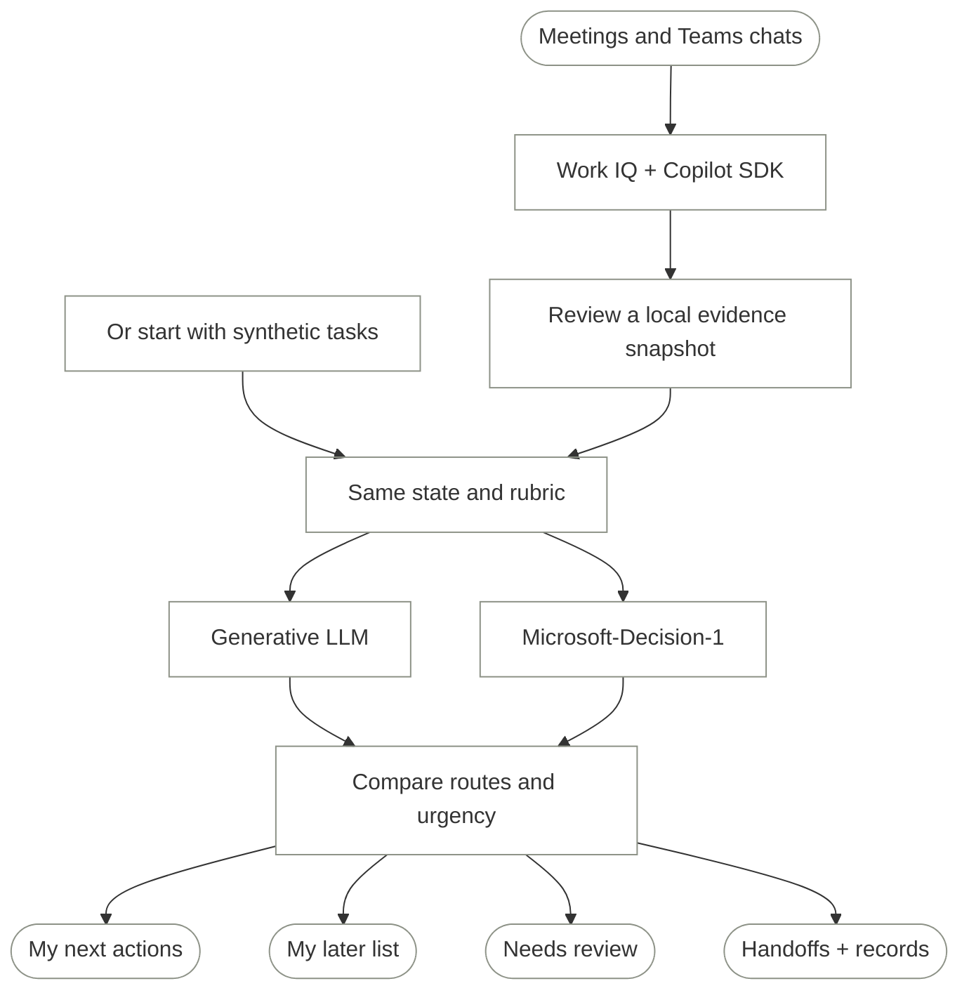

import { Code } from 'astro:components';
import triageSource from '../../../public/examples/workiq-triage.mjs?raw';

Every meeting ends with work.

Some of it never reaches a list. The rest lands on one big list, all mixed
together: things only I can do, things a teammate already owns, things an agent
could draft, and decisions dressed up as tasks.

**The question isn't just "What are the action items?" It's "Which of these
deserve my attention next?"**

A to-do list that holds everything isn't a plan. It's a backlog with my name on it.

## The problem: capture isn't triage

A meeting summary can tell me what was said. It cannot, by itself, tell me what
I should do next.

That needs context: who owns the work, what is blocked, whether a deadline is
real, and whether the decision was already made somewhere else. The answer
might be in a meeting note, a Teams thread or an email.

I want a smaller list, but not one that becomes smaller by quietly losing work.
Anything uncertain should stay visible. Anything assigned to someone else
should stay theirs. A request for a draft should not become permission to send it.

That is the workflow this tutorial builds.

## The discovery: separate finding work from judging it

**[Work IQ](https://learn.microsoft.com/en-us/microsoft-365/copilot/extensibility/work-iq/cli)**
provides Microsoft 365 context through a CLI and a Model Context Protocol
(MCP) server. A **[GitHub Copilot SDK](https://github.com/github/copilot-sdk)**
session can query it and turn the response into structured action items.

That gets the work onto the page. It doesn't settle the priorities.

For that, there are two paths worth comparing. Ask the generative LLM to choose
an owner and an urgency level. Or send the same evidence to
**[Microsoft-Decision-1](https://commandline.microsoft.com/microsoft-decision-1-model-foundry/)**,
which answers bounded questions with typed decisions and probabilities rather
than prose.

The useful distinction isn't "LLMs can't prioritise." They can. It is whether
a specialised decision interface gives me a more useful way to handle
uncertainty.

> **This is a runnable tutorial, not a benchmark report.** The six tasks below
> are synthetic. Their expected routes are a human-written rubric, not model
> output. The sample calls both services when you run it; no live
> LLM-versus-Decision-1 accuracy, cost or speed result is claimed here.

## What I built: a list with somewhere for uncertainty to go



It is one script, not another task-management app. Its output is a local
`todo.md` with both models' proposed lists.

There is deliberately no "done" arrow from an agent to a completed task. A
route is a recommendation, not proof that anyone did the work. Team handoffs
still need acknowledgment. Agent drafts still need review.

### First, make the priorities explicit

The example role is a project lead who approves budget and scope. Teammates
own their named deliverables. Unassigned, reversible drafting work may go to
an agent for a first pass.

At **09:00 UTC on 12 October 2026**, this is what the synthetic evidence says:

| Task | Evidence that matters | Expected treatment under this rubric |
|---|---|---|
| Approve the pilot budget | Lead approval due today; purchasing is blocked | My next actions |
| Publish the migration checklist | Sam owns it, due today; no lead approval needed | Team handoff, not my task |
| Draft an agenda | Three supplied topics; unassigned; due 15 October; human review required | Agent draft proposal |
| Record the rollout decision | Already approved and recorded; no follow-up remains | Decision record, not a new action |
| Follow up with the partner | No owner or deadline | Review; don't guess |
| Explore next quarter's tooling | Mine, explicitly no rush; revisit 2 November | My later list |

The checklist is urgent. **It still isn't mine.** The tooling research is mine.
**It still isn't urgent.** Those are different questions, and a single ranked
list tends to blur them.

### Then, give both models the same evidence

Each request gets the same `state`: an `as_of` timestamp, a description of my
role, and one task with its evidence and source.

Both get the same five routes: `me`, `team`, `agent`, `decision` and
`cannot_tell`. Both use the same ordered urgency scale:

| Index | Meaning |
|---|---|
| 0 | No outstanding work |
| 1 | Explicitly later than seven days, or explicitly no rush |
| 2 | Due within seven days, but not today |
| 3 | Overdue, due today, or explicitly blocking work |

Missing ownership or timing means `cannot_tell`, not permission to invent a
deadline.

The baseline uses a **fresh, tool-free Copilot SDK session for each item**. It
returns a route and an integer urgency level, validated with Zod. It does not
inherit the Work IQ extraction conversation or retrieve extra context that the
decision model cannot see.

Decision-1 receives that same item and rubric through a plain HTTP request:

```js
{
  model: deploymentName,
  state: { as_of, about_me, item },
  questions: {
    route: {
      type: "choice",
      instructions: "Who should handle this?",
      criteria: ROUTES
    },
    urgency: {
      type: "score",
      instructions: "How soon, relative to as_of?",
      criteria: URGENCY
    }
  }
}
```

That is the request shape; the complete script below includes the fuller
instructions shared with the LLM.

Microsoft's [API guide](https://learn.microsoft.com/en-us/azure/foundry/foundry-models/how-to/use-foundry-models-microsoft-decision)
defines a `choice` response as a selected option plus probabilities. A `score`
is a probability-weighted average of the level indexes. A four-level rubric
therefore produces a score between 0 and 3, including fractional values.

**A score of 2.6 is not a deadline, and a route probability of 0.8 is not proof
of 80% accuracy on your tasks.** These are signals to evaluate, not facts to
promote into certainty.

### Finally, apply a small, visible policy

Both lists separate ownership from urgency. Personal items scoring at least
2 go into **My next actions**; lower-scoring personal items remain in
**My later list**. Team and agent routes become **Proposed handoffs**.
Already-settled items become **Recorded decisions**.

`cannot_tell` always goes into **Review before routing**. On the Decision-1
side, a selected-route probability below **0.7** also goes there. The code uses
`probabilities[choice]`, not an interchangeable-looking `confidence` field.
Every item retains its evidence and source in the report.

Those cutoffs are illustrative policy choices. In particular, the LLM's whole
level and Decision-1's weighted score are not identical measurements: 2 and
1.9 can land in different sections without showing that one model is wrong.
Nothing is deleted because it scored low.

## Try it with six fictional tasks

**[Download the complete sample](/examples/workiq-triage.mjs)** and save it as
`triage.mjs` in a new directory. It uses Node.js 24, the Copilot SDK and Zod;
it does not need Work IQ access for the synthetic comparison.

```bash
mkdir workiq-triage
cd workiq-triage
npm init -y
npm install @github/copilot-sdk@1.0.19 zod@4.6.6
```

Use an authenticated Copilot CLI and a model available on your Copilot account.
Set `COPILOT_MODEL` to that model's exact ID so the baseline is explicit, rather
than an account default that may change.

Configure **one** Decision-1 provider:

```bash
export COPILOT_MODEL="<model-id-available-to-your-account>"

# Option A: OpenRouter
export OPENROUTER_API_KEY="<your-key>"

# Option B: Microsoft Foundry, instead of Option A
# Use the resource origin, not a project or chat-completions URL.
export AZURE_ENDPOINT="https://<your-resource>.services.ai.azure.com"
export AZURE_API_KEY="<your-key>"
export DEPLOYMENT_NAME="<your-decision-1-deployment>"
```

If `AZURE_ENDPOINT` is set, the script uses Foundry and requires its other
settings. Otherwise it uses OpenRouter. There is no silent provider fallback.
Keep keys out of source files and version control.

Foundry uses
`/providers/microsoft/v1/systemone` and your **deployment name**.
OpenRouter uses its
[alpha Decisions endpoint](https://openrouter.ai/docs/api/api-reference/alphadecisions/submit-a-decisions-request)
and model ID `microsoft/microsoft-decision-1`. The alpha API can change.

```bash
# Offline assertions: no login, API key or model call needed.
node triage.mjs --self-test

# Live calls on synthetic evidence; consumes API/Copilot usage.
node triage.mjs --sample
```

The self-test checks the routing boundaries, malformed responses and both
provider request paths using fake responses. It is **not** a model evaluation.

The live run prints each task's LLM route and urgency next to Decision-1's route,
selected-route probability and urgency. It writes both proposed lists to
`todo.md`, recording the baseline model, returned decision-model name and
reference timestamp. Existing output is not overwritten: rename it before
another run.

<details>
<summary>Full runnable sample: triage.mjs</summary>
<Code code={triageSource} lang="js" />
</details>

## Replace the fixture with Work IQ

Work IQ's [current prerequisites](https://learn.microsoft.com/en-us/microsoft-365/copilot/extensibility/work-iq/cli)
include a Copilot Studio usage-based billing plan, a user assigned to that plan,
and administrative consent in the Microsoft Entra tenant.
Read its licence and accept it yourself if appropriate:

```bash
npx -y @microsoft/workiq@1.0.1 accept-eula
node triage.mjs --extract
```

This command connects Work IQ to the SDK, asks for **up to 12 items** from the
previous seven days and writes `items.json`. It is a bounded snapshot, not a
claim to have found every obligation. An empty or invalid extraction stops
rather than producing a success-shaped empty to-do list.

Edit `ABOUT_ME` before extraction. Then inspect `items.json`: check the quoted
evidence against the sources, correct ownership and dates, and remove anything
you are not allowed to send to the selected services. The schema checks shape,
not whether an LLM quoted a meeting accurately.

Only after that review:

```bash
node triage.mjs --compare items.json
```

That explicit second command sends the reviewed snapshot to both the Copilot
model and the configured Decision-1 endpoint. Extraction does **not**
automatically forward meeting content to OpenRouter or Foundry.

The sample exposes only Work IQ's `ask` MCP tool, not its entity-write tools,
and rejects other permission requests. Comparison sessions have no tools.
These restrictions reduce what the local agent can invoke; they are not a
sandbox for the remote Work IQ service or a guarantee against prompt injection.
Source content remains untrusted, and the workflow stops at a proposal.

## Just the LLM vs Microsoft-Decision-1

| Question | LLM-only path | Decision-1 path |
|---|---|---|
| What does it see? | One frozen item, role, date and rubric | The same |
| Can it retrieve more context here? | No | No |
| What comes back? | Structured route and integer level | Route probabilities and weighted score |
| Can it explain an answer? | A generative model can; this baseline doesn't request a rationale | No generated rationale |
| How does it abstain? | `cannot_tell` | `cannot_tell`, plus a probability cutoff in our code |
| What is proven by a disagreement? | Neither model is proven right | Neither model is proven right |

An LLM could also be prompted to output a confidence number. I haven't treated
that self-reported number as equivalent to Decision-1's probability output.
Neither should be trusted without checking it against labelled examples.

Start by checking the live output against the six expected treatments above.
Did today's budget approval rise to the top? Did Sam keep the checklist?
Did the vague partner follow-up stay visible for review? Did the low-urgency
personal item survive on the later list?

For a more useful evaluation, label representative tasks **before** looking at
either answer. Count wrong owners, missed urgent personal tasks, incorrect
handoffs and items needing review. Repeat requests and reorder the route options
to look for instability. Keep the evidence, rubric and baseline model fixed.

This compares two application approaches, not a controlled claim about model
architecture alone: the SDK and Decision API still have different runtimes and
output contracts. If you measure elapsed time, report that distinction too.

If the ordinary LLM meets your needs, stop there. Decision-1 earns its extra
network call only if its probabilities and routing behaviour help on your work.
Microsoft's [launch benchmarks](https://commandline.microsoft.com/microsoft-decision-1-model-foundry/)
are a reason to investigate, not results from this to-do list.

## Where I'd keep a human in the loop

**Data boundaries come first.** Work IQ's access controls do not automatically
extend to a separate inference provider. Confirm organisational policy before
sending work data to either comparison service. OpenRouter introduces a
third-party routing service; Foundry still needs an approved deployment and
data-handling configuration. Local snapshots, reports and SDK session history
can also contain sensitive evidence.

**Costs belong to more than one service.** Work IQ uses Copilot Credits,
the SDK uses the configured Copilot/model access, and Decision-1 is separately
metered. Check current pricing rather than assuming one subscription covers
the whole workflow.

**Routing is not a people score.** This is about who owns a task, not who is
valuable or productive. Microsoft's guidance warns against using model scores
as the sole basis for consequential decisions about individuals.

## The point

I don't need a model to make every task sound important. I need a workflow that
can distinguish **urgent**, **mine**, **already settled** and **not clear yet**.

Work IQ supplies context. The Copilot SDK turns it into something a program can
use. An LLM or Decision-1 proposes the routing. The policy stays in code, and
the final call stays with a person.

The goal isn't an empty list. It's a list I can explain.
