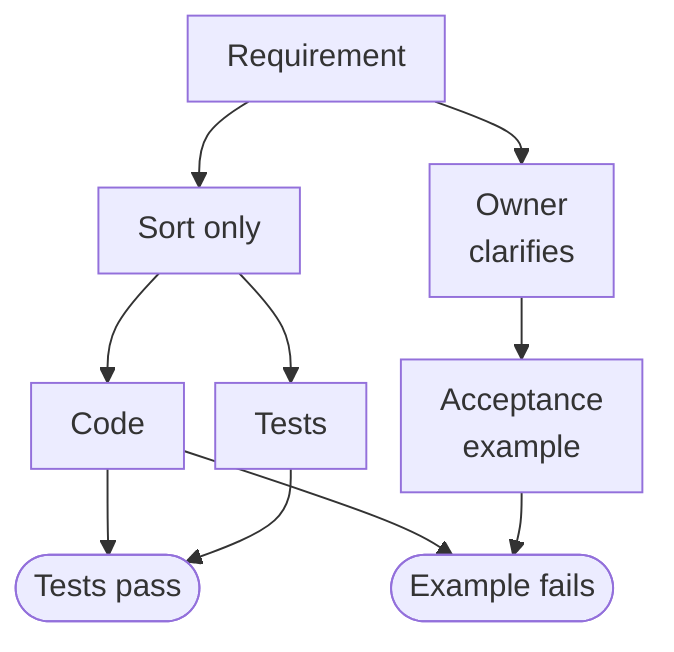

A function returns `[3, 12, 12]`. Its tests confirm that the values are sorted,
that sorting again changes nothing, and that the original input was left
alone. All pass. The requirement was to list each ID once.

There is no broken test runner here. The implementation and its tests agree on
a smaller job than the one requested. A coding assistant can make this mistake
while producing code that runs and assertions that check exactly what they
say. So can a person.

The useful question is not just whether the tests pass. It is **where their
definition of success came from**.

## A correct sort is the wrong function

Consider this deliberately small requirement:

> Given an array of positive safe integers, return every distinct ID exactly
> once, in ascending numeric order, without changing the input array.

Here is a constructed demonstration, not a recorded model failure. The first
function implements “sort the IDs” and forgets “exactly once.” Its companion
checks make the same omission.

Save this as `ids.mjs` and run `node ids.mjs`. It uses only the standard library.
The failed acceptance assertion is expected and caught, so the demonstration
itself should exit successfully.

```javascript
import assert from "node:assert/strict";

function listIds(ids) {
  return [...ids].sort((a, b) => a - b);
}

assert.deepEqual(listIds([]), []);
assert.deepEqual(listIds([12, 3]), [3, 12]);

const input = [12, 3, 12];
const actual = listIds(input);
assert.ok(actual.every((id, i) => i === 0 || actual[i - 1] <= id));
assert.deepEqual(listIds(actual), actual);
assert.deepEqual(input, [12, 3, 12]);

// Derived from "every distinct ID exactly once," not from listIds.
const expected = [3, 12];
assert.throws(
  () => assert.deepEqual(actual, expected),
  { code: "ERR_ASSERTION" },
);

function listUniqueIds(ids) {
  return [...new Set(ids)].sort((a, b) => a - b);
}

assert.deepEqual(listUniqueIds(input), expected);
console.log("Weak checks pass; acceptance rejects duplicates; corrected example passes.");
```

The duplicate was not even missing from the test inputs. It was missing from
the assertions. More inputs would not fix that: this implementation produces
ordered results and survives sorting twice even when duplicates remain.

The literal `[3, 12]` supplies the disagreement. In an ordinary acceptance
suite, its assertion would be allowed to fail; the catch above only makes this
demonstration self-checking. The corrected function passes that example. One
example does not establish its behavior for every possible input.

## The assertion needs a source

A *test oracle* is the basis for deciding whether observed behavior is correct.
[Barr and colleagues' survey of the oracle
problem](https://discovery.ucl.ac.uk/id/eprint/1471263/1/06963470.pdf)
distinguishes generating test inputs from deciding what their results should
be. Automating the first does not supply the second.

That distinction puts a constraint on the acceptance example: its expected
result must come from the stated requirement, not from running the program
and copying its output. Here, “every distinct ID exactly once” directly
justifies `[3, 12]`.

But suppose the request had only said “sort the IDs.” Removing duplicates
would then be an extra decision, not an obvious correction. A list of choices
might need one entry per ID; a list of events might need every occurrence.
Neither interpretation becomes authoritative because someone writes an
assertion for it.

An identified requirement owner must be able to resolve that ambiguity:
someone accountable for the intended behavior, not merely whoever can edit
the code. Before implementation, I would have a reviewer derive a few
input/output examples from the original request, ask that owner about unclear
cases, and record the answers with the examples. The owner's role is to decide
what should happen; the reviewer makes the decision concrete enough to check.

For the requirement above, the two routes look like this:



The routes share the requirement. They should not share the implementation's
summary of it. If that summary has already dropped “exactly once,” giving it
to a second test writer preserves the omission.

## Independent does not mean infallible

This is independence of interpretation, not a claim that two reviewers have
statistically independent errors. A reviewer can overlook the same sentence.
The original requirement can be incomplete. An owner can make a decision that
later proves unsuitable.

Changing the model that writes the tests does not automatically change their
source of truth. Nor does hiding a suite make its expected results correct.
Holding cases back can limit tailoring code to visible examples; it cannot
repair a mistaken expectation.

Keep the requirement, its owner, and the reason for each important expected
result reviewable. If code and an acceptance example disagree, investigate
both. Do not silently change the expected output to match the implementation,
but do not treat the assertion as beyond correction either.

## Properties still need someone to choose them

Handwritten examples are cheap to inspect for a small transformation.
Property-based testing becomes useful when input combinations outgrow a short
list: state a rule, generate many inputs, and look for a violation.
[Claessen and Hughes's original property-testing
paper](https://www.cs.tufts.edu/comp/150FP/archive/john-hughes/quick.pdf)
explicitly has the tester supply the checkable properties. Generated inputs
exercise those properties; they do not decide which ones matter.

The example already contains two such checks: ordered output and an unchanged
result after a second application. Both are true of the wrong function. A
uniqueness property would expose the omission, provided someone remembers to
write it and exercises a duplicate-containing input.

Metamorphic checks compare related executions when writing an exact answer is
awkward. Reordering the input should leave this result unchanged, but both
functions satisfy that relation. A more revealing relation is: **appending an
ID already present must not change the result**. The wrong function fails it.
That check comes from the same “exactly once” requirement as the acceptance
example.

Even that relation is insufficient alone. A function returning `[]` for every
input satisfies it. We still need checks that every requested ID appears and
no other ID does, alongside ordering and preserving the input. Properties
extend a decision about intended behavior; they do not relieve us of making
it.

Before accepting a generated implementation and its tests, pick one requirement
clause and derive an example without consulting either. Ask who can settle its
meaning. Then run it.
