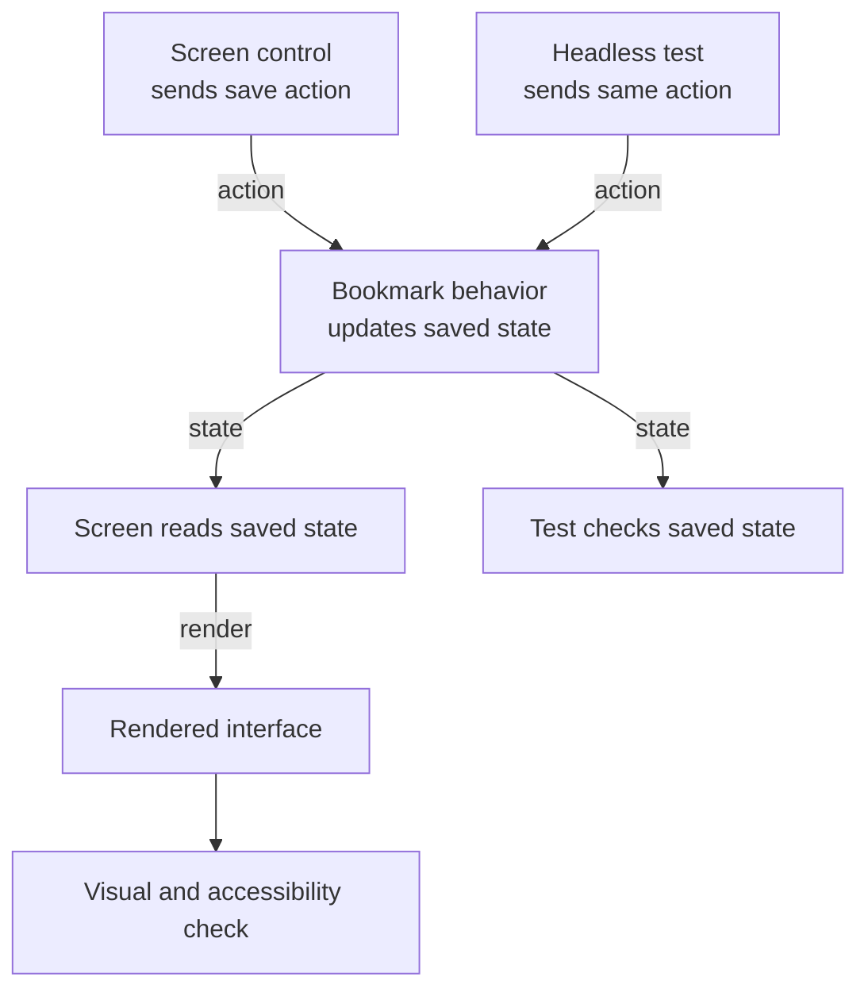

An app does not have to draw every screen to test what happens when someone
uses it. It does have to make that behavior testable through the same path
the screen uses.

That distinction matters. A test that reads state and sends an action can
check an app's behavior without opening a simulator. But if it exercises a
test-only copy of the logic, it proves nothing about what a real tap will do.
And even a faithful behavior test cannot tell whether the button is visible,
readable, or usable.

The useful question is not whether a test needs a screen. It is which part of
the feature the test needs to prove.

In its [Reflex architecture post](https://shopify.engineering/reflex), Shopify
describes exposing screen state and actions to a command-line tool as well as
the UI. Its ViewModel shape draws on [the Elm architecture](https://guide.elm-lang.org/architecture/).
The reading-list example below is a simplified model of that boundary, not the
team's implementation.

## A screen has state and actions

Take a reading-list app. An article page shows whether an article is saved and
lets the reader save or remove it. The screen communicates in two directions:
it reads a state, and it sends an action.

A behavior test can use that same boundary. It reads the saved state, sends
the `save` action, and checks that the state changed. Then it sends `remove`
and checks the result. The test does not need to locate a button to answer
those questions.

Here is a deliberately small, runnable model of that contract. Save it as
`bookmark.mjs` and run `node bookmark.mjs`; it uses only Node's standard
library and exits silently when its assertions pass.

```js
import assert from "node:assert/strict";

let state = { saved: false };

function send(action) {
  switch (action.type) {
    case "save":
      state = { saved: true };
      return;
    case "remove":
      state = { saved: false };
      return;
    default:
      throw new Error(`Unknown action: ${action.type}`);
  }
}

const readState = () => ({ ...state });

assert.deepEqual(readState(), { saved: false });
send({ type: "save" });
assert.deepEqual(readState(), { saved: true });
send({ type: "save" });
assert.deepEqual(readState(), { saved: true });
send({ type: "remove" });
assert.deepEqual(readState(), { saved: false });
```

In an app, the screen's button handler and the headless test would both call
`send`; the screen would render the value returned by `readState`. The snippet
only demonstrates the state transition. It does not show a button, persistence,
or a network request, and it does not prove that a real screen is wired to
these functions. Those are separate parts of the feature.

## Keep the app path real

The test boundary should expose what a screen can observe and do, not a second
implementation created for the test. In the example, `saved` is state the
screen displays, and `save` and `remove` are actions a person can take. The
test has no privileged operation that the screen cannot use.

For a larger app, the path might include navigation, reducers, and services.
Those are still the app's behavior. Network responses, storage, and device
capabilities can be supplied as fixtures at the edges so a test does not
depend on a live service or physical device. The goal is to remove rendering
and external timing from the check, not to replace the app's logic with mocks.

The boundary for the bookmark example looks like this:



This is a middle test surface, not a replacement for unit or end-to-end tests.
A unit test can still be the best way to check a small calculation. An
end-to-end test can still verify a complete journey through the rendered app.
A headless behavior test is useful when the question concerns how a screen's
state changes after an action, and the setup and runtime cost of driving the
whole interface make that feedback unnecessarily slow.

## A fast behavior check cannot verify the interface

Suppose the `save` action sets `saved` to `true`. A headless assertion can
prove that transition. It cannot prove the screen has a save button, that the
button sends `save`, or that the button changes its label after the state
updates.

It also cannot tell whether the button is clipped, whether its focus order
makes sense, whether a screen reader announces it correctly, or whether the
saved state is visually distinguishable. A UI check still has work to do:
verify the actual control is reachable, invokes the expected action, and
presents the new state accessibly. Pixel-level or device checks matter when
layout, animation, or platform behavior is the requirement.

This is why “headless” should describe how a test runs, not what it proves.
The behavior contract can make a check fast; it does not widen the evidence
that check provides.

## Agents make the feedback loop more visible

This boundary is especially useful when coding agents are producing changes.
An agent can inspect a screen's available state and actions, try an action,
and compare the resulting state with an expected result without waiting for a
simulator to launch. A concise, deterministic failure also gives it something
concrete to correct.

That makes it useful during implementation, not a substitute for review: it
tells the agent whether the state-and-action path behaved as expected, not
whether the screen is wired correctly or usable.

Shopify's [app-rebuild account](https://shopify.engineering/shopify-app-rebuild)
describes that fast feedback as part of a larger workflow for agent-written
changes. Those are reported design choices from one team, not evidence that
every app needs the same architecture.

The transferable idea is smaller: make important behavior observable and
repeatable. A command-line interface, a simulator-free test harness, and a
shared cross-platform test suite are possible implementations. None is the
goal on its own.

## Add the boundary where it earns its cost

An explicit state-and-action surface takes work to maintain. State must be
shaped so tests can inspect meaningful behavior. Actions must remain the same
ones the UI uses. Fixtures need to cover the external inputs that affect the
result. If those contracts drift, the fast test can become a confident check
of the wrong path.

That cost is easier to justify when the app has stateful workflows, when
several platforms need to behave alike, or when slow UI setup prevents
frequent checks. It is harder to justify for a small screen whose behavior is
simple and whose correctness depends mostly on native presentation. Building
a command-line layer for every screen just because agents might use it would
be another abstraction to maintain.

Start with one feature whose behavior is hard to test quickly. Write down the
state the screen shows, the actions it accepts, and the expected result for
one meaningful journey. Then check whether the screen and the headless test
can use the same path. If they cannot, the test surface may be a second
implementation in disguise.

Not every test needs to see the screen. But the screen still needs a test of
its own.
