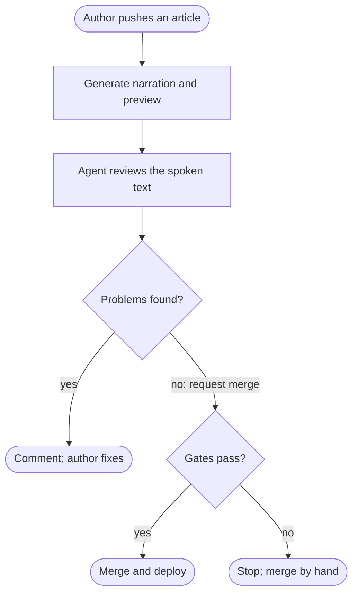

Every post on this site now has a play button. The narration comes from
[Kokoro](https://huggingface.co/hexgrad/Kokoro-82M), a speech model with 82
million parameters and Apache-licensed weights, run once per post rather than
once per listener. No speech API is called, and nothing is billed per play.

Getting audio was the easy part. The harder question came when I wanted it to
happen on its own: I write a post, open a pull request, and the narration,
a preview and the merge follow. That sounds like a job for an agent. Most of
it isn't.

So the pipeline is mostly ordinary build steps, with one agent step in the
middle. The agent's job is the one judgment call in the pipeline, and its
power is limited to asking.

## What a listener shouldn't hear

A speech model reads whatever text it gets. A post written for the eye has
plenty that doesn't belong in the ear: code blocks, URLs, frontmatter, MDX
tags, table pipes, and diagrams.

Diagrams were the decision that shaped the rest. A diagram on this site has
a caption and descriptive alt text, and both are written for people who
can't see it. Read aloud in the middle of an article, they become a second,
worse explanation of a picture the listener doesn't have. So the
extractor drops whole figures, captions included, along with image syntax
and fenced code. The prose around a diagram already says what it shows, or
it should.

The extraction is a few dozen lines of regular expressions with a
self-check, and its output is plain text, one paragraph per line. That file
is the contract: the audio says exactly what the text says, so reviewing the
text is reviewing the narration.

## Generation is a build step

Turning that text into audio gives the same result every time for the same
text and voice. That makes it a build step, not a task for a model that
reasons. I considered three places to do it:

| Approach | What it costs | When it wins |
| --- | --- | --- |
| Speech in the reader's browser | Nothing to host; voice and quality depend on each reader's device | Pages that change often and don't need a consistent voice |
| Hosted speech API at publish time | Per-character pricing and an account; audio is a file you keep | Many languages or voice cloning; no machine to run a model on |
| Open-weight model at build time | Compute once per change, plus storage for the files | A fixed set of voices and a site that's built anyway |

The browser option is the
[Web Speech API](https://developer.mozilla.org/en-US/docs/Web/API/Web_Speech_API):
free, but a reader on one device hears a different voice from a reader on
another, and some hear nothing. I wanted the same narrator everywhere, so the
site ships files.

Here is what the open-weight option cost for this site. The 12 published
posts come to 20,171 spoken words. In two voices that's 24 MP3 files, 263
minutes of audio and 75 MB at 40 kbps mono. One voice for all 12 posts took
about an hour on a laptop GPU.

Regenerating everything on each change would waste that hour. A manifest
records a hash of the spoken text and voice for each file, and the generator
only runs for outputs whose hash changed. A fix to a tag or the description
doesn't touch the audio, because neither is spoken. A test fails if any
published post's audio is missing or out of date, so stale narration can't
merge quietly.

## The one judgment call

What's left is a question an extractor can't answer about itself: is the
spoken text right? A new post might use syntax the regular expressions don't
know, such as a custom component or a table written as HTML. A listener would
hear its markup or lose a paragraph. That check needs reading, not matching,
so that's where the agent goes.

The agent gets the spoken text and the article source for each changed post,
and a narrow brief: look for code, URLs, markup, diagram labels or captions,
cut-off sentences, and sections of prose missing from the spoken text. Ignore
style and wording, because those are mine. It posts one comment on the pull
request with a verdict and quotes any problem it found.

The workflow framework I used compiles a Markdown prompt into a CI job. The
agent runs with read-only permissions and writes nothing itself. It can only
request actions from a fixed list, which separate jobs carry out:

```yaml
safe-outputs:
  add-comment:
    max: 1
  dispatch-workflow:
    workflows: [article-merge]
    max: 1
```

Those are its only two actions: one comment, and one request to start the
merge job. If it found a problem, the brief says not to make the request.

## The agent asks; the gates decide

The merge job doesn't trust the request. It runs its own checks, and any one
of them stops the merge with a comment that says why:



- **Author:** only the site owner's pull requests merge automatically.
- **Files:** every changed file must be part of an article: the post, its
  audio, diagrams, images, its hero or the spelling list. A change to the
  site's code needs a person.
- **Reviewed commit:** the agent reviewed the author's last commit. Commits
  after it may only be the generated audio. If I push again mid-review, the
  merge waits for a new review.
- **Hold:** a `hold` label keeps any pull request for a manual merge. It's my
  way to ask for a look at the preview first.
- **Checks:** the required build check must pass on the final commit.

The agent's verdict is one input among those five, and it's the only one a
model produces. A wrong verdict can at worst merge my own post with a stray
symbol in its audio. It can't merge code, someone else's change, or a commit
nobody reviewed.

## The token that starts nothing

One detail cost more thought than the agent did. On my CI platform, a commit
or merge made with a job's
[built-in token](https://docs.github.com/en/actions/concepts/security/github_token)
doesn't start other workflows, which stops a job from triggering itself in a
loop. The narration job commits the audio with that token, so the required
check never ran on the new commit, and the merge job would have waited for a
check that never came.
The same was true of the merge itself: the push to the main branch wouldn't
start the deploy.

The fix is to hand off explicitly. Each job starts the next one by name,
passing the pull request number and the commit that was reviewed: narration
starts the build check and the review, the review can start the merge, and
the merge starts the deploy. It's more wiring than a chain of triggers, but
every link is visible in the logs.

## What I haven't seen yet

The pipeline is written and its files compile, but this post is the first
article it will handle, so none of this has run end to end. These are the
open questions:

- **Time on a CI runner.** The laptop number came from a GPU. A runner
  generates on CPU, and I don't yet know whether one new post fits
  comfortably in the job's time limit.
- **The review's accuracy.** I haven't measured how often the agent misses
  a problem or flags a non-problem. The test I'd run is to plant failures: a
  post with an HTML table, a custom component and a caption outside a
  figure, and check that the comment quotes each one. A review that only
  ever says "No problems found" is a rubber stamp.
- **Storage.** Audio lives in the repository, about 6 MB per post across both
  voices, and every rewrite of a post adds another copy to history. That's
  fine for a dozen posts and worth moving to release assets or object storage
  well before a few hundred.

If the planted failures come back unflagged, the agent step goes and I merge
by hand again. The audio was the easy part; deciding what the agent shouldn't
do was most of the work.
