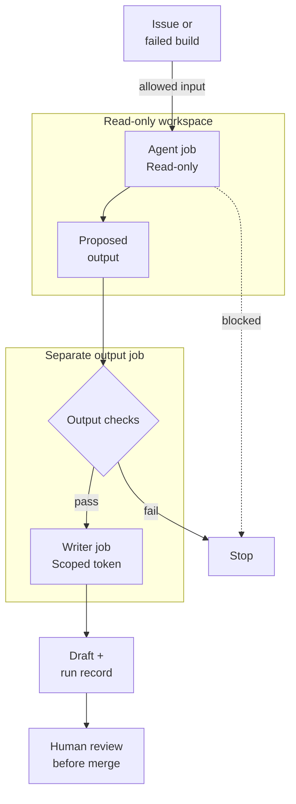

A build fails. The automation has already done its job: it ran the tests,
recorded the failure, and told someone. Now a person has to read the logs,
compare the failure with recent changes, and decide what to investigate.

That second part is what interests me. It happens repeatedly, but not
identically. The next failure might have a different cause. An issue might
describe an old bug in unfamiliar language. A code change might leave a
paragraph of documentation wrong without breaking a single test.

Why should agentic workflows exist? Some recurring work involves interpretation,
and a person often supplies both the interpretation and the machinery around
it: remembering to check, collecting the evidence, and writing up the next step.

I would want an agentic workflow to take on that preparation. I would be much
more cautious about letting it make the decision that follows.

## Repeated does not mean rule-based

Traditional automation works well when we can specify what should happen.
Run the test suite. Reject an invalid file. Route a change according to a
maintained ownership map. Those jobs should stay deterministic: the same
relevant input should produce the same result.

Other tasks resist a short rule. Does this issue describe the same behavior
as an existing report? Which part of a long build log is worth reading first?
Does this documentation still explain what the code does?

A model can attempt those interpretations. It can also be wrong. The useful
system therefore needs more than a prompt: a trigger, bounded access to
context, a defined output, and a way to handle uncertainty or failure.

That is the distinction I mean by an **agentic repository workflow**: an
event-driven or scheduled job that uses a model and tools to investigate a
bounded task and prepare an outcome. It is not a general mandate to keep
changing the repository until something looks better.

Before adding one, I would compare it with the simpler options.

| Approach | Where I would use it | What I would be taking on |
| --- | --- | --- |
| Script, rule, or existing bot | The condition and response can be specified precisely | Keeping the rule current |
| Interactive assistant | An occasional investigation that benefits from a conversation | Someone must start and steer it |
| Agentic repository workflow | Recurring interpretation with a narrow, reviewable output | Evaluation, runtime cost, permissions, and a review queue |
| Separate automation service | Work that spans systems or needs a runtime the repository platform cannot provide | Operating the service and its integrations |

A script that solves the problem is a better fit than an agent that repeatedly
rediscovers the rule.

## Where I would start

I would start with chores where gathering and interpreting evidence takes
time, but a person can check the proposed result without repeating the entire
investigation.

**Issue triage.** Read a new report, find potentially related issues, and
suggest an owner with links explaining the suggestion. A fixed ownership rule
should run first wherever one exists. The agent handles the ambiguous
remainder; it should not close a report merely because two descriptions sound
similar.

**Failure investigation.** Extract the relevant error, compare recent changes,
and propose the next diagnostic step. A useful output is "these lines suggest
this hypothesis; here is how to check it," not a confident root cause without
evidence. Restoring a service remains a separate responsibility.

**Documentation maintenance.** Identify a passage that may no longer match the
code and prepare a small proposed edit. Broken-link checks and generated API
references still belong to ordinary tooling. The model's job is the mismatch
that requires reading both the explanation and the implementation.

**Dependency research.** Collect release notes and compatibility concerns for
a proposed upgrade. Existing dependency automation can open the update;
interpretation may help a reviewer understand it. Passing tests and a
plausible summary still do not establish that the upgrade is safe.

These tasks appear in the project's
[public description of intended uses](https://github.github.com/gh-aw/introduction/ai-transparency/).
They are starting points, not evidence that every team will benefit.

I would not start with automatic production changes, access grants, incident
closure, or policy exceptions. The cost of a mistaken decision is too high
for "the draft looked reasonable" to be the acceptance test.

## The interesting part is the boundary

One implementation of this pattern is
[an open-source agentic workflow tool](https://github.github.com/gh-aw/). Its
[documented model](https://github.github.com/gh-aw/introduction/overview/) takes
a Markdown workflow with structured configuration and compiles it into a
workflow for the repository's existing automation system.

The design choice that interests me is the separation between interpretation
and authority.

In the documented default, the agent job has read-only repository permissions.
It can prepare proposed writes through a mechanism called *safe outputs*.
Separate jobs check and apply those configured outputs with the permissions
they require. The
[architecture documentation](https://github.github.com/gh-aw/introduction/architecture/)
describes buffered outputs, limits, and filtering rather than an unrestricted
write token handed to the reasoning step.

Here is the arrangement I would aim for when preparing a code change:

The final human-review step is a deliberate choice in this design, **not a
claim that every safe output waits for a person**. Automated checks may apply
an allowed comment or label without human approval. The
[FAQ](https://github.github.com/gh-aw/reference/faq/) describes configuring
approval gates separately.

Nor does "safe" mean correct or immune to attack. The
[transparency documentation](https://github.github.com/gh-aw/introduction/ai-transparency/)
explicitly describes incorrect outputs, prompt injection, and residual risk.
A model reading an issue can encounter instructions planted inside that
issue. Network restrictions and output checks reduce exposure; they do not
turn untrusted text into trusted instructions.

Custom jobs and external tools also need their own review. A read-only
repository token does not make every other credential, destination, or side
effect read-only.

This is why I would consider the approach rather than just running a prompt
on a timer. It gives the recurring task a versioned definition and an explicit
place to constrain its actions. A custom service can implement the same
separation. The question is whether reusing the repository's runners, logs,
and permission model is simpler than operating another system.

## A large organization needs repeatability, not one enormous agent

The organizational opportunity is distributed work. If many repositories
need the same kind of first-pass investigation, it is worth asking whether
every team should maintain its own prompt, credentials, and output format.

A platform team could provide a reviewed workflow definition with narrow
permissions, a common evidence format, and cost limits. Repository owners
would supply local context and decide whether the workflow fits their work.
The project's
[guidance on use at scale](https://github.github.com/gh-aw/guides/using-at-scale/)
and [sharing workflows](https://github.github.com/gh-aw/guides/sharing-workflows/)
describes shared definitions and versioned distribution.

Shared controls still need local context.
An ownership map can be stale. A repository can have special release rules.
A shared prompt cannot resolve those differences by wishing them away.

The organizational benefit would be a repeatable service: work starts from an
event, evidence accompanies the proposal, and a named team owns what happens
next. That can reduce dependence on somebody remembering to do the first
pass. It does not remove the need for that somebody's judgment.

The same scale magnifies mistakes. A noisy workflow copied into hundreds of
repositories creates hundreds of review queues. Shared definitions need
version pins, gradual rollout, a rollback path, and an owner who can disable
them. One successful repository is not permission to switch on the whole
organization.

Data boundaries matter just as much. Decide which repository contents and
logs may reach the selected model provider or external tools. Review
retention, credentials, output visibility, and the platform's supported
deployment environments. Shared automation is not blanket authorization for
cross-repository access, and an audit trail is not proof of compliance.

## Count the work left behind

I did not find a defensible time-savings benchmark in the official material
reviewed for this post. I would not turn a demonstration into a claim that
teams save a certain percentage of their week.

We can still make the economics explicit. **The following is a hypothetical
planning example, not a measured result or a product benchmark.**

Suppose a team handles 200 comparable first-pass investigations per month.
Each currently takes 12 minutes: 40 hours in total. Assume a workflow produces
a usable first pass for 70% of them. Every output takes three minutes to
inspect and make minor corrections, including outputs that get rejected.
The remaining 30% still require the full 12-minute manual investigation.
Allow another four hours a month to maintain the workflow.

| Monthly human effort | Manual approach | Workflow approach |
| --- | ---: | ---: |
| First-pass investigations still done manually | 40 hours | 12 hours |
| Inspecting outputs and minor corrections | 0 hours | 10 hours |
| Workflow maintenance | 0 hours | 4 hours |
| Total | 40 hours | 26 hours |

Under those assumptions, the net reduction is **14 human hours per month**.
If initial setup takes 12 hours, the first month's reduction is only two
hours. If just 30% of outputs are usable, manual fallback rises to 28 hours
and total effort becomes 42 hours: **two hours worse than the baseline**.

That sensitivity is the point. Review is work. Rejected outputs are work.
Fixing a bad prompt is work. Time saved writing a summary is irrelevant if
checking it takes longer than writing it did.

This example excludes model charges and runner costs; evaluate those
separately rather than hiding them inside a time claim. It also excludes
high-impact mistakes, which cannot sensibly be priced as a few extra minutes
of review. The
[cost guidance](https://github.github.com/gh-aw/reference/cost-management/)
recommends deterministic tooling where it suffices, and
[impact measurement guidance](https://github.github.com/gh-aw/guides/measuring-impact/)
focuses on accepted outcomes and their cost.

Elapsed time is a different measure. A workflow might prepare an investigation
before the next working day and shorten the wait for attention. That is not
the same as saving a working day of human effort. Track both. Do not count
work nobody needed as a saving merely because a machine completed it.

## What I would be trading

The advantages are conditional: recurring work can start without a person
remembering; interpretation can sit beside deterministic checks; and proposals
can arrive with a consistent record of their evidence. Those are useful when
the task recurs often enough and the output is genuinely cheaper to review.

The disadvantages do not disappear behind the workflow file.

- **Variable quality.** The same instructions can produce different answers.
  Model, prompt, and context changes need evaluation; version control alone
  does not make an answer reproducible.
- **A new operating burden.** Someone must handle failed runs, duplicate
  proposals, stale context, upgrades, and noisy output.
- **More review demand.** Cheap drafts can overwhelm the people expected to
  check them. Cap output volume and make "nothing useful to propose" a valid
  outcome.
- **More places data can go.** Model providers, tools, logs, and published
  outputs all belong in the access review.
- **Platform coupling and cost.** Runner support, authentication, and workflow
  semantics constrain where the implementation fits. A scheduled agent also
  incurs runtime costs when it finds nothing useful.

I would begin with one recurring task and a named reviewer. Compare outputs
against a sample of completed work, then try a report-only pilot on new
inputs. Measure useful outcomes, rejected proposals, missed cases, review
minutes, and operating cost against the existing process.

The documented
[staged mode](https://github.github.com/gh-aw/reference/staged-mode/) can preview
built-in outputs without applying their writes. It is not a universal dry run:
custom jobs and external tools still need separate controls.

A useful pilot leaves its reviewer with less work and enough evidence to check
the proposal. If it only moves the effort into another queue, I would keep the
simpler process.
