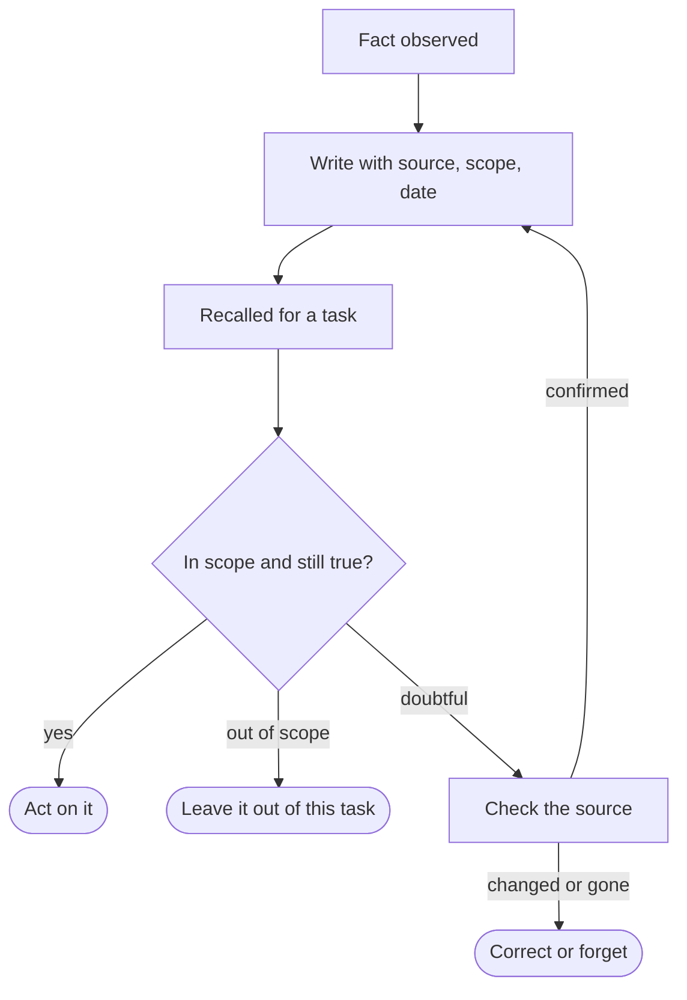

An assistant that remembers is a relief. You stop pasting the same background
into every session: which project this is, how you like summaries written, what
was decided last week. The catch is that a remembered fact arrives looking
exactly like a fact you just typed. Nothing on it says it was true in March,
that it came from a different project, or that the assistant guessed it.

My position is that a memory is a claim, written at one moment, by one source,
about one place. Before an agent acts on a recalled claim, it should be able to
check three things: **where it came from, where it applies, and how old it
is.** It also needs a cheap way to drop the claim when it turns out to be wrong.
Memory without those is a cache you can't invalidate.

## Four ways to carry context

Whether to remember at all is a real decision. These are the realistic options.

| | What it costs | Wins when | Typically fails by |
| --- | --- | --- | --- |
| **No memory.** You supply context every time. | Your time, plus whatever you forget to repeat. | Stakes are high, facts change often, or the work is one-off. | Tedium, and context that differs between sessions. |
| **Retrieval over documents you own.** The agent searches a corpus you maintain. | Keeping the corpus current and indexed. | The facts already live in documents with owners: specs, runbooks, a wiki. | Returning an old document as if it were current, or the wrong passage. |
| **Notes the agent writes for itself.** | Little up front; reviewing them later. | The facts are preferences and working context that are cheap to get wrong. | Guesses stored as facts, in a file nobody reads. |
| **Notes a human curates.** | Ongoing editorial effort. | A wrong fact is expensive: conventions, approvals, constraints. | Curation stops and the notes quietly age. |

They aren't exclusive. The useful question is which kind of fact goes where. A
fact that already has a document of record shouldn't be copied into memory at
all, because a copy won't see the owner's next edit; look it up instead. A rule
with consequences deserves a human owner. A cheap preference can be written by
the agent, as long as someone can see and delete it.

## What the research shows, and what it doesn't

Two well-known papers describe the machinery behind agent-written notes.

[Generative Agents: Interactive Simulacra of Human Behavior](https://arxiv.org/abs/2304.03442)
(Park et al., 2023) keeps a "memory stream" of experiences in natural language.
Retrieval combines relevance, recency and importance. Periodically the agent
writes reflections, which are higher-level inferences stored back in the same
stream, and each reflection keeps pointers to the memories it cites. The authors
simulated 25 agents in a sandbox town and had people judge how believable the
behavior was; ablations showed that observation, planning and reflection each
mattered. They also report that agents sometimes embellished what they knew, and
they list "memory hacking", a conversation that convinces an agent of an event
that never happened, as an untested risk.

[MemGPT: Towards LLMs as Operating Systems](https://arxiv.org/abs/2310.08560)
(Packer et al., 2023) borrows from operating systems. A bounded main context
holds what the model is working on, external storage holds the rest, and the
model moves data between them with function calls. It was evaluated on
multi-session chat and on analyzing documents too long for the context window.

Both show that storing and retrieving memory can work. Neither tests whether a
retrieved memory should still be trusted, or how often an agent acts on a stale
or out-of-scope one in real work. In Park et al., recency decays with the time
since a memory was last *retrieved*, so it ranks what to surface; it doesn't say
whether the fact has changed. That gap is where I'm reasoning rather than
citing.

## Four ways it goes wrong

These are my reasoning from how the designs work, not measured rates.

- **Stale.** The fact was true when it was written. A note saying tests run
  with the old runner outlives the migration, and nothing in the note shows
  its age.
- **Wrong scope.** A rule learned in one project gets applied in another. Say
  "always squash commits" is one team's convention, but the memory records it as
  your personal habit, so it follows you everywhere.
- **A guess stored as a fact, then reinforced.** Say you reject two suggestions
  to add a dependency, and the agent writes "avoids new dependencies". That is
  an inference about your reason. Later sessions retrieve it and stop proposing
  dependencies, so you never see the counterexample. In a reflection design the
  inference is retrieved like any observation, and Park et al. let reflections
  build on other reflections, so a wrong one can become the base for the next.
  Silence looks like confirmation.
- **No way to find the source.** "The billing owner is Dana." Did Dana say it,
  did a document, or did the model infer it from a name in a thread? With no
  source you can only believe the note or delete it.

All four are one failure: recall presented a claim without the information
needed to doubt it.

## What a memory should carry

I'd write every memory with a **source** (a pointer to a message, file or
person), a **scope** (one repository, one person, or everywhere), the **date
written and last confirmed**, and whether it was **stated or inferred**. At
recall, the agent checks those before it acts.

An out-of-scope memory is skipped rather than deleted, because it may be right
where it came from. A doubtful one goes back to the source: read the file, ask
the person. If the source confirms it, the memory is rewritten with a new date.
If not, it is corrected or forgotten. The check can be the kind of small,
auditable decision layer described in
[Decide Cheaply, Generate Carefully](/writing/decide-cheaply-generate-carefully/):
fixed outcomes, a policy the application owns, and a person for the uncertain
cases.

This costs more writing per memory and an extra step at recall. For a
low-stakes preference, skip the check. How old is too old depends on the fact:
a job title ages slowly, a build command can change in a week.

## Testing sourced memory

I haven't run this. Here is how I'd do it.

**Setup.** Invent a small project and about 40 facts about it. Include stable
ones (the language), volatile ones (the deploy command, the owner of a
service), and scoped ones (a rule that holds in project A but not project B).
Keep a source document for each fact. Build two memory stores from the same
facts: one with bare sentences, one with source, scope, date and
stated-or-inferred flags. Then change about a third of the underlying facts in
the source documents, without touching either store.

**Run.** Give the same agent, model and prompt a set of tasks whose correct
action depends on a changed or scoped fact. Run each task against each store,
several times, in randomized order.

**Measure.**

- *Stale-action rate*: how often the agent acted on a fact that had changed.
- *Wrong-scope rate*: how often it applied a project A rule in project B.
- *Check rate and cost*: how often it consulted the source, and how many extra
  steps that took, including checks on facts that hadn't changed.

**What counts against me.** If the annotated store doesn't lower stale-action
or wrong-scope rates, then labels don't help an agent that decides for itself.
If it lowers them only by adding checks that cost more than the errors they
prevent, the check isn't worth it for these facts. A third arm, where the
harness forces the check instead of leaving it to the model, would separate
"agents ignore labels" from "labels don't carry the needed information."

**Limitation.** The facts and tasks are synthetic and the changes are abrupt.
Real memories drift, partly change, and get corrected by people in ways this
doesn't reproduce. It also assumes the source document is itself current, which
is often the harder problem.

## Who audits the notes?

I don't know how age should turn into doubt, or whether it can be learned per
fact type rather than set by hand. I don't know whether agents use provenance
when it is available or just read past it. And I don't know who, in a real
team, deletes a memory once it stops being true. The agent can't be both the
author and the only auditor of its own notes. Someone else has to be able to
read them, and say that one is wrong.
