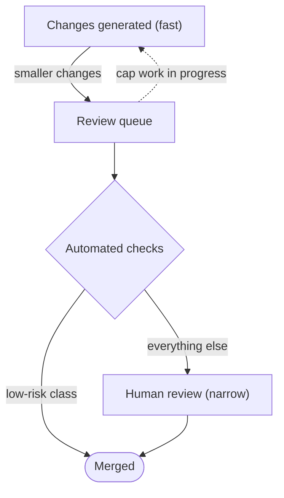

A coding assistant can produce a plausible change in minutes. In many teams,
writing a change was the slow part and review could keep up. What happens to the
rest of the pipeline when only the first step gets faster?

My view is that the scarce resource moves. When a change is cheap to produce,
the limit is how many changes the people and checks around it can judge safe to
merge. Speeding up generation alone does not ship more. It lengthens the line in
front of review: more changes open at once, each waiting longer, and steady
pressure on reviewers to look less closely.

That is a design problem. Either raise review capacity, lower review demand, or
accept the consequences of doing neither. Nothing below is measured, and I mark
what is sourced, what I reason, and what is unknown.

## What the theory says

J. D. C. Little's
[1961 paper, "A Proof for the Queuing Formula: L = λW"](https://doi.org/10.1287/opre.9.3.383),
shows that, under finite means and stationary processes, the mean number of
units in a system equals their arrival rate times the mean time each spends
there. Read it for review and it is bookkeeping: open changes equal the rate at
which changes are opened times the average time from open to merge. It does not
say which of the three to change. It says they cannot move independently.

The second source is Eliyahu Goldratt's novel
[*The Goal*](https://northriverpress.com/the-goal-30th-anniversary-edition/),
which introduced the Theory of Constraints. As
[an encyclopedia overview](https://www.ebsco.com/research-starters/business-and-management/theory-constraints-toc)
summarizes it, a constraint is whatever limits a system's output, and a place
to look for it is where work in progress piles up. The five focusing steps are
to identify the constraint, exploit it with what you have, subordinate the
other steps to it, elevate it by adding capacity, and repeat, because relieving
one constraint exposes another.

The corollary I'd draw, which the overview does not state, is that speeding up
a step that is not the constraint leaves the system's output unchanged. That is
the claim I'd test.

A simple model shows the shape. In the textbook
[single-server queue](https://en.wikipedia.org/wiki/M/M/1_queue) with random
arrivals and service times, the queue is stable only while arrivals are slower
than service, and the average time in the system is one over the gap between the
two rates. Say review finishes 10 changes a week. At 5 arrivals a week an
average change spends about 0.2 weeks in the system, with about one open. At 9
it is a week, with about 9 open. At 9.9 it is ten weeks, with about 99 open.
Double generation from 5 to 10 and arrivals match capacity: the model is no
longer stable, and the line keeps growing.

Real review is not that model: reviewers are several, changes vary in size, and
people skim when the line is long. Read it for its shape. Wait does not rise in
proportion to load; it bends sharply as load nears capacity.

What I reason, not what is shown: a long line costs more than waiting. Changes
age and collide with newer ones, so they need rework, and authors lose the
context they had when they wrote them.

## Review is not a fixed cost

Review capacity looks like a count of reviewers, but part of it is
comprehension. A reviewer has to rebuild the author's intent from the diff. A
colleague who wrote the change can answer questions. When an assistant wrote it,
the person who opened it may not have read every line, so the reviewer can be
the first to understand it. Cheaper generation does not make that step cheaper,
and larger or less-understood changes can make it dearer.

An automated reviewer is not free capacity either. It is a generator: its
comments can be wrong, and what it misses is invisible by construction. Check
it like any filter, by how often its findings are acted on and what it lets
through that a person catches later. It can still remove work by clearing a
class of issue cheaply. But it turns "who reviews this?" into "who reviews the
reviewer?", and that needs an answer before it counts as capacity.

## Five ways to respond

Each lever acts at a different point in the flow.

**1. Let the queue grow.** This is the default when nobody decides. Open
changes and time to merge both rise, with the costs above. It wins only when
lateness is cheap, such as exploratory work nobody depends on, or a short burst
that review will clear.

**2. Review faster and shallower.** The line stays short because each change
gets less attention. The cost shows up later, as defects a closer look would
have caught. It is a legitimate choice when changes are easy to undo and tests,
staged rollout, or monitoring catch the rest. As unplanned drift it worries me
most, because no one chose it and no one is watching for it.

**3. Cap work in progress.** Generation waits until review has room. This is my
reading of "subordinate": pace the other steps to the constraint, and release no
more work than it can process. The cost is idle generation, which feels like
waste. The idle time can go to things that lower review demand, such as tests,
splitting changes, and clearer descriptions. It wins when review is the
constraint and changes go stale quickly.

**4. Shrink, tier, and automate.** Three moves that all lower demand:

- *Shrink.* A smaller change is easier to understand, but slicing alone only
  trades one large read for many small ones. It helps when it separates the
  mechanical part from the part that needs judgment.
- *Tier.* Set review depth by what a change touches, not by how it is described.
  A migration or an access-control change gets two people; a documentation fix
  gets a light check. If a score picks the tier, the
  [calibrated thresholds that hand uncertain cases to a person](/writing/decide-cheaply-generate-carefully/)
  apply here too. A generator can split a risky change into small, low-tier
  ones, so tiers need to look at the sum.
- *Automate.* Formatters, linters, type checks, and tests remove whole classes
  of comment, and for a narrow class of low-risk change, passing them can stand
  in for review. The cost is building and maintaining them, and they catch only
  what they encode.

It wins when much of the volume is routine, which I would expect.

**5. Add reviewers.** This raises capacity directly. It is slow, each new
reviewer pays the comprehension cost, and coordination grows with headcount. It
only pays if demand does not expand to fill the new capacity.

I'd expect a mix. The five steps put elevating, the
equivalent of adding reviewers, after exploiting and subordinating, so I'd start
with 3 and 4 and add reviewers last.

## Measuring the review queue

I haven't run this.

**Setup.** One repository with a human-review requirement. For each pull
request, record when it was opened, first reviewed, and merged, plus open
changes per active reviewer at the end of each day. Compare a baseline period
with one after generation gets faster, for example after an assistant is rolled
out to the team.

**What to look at.** Changes opened per week; open count; time from open to
first review; time from open to merge, as median and 90th percentile. Little's
Law is accounting, so open count should roughly equal opened-per-week times
average time to merge. A big gap points to abandoned or draft changes in the
data, not to a finding. Add rough depth proxies: comments per change, the share
approved with none, and merged changes later reverted or followed by a fix.

**Evidence for the claim.** Volume rises, reviewer count stays flat, and open
count and time to first review rise together, while the share approved with no
comments, or the rate of reverts and follow-up fixes, also rises.

**Evidence against.** Time to merge stays flat as volume rises: review is not
the constraint there, or has slack. Or the wait grows but time to first review
does not, which points at continuous integration, environments, or author
rework instead.

**Limitation.** One repository, no randomization, and other things change in the
same weeks: team size, project phase, holidays. Comment counts are a weak proxy
for review quality. A cleaner version would add a work-in-progress cap to one
team and not another.

## What checks leave behind

I don't know how much review work checks can safely remove before the residue
is the hard part, whether the comprehension cost of changes nobody fully read
grows faster than their volume, or whether an automated reviewer reduces what
people read or only adds comments to it.

The overview says relieving one constraint exposes another. If so, fixing
review will move the constraint elsewhere, perhaps to deployment or to deciding
what to build. Before choosing a lever, I'd measure the queue for a few weeks.
If it isn't growing, none of the five options is needed yet.
