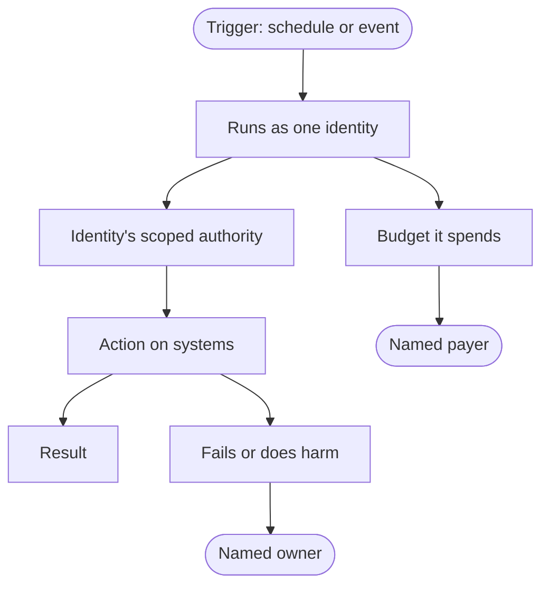

A scheduled agent wakes at 3 a.m. An event-driven one starts when a ticket is
filed. Nobody is signed in, nobody approved this run, and nobody is watching.
It still reads data, changes things and spends money, and if something goes
wrong, someone will be asked why.

My view is that every unattended run needs an accountable human, and the
design choice is whether that person is named on purpose or found afterward.

The usual way to build an automation hides the question. If a job runs as me,
with my credentials, against my budget, then identity, authority, payer and
owner all quietly resolve to "me." Nobody had to decide anything, so nobody
did. That holds until I change teams or leave, and the job keeps running as
someone who is no longer there.

## Four questions with a named answer

Before an unattended automation ships, I'd want a name beside each of these:

- **Which identity does it execute as?**
- **What authority does that identity hold?**
- **Who pays for the budget it consumes?**
- **Who is responsible when it fails or does something wrong?**

The diagram follows one run to a result or a failure. Identity and authority
sit on the path to the action. Payer and owner sit on side branches, where they
are easiest to forget.

Treat it as a table: one row per automation, those four columns. A blank isn't
neutral. It means the answer gets settled during an incident.

### What is established, and what is my reading

The idea that someone must be accountable is old. Saltzer and Schroeder's 1975
[tutorial on protection](https://web.mit.edu/Saltzer/www/publications/protection/)
defines a principal as "the entity accountable for the activities of a virtual
processor." It also lists least privilege as a design principle: operate with
"the least set of privileges necessary to complete the job." Their examples are
about people using shared computers. Applying the idea to a scheduler is my
reading, not their claim.

[RFC 6749 section 4.4](https://www.rfc-editor.org/rfc/rfc6749.html#section-4.4)
gives a program a standard way to act on its own behalf: the client credentials
grant lets a client request a token "using only its client credentials." It says
nothing about who in your organization owns that client. That is the fourth
question, and no protocol answers it.

[RFC 8693](https://www.rfc-editor.org/rfc/rfc8693.html#section-1.1) draws the
line that matters for audit. When A impersonates B, "A is B within the context
of the rights authorized by the token," and a receiver cannot tell them apart.
With delegation, A "still has its own identity separate from B," and actions are
"taken by A representing B." A job running on a stored personal credential
isn't literally token exchange. My inference is that the record looks the same:
it names the person, and nothing in it says a job acted.

## Four ways to run it

| Option | Runs as | What it costs | When it wins |
| --- | --- | --- | --- |
| 1. Borrowed identity | The person who created it | Authority is everything that person can do. Logs name the person. Breaks when they leave. | A short experiment on your own data, for yourself |
| 2. Shared team account | One account behind many jobs | Authority is the union of every job's needs. Logs can't say which job acted. Owned by no one by default. | A small team, low-stakes jobs, one named account owner |
| 3. Dedicated identity per automation | Its own identity, scoped permissions, a named owner | Provisioning work, and an owner field someone must keep current | Jobs that write to shared systems, spend real money, or outlive their author's attention |
| 4. No automation | A person triggers each run | Slower, and the person is a bottleneck | Irreversible or high-stakes actions, or when the four questions can't be answered yet |

Option 4 is easy to dismiss, but it answers all four questions at once: the
person who triggers a run is its identity, its authority and its owner. Option 1
looks like option 4 with the person removed. The answers still point at that
person, who is no longer there to act on them.

These costs are reasoned, not measured, and a team will mix the options.

## Where each one breaks

**Offboarding.** If a job runs on a departed person's credential, I'd expect one
of two outcomes. The credential is revoked and the job fails, which is a silent
outage. Or a long-lived token outlives the account and the job keeps acting with
the authority of someone who no longer works there, which is worse. A shared
account survives every departure and belongs to no one. A dedicated identity has
the same weakness unless its owner field is kept current. My rule would be that
an automation whose owner has left is paused until someone accepts it, not left
running by default. That trades an outage for a decision, and I'd rather have
the decision.

**Runaway cost.** An unattended run has no one present to notice that it is
expensive. A retry loop, a trigger that fires on the job's own output, or an
input that grows every run keeps spending with nobody watching. If limits are
per person, as in [an earlier post on running out of an AI budget](/writing/keep-shipping-copilot-budget-limits-part-1/),
a borrowed identity spends from its creator's allowance and can strand them at
the limit. A shared account spends from no one's. I'd attach a cap to the
identity, name a payer who sees the spend, and make hitting the cap stop the run
and tell the owner instead of retrying.

**Silent failure.** With no one signed in, no one sees the error. The Linux
[crontab(5) manual page](https://man7.org/linux/man-pages/man5/crontab.5.html)
for one widely used cron says that mail about a job goes to the owner of the
crontab unless `MAILTO` points elsewhere, and an empty `MAILTO` sends none. A
failure channel that defaults to one person's inbox is the borrowed identity
again. I'd send failures to a queue the named owner is responsible for watching,
and alert when an expected run doesn't happen, because a job that never started
produces no error to route.

**The audit trail.** After something goes wrong, the questions are who or what
acted, on whose authority, and what started it. A useful record carries the
automation's name, its identity, the trigger, and the owner at the time of the
run. Under borrowed identity the log can't separate "Dana did this" from "Dana's
job did this." Under a shared account it can't separate one job from another.

## Auditing one team's jobs

I haven't run this. It is an inventory more than an experiment.

**Setup.** Choose one team. List every scheduled job and event-driven
automation it runs: cron entries, CI schedules, webhooks, and any agent set to
run on a timer or an event. Search the systems that can start work instead of
asking people to recall them. Make a table with four columns: identity,
authority, budget payer, failure owner.

**What to count.**

- Blanks in each column. For the failure owner, "named" means a person or queue
  that receives the failure.
- Rows whose identity or owner has left, checked against the directory.
- Rows that run on a person's own credential.
- Rows whose granted authority is broader than the job needs, as its owner
  describes it.

**What would count against the claim.** If, across a meaningful number of rows,
almost nothing is blank and no owner has left, current practice already answers
the questions. If borrowed-identity rows are no more likely to have blanks or
departed owners than dedicated-identity rows, the identity type isn't the cause,
and inventory discipline matters more than the pattern I'm arguing for. If many
blanks sit on jobs that have run for years without trouble, the cost of an
unnamed owner may be smaller than I think.

**Limitation.** One team is not a sample, and the jobs you fail to find may be
the ones nobody owns. The test counts the state of ownership, not harm, so it
can't say how often an unowned job causes an incident.

## When an automation creates an automation

I don't know whether a separate identity per automation pays for its inventory
cost at small scale, or whether a shared account with a diligent owner is
enough. I don't know the right default when an owner leaves: pausing protects
against drift but can break something people quietly depend on. And I haven't
worked out who owns an automation that another one created, such as a follow-up
run an agent schedules for itself. The four questions still apply. I don't yet
have a rule for who answers them.
